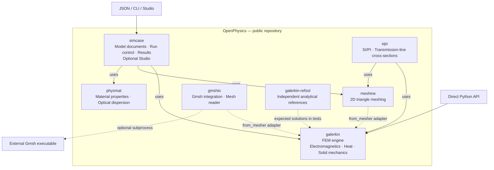
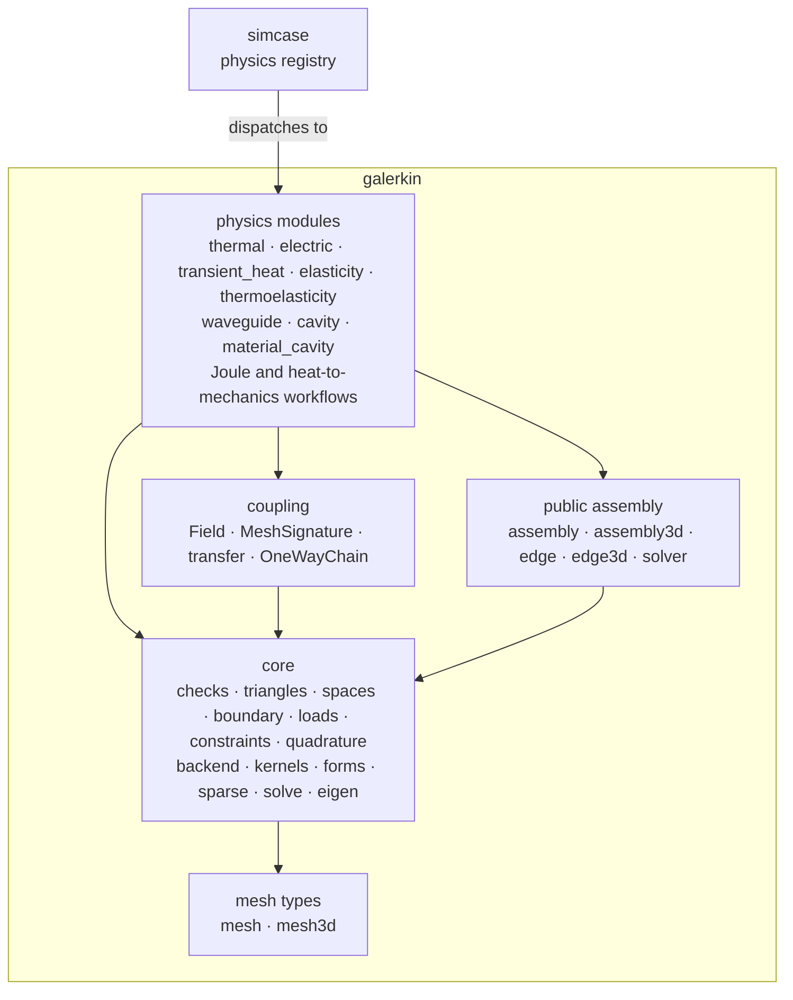

# OpenPhysics architecture

**English** | [한국어](locales/ko/pages/architecture.md)

OpenPhysics is the repository and toolkit. **`galerkin` is its finite-element
engine**, one of seven implementation packages under `packages/`. The packages
have separate distributions and can be used independently where their
dependencies permit. See the [installation guide](overview.md).

## Package map

Solid arrows show entry points and orchestration dependencies. Dashed arrows
show optional mesh interoperability, independent validation or an external
executable. This is a package relationship map, not one mandatory sequence of
calls: each study uses the components it needs. Direct Python use is also
available for the other packages; the diagram highlights the solver entry point.

| Package | Responsibility |
|---|---|
| [simcase](packages/simcase/overview.md) | JSON model schema, study dispatch, results and saved output; optional browser Studio. |
| [galerkin](packages/galerkin/overview.md) | Finite-element assembly, solvers and field postprocessing for implemented electromagnetic, thermal and mechanical models. |
| [meshine](packages/meshine/overview.md) | 2D triangular meshes for material regions. |
| [physmat](packages/physmat/overview.md) | Material models and properties, optical dispersion, refractiveindex.info access and fitting. |
| [gmshio](packages/gmshio/overview.md) | Optional Gmsh executable integration and mesh-file reading. Existing mesh files can be read without running Gmsh. |
| [sipi](packages/sipi/overview.md) | Signal and power integrity: layered PCB cross-sections, quasi-static C/L/G matrices, impedance and coupled-line modes, built on galerkin and meshine. |
| [galerkin-refsol](packages/galerkin-refsol/overview.md) | Independent analytical solutions and published benchmarks, imported as `refsol`. Tests compare solver results with these references; the reference package does not import the solver it grades. |

`galerkin.from_mesher` adapts supported mesh objects or array dictionaries into
the engine's mesh types. It does not make either mesher a mandatory solver
runtime dependency. Gmsh is installed separately and retains its own license;
see [NOTICE](../NOTICE).

The eighth distribution, [`openphysics`](packages/openphysics/overview.md),
is a meta distribution with no code that requires six of the implementation
packages and offers `sipi` as an extra. 0.1.0 is not published yet: the `openphysics` on PyPI is the empty 0.0.1
name reservation, so **`pip install openphysics` does not install the toolkit
yet.** The seven implementation packages already live in this public
repository; separate historical package repositories are not needed to use them.

## Entry points and current scope

- **Python:** the broadest API surface, including standalone electromagnetic,
  steady and transient thermal, elasticity and prescribed-temperature thermoelastic models,
  plus the documented steady heat-to-mechanics workflow and transient heat-to-mechanics call.
- **JSON / CLI through `simcase`:** passive absorbing `em.modes2d`, `em.cavity3d` and the
  documented `thermal.steady2d` and `thermal.transient2d` subsets, including
  [material-region heat documents](packages/simcase/thermal_regions2d.md).
  [Electric/Joule documents](packages/simcase/electric_joule.md) add homogeneous
  rectangles for `electric.steady2d`, `joule.steady2d` and `joule.temperature2d`.
  Python-only extensions do not
  automatically become document features. The [steady boundary contract](packages/simcase/thermal_steady_boundary2d.md)
  adds side-constant outward flux/convection and v2 raw fields; documents omitting
  both new keys retain v1.
- **Studio:** a local browser interface for 2D optical models and dedicated
  steady and transient heat views for rectangular documents and documents with
  material regions (within Studio's region limits). Generic optical
  routes keep their heat/3D guards. Structural forms, 3D models and a general
  thermal form editor are outside its scope. See the
  [steady](packages/simcase/thermal_studio.md) and
  [transient](packages/simcase/thermal_transient_studio.md) Studio guides.

These layers do not imply a general-purpose, fully coupled multiphysics solver.
The [overview](overview.md#current-limits) lists current limits; exact contracts
and validation limits are linked from the [documentation index](README.md).

## Inside galerkin: core, physics and coupling

galerkin is one distribution with layers inside it. Imports point downward:
physics modules use coupling, core and the public assembly modules; coupling
uses core; the public assembly modules (`assembly`, `assembly3d`, `edge`,
`edge3d`, `solver`) keep their names for callers and sit on core; core uses only
the mesh types (`mesh`, `mesh3d`), which import nothing else from galerkin. No module
uses another module's private (underscore) names, imported or read as
attributes, and only a class's own methods read its underscore members. What a family of modules
shares lives in core, in the package-private `_thermal_mechanical_common` (the
heat-to-mechanics workflows) and `_cavity_common` (the two box cavities), or in
public names of the module that owns it (thermoelasticity builds on elasticity's). Material lookup lives in
core (`galerkin.materials` keeps its public names), and a physics module hands
core its mesh-bound containers as plain checked values (`core.loads.ElementSource`).
`tests/galerkin/test_layers.py` fails if the mesh types, core, the public
assembly modules or coupling import a module above them, or if a module uses
another's private names.

| Layer | Package path | Holds |
|---|---|---|
| core | [`galerkin.core`](../packages/galerkin/src/galerkin/core/__init__.py) | Input checks, mesh and element data, edge numbering for the Nédélec spaces (`spaces`), boundary sampling, loads, constraints and quadrature. Element kernels (`kernels`), assembly into a sparse matrix (`forms`, `sparse`), and the sparse solve and eigenpair refinement with hand-written adjoints (`solve`, `eigen`). It dispatches on NumPy, JAX and PyTorch in one place (`backend`). |
| physics | `galerkin.thermal`, `electric`, `transient_heat`, `elasticity`, `thermoelasticity`, `waveguide`, `cavity`, … | One formulation each: inputs and units, the checks of its contract, assembly (from core kernels, directly or through the public functions), the solve and the result dataclass. |
| coupling | [`galerkin.coupling`](../packages/galerkin/src/galerkin/coupling/__init__.py) | Node and element `Field`s on one mesh with an SI unit, same-mesh `transfer` and the `OneWayChain` driver, which runs stages handed to it and imports no physics. The Joule and heat-to-mechanics workflows run on it. The [kernel interface](packages/galerkin/coupling.md) states what a solver must expose for another solver to consume its result. |

Each element formula lives once, as a closed-form kernel in `core.kernels`. The
public assembly functions (`assemble_stiffness`, `assemble_curlcurl_3d`, …)
assemble those kernels with `core.forms` and return SciPy matrices; they take
NumPy values and refuse JAX or PyTorch ones. Physics modules that differentiate
assemble the same kernels in the input's array library, and through that route
seven solvers differentiate on JAX and PyTorch
([derivatives](packages/galerkin/differentiation.md)). The kernels are checked
against exact integrals for every coefficient form
([element definitions](reference-comparisons.md#element-definitions)).

Not differentiable yet: `material_cavity` and `mode_coordinates` assemble through
the public functions only and refuse JAX and PyTorch values (`pml` computes coefficients and assembles nothing). The coupling layer passes fields one way on a
single mesh. A fixed-point driver waits for a third coupled pair, and
grid-to-mesh projection waits for a second engine
([limits](packages/galerkin/coupling.md#limits)).

## Adding a physics

1. **Formulation in galerkin.** Add one module. Build element matrices with
   `core.kernels`, or write a kernel of the same shape (`(T, i, j)` arrays, no
   loop over cells). Assemble with `core.forms` and solve with `core.solve`.
   Validate inputs with `core.checks`, and do not copy helpers from another
   physics module. [Contributing](../CONTRIBUTING.md#making-a-change) sets the
   validation evidence: independent analytical references and mesh-convergence
   checks. Record them in a contract and a validation page under
   `docs/packages/galerkin/`.
2. **Results for other physics.** Return node or element values that a
   `galerkin.coupling.Field` can carry, on the solved mesh with SI units, per
   the [kernel interface](packages/galerkin/coupling.md). A one-way workflow is
   a `OneWayChain` of existing stages.
3. **Derivatives (optional).** Keep values live from input to solve: use
   `core.backend` and kernels whose coefficients may be JAX or PyTorch arrays.
   Keep one body for NumPy and live inputs: solve the linear system once with
   `core.solve`, whose adjoint gives the derivative, and run every check on a
   snapshot of the numbers, as the steady heat, electric and elasticity solvers
   do (eigenpairs: `core.eigen`). Until then,
   refuse live values with `core.checks.refuse_live` rather than cut the
   derivative silently ([pattern and limits](packages/galerkin/differentiation.md)).
   A solver that finds its solution by iteration attaches the implicit
   derivative of its residual, never the derivative of one more pass of the
   iteration ([iterative solvers](packages/galerkin/differentiation.md#iterative-solvers)).
4. **Documents (optional).** Register a `PhysicsKind` in
   [`simcase.registry`](../packages/simcase/src/simcase/registry.py) with its
   contract validation, runner, summary and result types. The runner and schema
   dispatch on the registry and need no change. The command line handles two
   cases by name, the output check of `em.modes2d` subspace sweeps and the
   failure evidence of the temperature-dependent Joule workflow
   ([`simcase/cli.py`](../packages/simcase/src/simcase/cli.py)); a kind whose
   failures carry structured evidence adds it there. Python-only physics stays
   out of documents until it is registered.

Keep English and Korean pages together, and keep numerical thresholds as
validated ([contributing](../CONTRIBUTING.md)).

## Connections in the code

The map follows the [`simcase` dependencies](../packages/simcase/pyproject.toml),
[runner](../packages/simcase/src/simcase/runner.py),
[material bridge](../packages/simcase/src/simcase/materials.py),
[mesh adapter](../packages/galerkin/src/galerkin/interop.py) and
[Gmsh integration notes](../packages/galerkin/src/galerkin/gmsh.py).
`simcase` dispatches each document by its physics type through the
[physics registry](../packages/simcase/src/simcase/registry.py): each physics family
registers its contract validation, runner, summary and result types there, so a new
physics does not edit the runner or the schema ([adding a physics](#adding-a-physics)).
This architecture page adds no new implementation or numerical validation claim.
