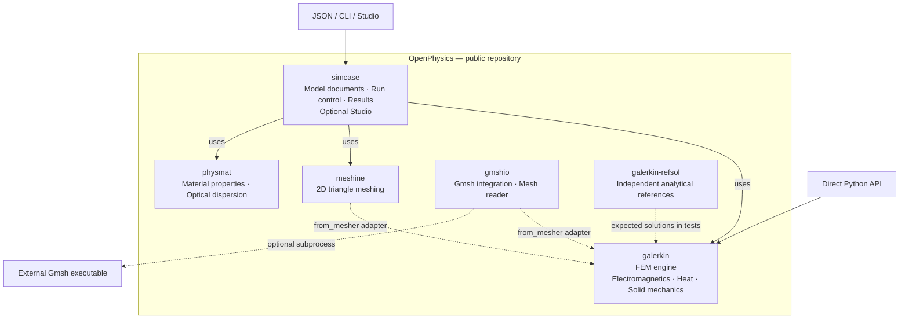

# OpenPhysics architecture

**English** | [한국어](locales/ko/pages/architecture.md)

OpenPhysics is the repository and toolkit. **`galerkin` is its finite-element
engine**, one of six implementation packages under `packages/`. The packages
have separate distributions and can be used independently where their
dependencies permit. See the [installation guide](overview.md).

## Package map

Solid arrows show entry points and orchestration dependencies. Dashed arrows
show optional mesh interoperability, independent validation or an external
executable. This is a package relationship map, not one mandatory sequence of
calls: each study uses the components it needs. Direct Python use is also
available for the other packages; the diagram highlights the solver entry point.

| Package | Responsibility |
|---|---|
| [simcase](../packages/simcase/docs/overview.md) | JSON model schema, study dispatch, results and saved output; optional browser Studio. |
| [galerkin](../packages/galerkin/docs/overview.md) | Finite-element assembly, solvers and field postprocessing for implemented electromagnetic, thermal and mechanical models. |
| [meshine](../packages/meshine/docs/overview.md) | 2D triangular meshes for material regions. |
| [physmat](../packages/physmat/docs/overview.md) | Material models and properties, optical dispersion, refractiveindex.info access and fitting. |
| [gmshio](../packages/gmshio/docs/overview.md) | Optional Gmsh executable integration and mesh-file reading. Existing mesh files can be read without running Gmsh. |
| [galerkin-refsol](../packages/galerkin-refsol/docs/overview.md) | Independent analytical solutions and published benchmarks, imported as `refsol`. Tests compare solver results with these references; the reference package does not import the solver it grades. |

`galerkin.from_mesher` adapts supported mesh objects or array dictionaries into
the engine's mesh types. It does not make either mesher a mandatory solver
runtime dependency. Gmsh is installed separately and retains its own license;
see [NOTICE](../NOTICE).

The seventh distribution, [`openphysics`](../packages/openphysics/docs/overview.md),
is an empty name reservation. **`pip install openphysics` does not install the
toolkit.** The six implementation packages already live in this public
repository; separate historical package repositories are not needed to use them.

## Entry points and current scope

- **Python:** the broadest API surface, including standalone electromagnetic,
  steady and transient thermal, elasticity and prescribed-temperature thermoelastic models,
  plus the documented steady heat-to-mechanics workflow.
- **JSON / CLI through `simcase`:** lossless `em.modes2d`, `em.cavity3d` and the
  documented `thermal.steady2d` and rectangular `thermal.transient2d` subsets. Python-only extensions do not
  automatically become document features.
- **Studio:** a local browser interface for 2D optical models. It rejects 3D
  models and does not yet provide thermal or structural forms and plots.

These layers do not imply a general-purpose, fully coupled multiphysics solver.
The standalone [transient heat API](../packages/galerkin/docs/transient_heat.md)
uses a fixed P1 mesh, consistent mass and backward Euler. The separate
[headless document path](../packages/simcase/docs/thermal_transient2d.md) adds
rectangular JSON/API/CLI and saved histories, not Studio, restart,
transient flux/Robin input or automatic coupling. Exact contracts
and measured validation limits are linked from the
[documentation index](README.md).

## Connections in the code

The map follows the [`simcase` dependencies](../packages/simcase/pyproject.toml),
[runner](../packages/simcase/simcase/runner.py),
[material bridge](../packages/simcase/simcase/materials.py),
[mesh adapter](../packages/galerkin/galerkin/interop.py) and
[Gmsh integration notes](../packages/galerkin/galerkin/gmsh.py).
This architecture page adds no new implementation or numerical validation claim.
