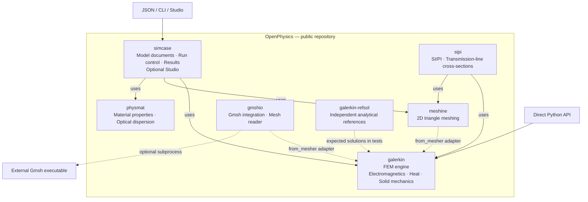

# OpenPhysics architecture

**English** | [한국어](locales/ko/pages/architecture.md)

OpenPhysics is the repository and toolkit. **`galerkin` is its finite-element
engine**, one of seven implementation packages under `packages/`. The packages
have separate distributions and can be used independently where their
dependencies permit. See the [installation guide](overview.md).

## Package map

Solid arrows show entry points and orchestration dependencies. Dashed arrows
show optional mesh interoperability, independent validation or an external
executable. This is a package relationship map, not one mandatory sequence of
calls: each study uses the components it needs. Direct Python use is also
available for the other packages; the diagram highlights the solver entry point.

| Package | Responsibility |
|---|---|
| [simcase](packages/simcase/overview.md) | JSON model schema, study dispatch, results and saved output; optional browser Studio. |
| [galerkin](packages/galerkin/overview.md) | Finite-element assembly, solvers and field postprocessing for implemented electromagnetic, thermal and mechanical models. |
| [meshine](packages/meshine/overview.md) | 2D triangular meshes for material regions. |
| [physmat](packages/physmat/overview.md) | Material models and properties, optical dispersion, refractiveindex.info access and fitting. |
| [gmshio](packages/gmshio/overview.md) | Optional Gmsh executable integration and mesh-file reading. Existing mesh files can be read without running Gmsh. |
| [sipi](packages/sipi/overview.md) | Signal and power integrity: layered PCB cross-sections, quasi-static C/L/G matrices, impedance and coupled-line modes, built on galerkin and meshine. |
| [galerkin-refsol](packages/galerkin-refsol/overview.md) | Independent analytical solutions and published benchmarks, imported as `refsol`. Tests compare solver results with these references; the reference package does not import the solver it grades. |

`galerkin.from_mesher` adapts supported mesh objects or array dictionaries into
the engine's mesh types. It does not make either mesher a mandatory solver
runtime dependency. Gmsh is installed separately and retains its own license;
see [NOTICE](../NOTICE).

The eighth distribution, [`openphysics`](packages/openphysics/overview.md),
is a meta distribution with no code that requires six of the implementation
packages and offers `sipi` as an extra. 0.1.0 is not published yet: the `openphysics` on PyPI is the empty 0.0.1
name reservation, so **`pip install openphysics` does not install the toolkit
yet.** The seven implementation packages already live in this public
repository; separate historical package repositories are not needed to use them.

## Entry points and current scope

- **Python:** the broadest API surface, including standalone electromagnetic,
  steady and transient thermal, elasticity and prescribed-temperature thermoelastic models,
  plus the documented steady heat-to-mechanics workflow and transient heat-to-mechanics call.
- **JSON / CLI through `simcase`:** passive absorbing `em.modes2d`, `em.cavity3d` and the
  documented `thermal.steady2d` and rectangular `thermal.transient2d` subsets. Python-only extensions do not
  automatically become document features. The [steady boundary contract](packages/simcase/thermal_steady_boundary2d.md)
  adds side-constant outward flux/convection and v2 raw fields; documents omitting
  both new keys retain v1.
- **Studio:** a local browser interface for 2D optical models and dedicated
  steady and transient heat views for rectangular documents. Generic optical
  routes keep their heat/3D guards. Structural forms, 3D models and a general
  thermal form editor are outside its scope. See the
  [steady](packages/simcase/thermal_studio.md) and
  [transient](packages/simcase/thermal_transient_studio.md) Studio guides.

These layers do not imply a general-purpose, fully coupled multiphysics solver.
The [overview](overview.md#current-limits) lists current limits; exact contracts
and validation limits are linked from the [documentation index](README.md).

## Connections in the code

The map follows the [`simcase` dependencies](../packages/simcase/pyproject.toml),
[runner](../packages/simcase/src/simcase/runner.py),
[material bridge](../packages/simcase/src/simcase/materials.py),
[mesh adapter](../packages/galerkin/src/galerkin/interop.py) and
[Gmsh integration notes](../packages/galerkin/src/galerkin/gmsh.py).
`simcase` dispatches each document by its physics type through the
[physics registry](../packages/simcase/src/simcase/registry.py): each physics family
registers its contract validation, runner, summary and result types there, so a new
physics does not edit the runner or the schema.
This architecture page adds no new implementation or numerical validation claim.
