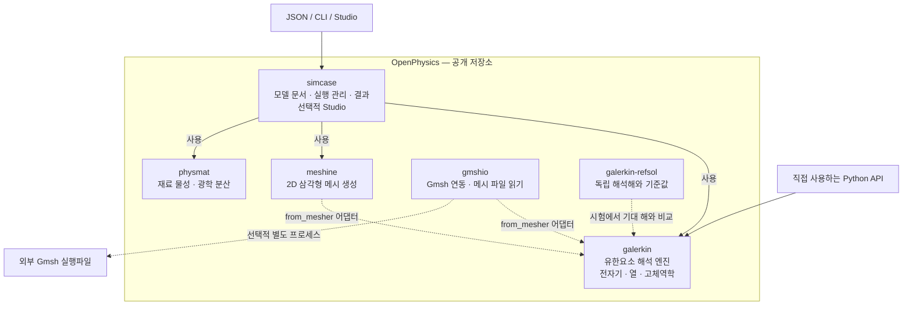

# OpenPhysics 구조

[English](../../../architecture.md) | **한국어**

OpenPhysics는 저장소이자 전체 도구 모음입니다. **`galerkin`은 그 안의 유한요소
해석 엔진**이며, `packages/` 아래 여섯 구현 패키지 중 하나입니다. 각 패키지는
별도의 배포 단위를 가지며 의존성을 충족하면 독립적으로 사용할 수 있습니다.
[설치 안내](overview.md)를 참고하세요.

## 패키지 구조도

실선은 진입점과 실행 관리 계층의 의존 관계를 나타냅니다. 점선은 선택적 메시
연동, 독립 검증 또는 외부 실행파일 관계입니다. 이 그림은 패키지 관계도이며
모든 해석이 반드시 같은 호출 순서를 따른다는 뜻은 아닙니다. 각 study는 필요한
구성요소를 사용합니다. 다른 패키지도 Python에서 직접 사용할 수 있으며,
그림에서는 해석 엔진 진입점을 강조했습니다.

| 패키지 | 역할 |
|---|---|
| [simcase](../../../../packages/simcase/docs/locales/ko/pages/overview.md) | JSON 모델 스키마, study 분기, 결과와 출력 저장, 선택적 브라우저 Studio. |
| [galerkin](../../../../packages/galerkin/docs/locales/ko/pages/overview.md) | 구현된 전자기·열·기계 모델의 유한요소 조립, 해석과 장 후처리. |
| [meshine](../../../../packages/meshine/docs/locales/ko/pages/overview.md) | 재료 영역을 위한 2D 삼각형 메시 생성. |
| [physmat](../../../../packages/physmat/docs/locales/ko/pages/overview.md) | 재료 모델과 물성, 광학 분산, refractiveindex.info 접근과 fitting. |
| [gmshio](../../../../packages/gmshio/docs/locales/ko/pages/overview.md) | 선택적 Gmsh 실행파일 연동과 메시 파일 읽기. 기존 메시 파일은 Gmsh를 실행하지 않고 읽을 수 있습니다. |
| [galerkin-refsol](../../../../packages/galerkin-refsol/docs/locales/ko/pages/overview.md) | 독립 해석해와 출판된 benchmark. `refsol`로 import합니다. 시험에서 해석기 결과를 기준해와 비교하며, 기준해 패키지는 평가 대상 해석기를 import하지 않습니다. |

`galerkin.from_mesher`는 지원하는 메시 객체나 배열 사전을 엔진의 메시 타입으로
변환합니다. 이 어댑터가 두 메시 생성기를 엔진의 필수 실행 의존성으로 만드는
것은 아닙니다. Gmsh는 별도로 설치하며 자체 라이선스를 유지합니다.
[NOTICE](../../../../NOTICE)를 참고하세요.

일곱 번째 배포인 [`openphysics`](../../../../packages/openphysics/docs/locales/ko/pages/overview.md)는
비어 있는 이름 예약 패키지입니다. **`pip install openphysics`로는 전체 도구가
설치되지 않습니다.** 여섯 구현 패키지는 이미 이 공개 저장소에 포함돼 있으므로,
사용하기 위해 통합 전의 개별 패키지 저장소가 필요하지 않습니다.

## 진입점과 현재 지원 범위

- **Python:** 가장 넓은 API 범위를 제공합니다. 독립 전자기·정상 및 과도 열전도·탄성·
  처방 온도 열탄성 모델과 문서화된 정상 열전도→기계 workflow를 포함합니다.
- **`simcase`의 JSON / CLI:** 무손실 `em.modes2d`, `em.cavity3d`와 문서화된
  `thermal.steady2d`와 직사각형 `thermal.transient2d` 부분집합을 지원합니다. Python 전용 확장이 자동으로
  문서 입력 기능에 연결되지는 않습니다.
- **Studio:** 2D 광학 모델용 로컬 브라우저 화면입니다. 3D 모델을 거부하며,
  열·구조 입력 화면과 결과 그래프는 아직 제공하지 않습니다.

이 계층 구성이 범용 완전 연성 다중물리 해석기를 뜻하지는 않습니다.
[독립 과도 열전도 API](../../../../packages/galerkin/docs/locales/ko/pages/transient_heat.md)는
고정 P1 메시, 일관 질량과 후진 Euler를 사용합니다.
별도 [headless 문서 경로](../../../../packages/simcase/docs/locales/ko/pages/thermal_transient2d.md)는
직사각형 JSON/API/CLI·저장 이력을 추가하지만 Studio·restart·과도 flux/Robin 입력·
자동 연성을 제공하지 않습니다. 정확한 사용 계약과
실측 검증 한계는 [문서 색인](index.md)에 연결돼 있습니다.

## 실제 코드와의 연결

이 구조도는 [`simcase` 의존성](../../../../packages/simcase/pyproject.toml),
[실행기](../../../../packages/simcase/simcase/runner.py),
[재료 연결](../../../../packages/simcase/simcase/materials.py),
[메시 어댑터](../../../../packages/galerkin/galerkin/interop.py),
[Gmsh 연동 설명](../../../../packages/galerkin/galerkin/gmsh.py)을 기준으로 합니다.
이 문서 추가가 새 구현이나 수치 검증 결과를 의미하지는 않습니다.
