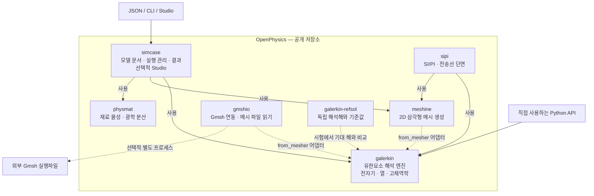

# OpenPhysics 구조

[English](../../../architecture.md) | **한국어**

OpenPhysics는 저장소이자 전체 도구 모음입니다. **`galerkin`은 그 안의 유한요소
해석 엔진**이며, `packages/` 아래 일곱 구현 패키지 중 하나입니다. 각 패키지는
별도의 배포 단위를 가지며 의존성을 충족하면 독립적으로 사용할 수 있습니다.
[설치 안내](overview.md)를 참고하세요.

## 패키지 구조도

실선은 진입점과 실행 관리 계층의 의존 관계를 나타냅니다. 점선은 선택적 메시
연동, 독립 검증 또는 외부 실행파일 관계입니다. 이 그림은 패키지 관계도이며
모든 해석이 반드시 같은 호출 순서를 따른다는 뜻은 아닙니다. 각 study는 필요한
구성요소를 사용합니다. 다른 패키지도 Python에서 직접 사용할 수 있으며,
그림에서는 해석 엔진 진입점을 강조했습니다.

| 패키지 | 역할 |
|---|---|
| [simcase](packages/simcase/overview.md) | JSON 모델 스키마, study 분기, 결과와 출력 저장, 선택적 브라우저 Studio. |
| [galerkin](packages/galerkin/overview.md) | 구현된 전자기·열·기계 모델의 유한요소 조립, 해석과 장 후처리. |
| [meshine](packages/meshine/overview.md) | 재료 영역을 위한 2D 삼각형 메시 생성. |
| [physmat](packages/physmat/overview.md) | 재료 모델과 물성, 광학 분산, refractiveindex.info 접근과 fitting. |
| [gmshio](packages/gmshio/overview.md) | 선택적 Gmsh 실행파일 연동과 메시 파일 읽기. 기존 메시 파일은 Gmsh를 실행하지 않고 읽을 수 있습니다. |
| [sipi](packages/sipi/overview.md) | 신호·전원 무결성: 층 구조 PCB 단면의 준정적 C/L/G 행렬, 임피던스, 결합선 모드. galerkin과 meshine 위에 있습니다. |
| [galerkin-refsol](packages/galerkin-refsol/overview.md) | 독립 해석해와 출판된 benchmark. `refsol`로 import합니다. 시험에서 해석기 결과를 기준해와 비교하며, 기준해 패키지는 평가 대상 해석기를 import하지 않습니다. |

`galerkin.from_mesher`는 지원하는 메시 객체나 배열 사전을 엔진의 메시 타입으로
변환합니다. 이 어댑터가 두 메시 생성기를 엔진의 필수 실행 의존성으로 만드는
것은 아닙니다. Gmsh는 별도로 설치하며 자체 라이선스를 유지합니다.
[NOTICE](../../../../NOTICE)를 참고하세요.

여덟 번째 배포인 [`openphysics`](packages/openphysics/overview.md)는
코드 없이 구현 패키지 여섯 개를 의존성으로(`sipi`는 extra로) 요구하는 메타 배포판입니다. 0.1.0은 아직 게시되지
않았습니다. PyPI의 `openphysics`는 빈 0.0.1 이름 예약이므로 **`pip install openphysics`로는
아직 전체 도구가 설치되지 않습니다.** 일곱 구현 패키지는 이미 이 공개 저장소에 포함돼 있으므로,
사용하기 위해 통합 전의 개별 패키지 저장소가 필요하지 않습니다.

## 진입점과 현재 지원 범위

- **Python:** 가장 넓은 API 범위를 제공합니다. 독립 전자기·정상 및 과도 열전도·탄성·
  처방 온도 열탄성 모델, 문서화된 정상 열전도→기계 workflow와 과도 열전도→기계 호출을 포함합니다.
- **`simcase`의 JSON / CLI:** 수동 흡수 `em.modes2d`, `em.cavity3d`와 문서화된
  `thermal.steady2d`와 직사각형 `thermal.transient2d` 부분집합을 지원합니다. Python 전용 확장이 자동으로
  문서 입력 기능에 연결되지는 않습니다. [정상 경계조건 계약](packages/simcase/thermal_steady_boundary2d.md)은
  변별 상수 외향 열유속·대류와 v2 raw 필드를 추가하며, 새 키 두 개를 모두
  생략한 기존 문서는 v1을 유지합니다.
- **Studio:** 2D 광학 모델과 직사각형 문서용 전용 정상·과도 열전도 화면을 제공하는
  로컬 브라우저 도구입니다. Generic 광학 route는 열/3D guard를 유지합니다. 구조 폼,
  3D 모델과 범용 열전도 폼 editor는 범위 밖입니다.
  [정상](packages/simcase/thermal_studio.md)·[과도](packages/simcase/thermal_transient_studio.md)
  Studio 가이드를 참고하세요.

이 계층 구성이 범용 완전 연성 다중물리 해석기를 뜻하지는 않습니다.
현재 한계는 [도구 개요](overview.md#현재-한계)에 있고, 정확한 사용 계약과 검증 한계는
[문서 색인](index.md)에 연결돼 있습니다.

## 실제 코드와의 연결

이 구조도는 [`simcase` 의존성](../../../../packages/simcase/pyproject.toml),
[실행기](../../../../packages/simcase/src/simcase/runner.py),
[재료 연결](../../../../packages/simcase/src/simcase/materials.py),
[메시 어댑터](../../../../packages/galerkin/src/galerkin/interop.py),
[Gmsh 연동 설명](../../../../packages/galerkin/src/galerkin/gmsh.py)을 기준으로 합니다.
`simcase`는 [물리 등록표](../../../../packages/simcase/src/simcase/registry.py)로 문서를 물리
타입별로 나눠 보냅니다. 물리마다 계약 검증·실행기·요약·결과 형식을 그곳에 등록하므로, 새 물리를
더할 때 실행기나 스키마를 고치지 않습니다.
이 문서 추가가 새 구현이나 수치 검증 결과를 의미하지는 않습니다.
