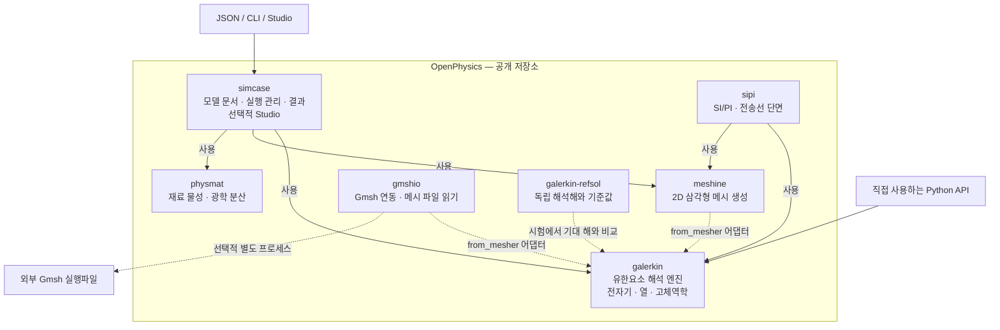
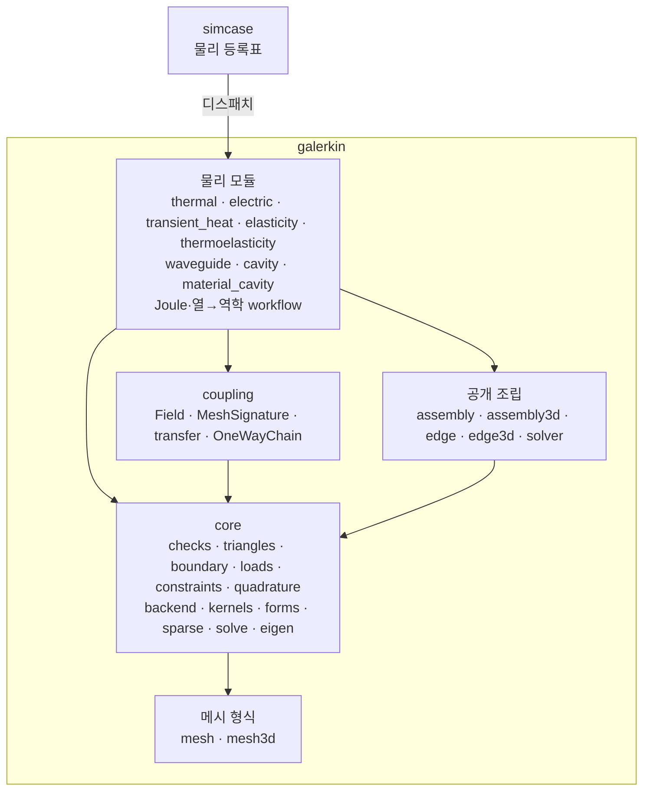

# OpenPhysics 구조

[English](../../../architecture.md) | **한국어**

OpenPhysics는 저장소이자 전체 도구 모음입니다. **`galerkin`은 그 안의 유한요소
해석 엔진**이며, `packages/` 아래 일곱 구현 패키지 중 하나입니다. 각 패키지는
별도의 배포 단위를 가지며 의존성을 충족하면 독립적으로 사용할 수 있습니다.
[설치 안내](overview.md)를 참고하세요.

## 패키지 구조도

실선은 진입점과 실행 관리 계층의 의존 관계를 나타냅니다. 점선은 선택적 메시
연동, 독립 검증 또는 외부 실행파일 관계입니다. 이 그림은 패키지 관계도이며
모든 해석이 반드시 같은 호출 순서를 따른다는 뜻은 아닙니다. 각 study는 필요한
구성요소를 사용합니다. 다른 패키지도 Python에서 직접 사용할 수 있으며,
그림에서는 해석 엔진 진입점을 강조했습니다.

| 패키지 | 역할 |
|---|---|
| [simcase](packages/simcase/overview.md) | JSON 모델 스키마, study 분기, 결과와 출력 저장, 선택적 브라우저 Studio. |
| [galerkin](packages/galerkin/overview.md) | 구현된 전자기·열·기계 모델의 유한요소 조립, 해석과 장 후처리. |
| [meshine](packages/meshine/overview.md) | 재료 영역을 위한 2D 삼각형 메시 생성. |
| [physmat](packages/physmat/overview.md) | 재료 모델과 물성, 광학 분산, refractiveindex.info 접근과 fitting. |
| [gmshio](packages/gmshio/overview.md) | 선택적 Gmsh 실행파일 연동과 메시 파일 읽기. 기존 메시 파일은 Gmsh를 실행하지 않고 읽을 수 있습니다. |
| [sipi](packages/sipi/overview.md) | 신호·전원 무결성: 층 구조 PCB 단면의 준정적 C/L/G 행렬, 임피던스, 결합선 모드. galerkin과 meshine 위에 있습니다. |
| [galerkin-refsol](packages/galerkin-refsol/overview.md) | 독립 해석해와 출판된 benchmark. `refsol`로 import합니다. 시험에서 해석기 결과를 기준해와 비교하며, 기준해 패키지는 평가 대상 해석기를 import하지 않습니다. |

`galerkin.from_mesher`는 지원하는 메시 객체나 배열 사전을 엔진의 메시 타입으로
변환합니다. 이 어댑터가 두 메시 생성기를 엔진의 필수 실행 의존성으로 만드는
것은 아닙니다. Gmsh는 별도로 설치하며 자체 라이선스를 유지합니다.
[NOTICE](../../../../NOTICE)를 참고하세요.

여덟 번째 배포인 [`openphysics`](packages/openphysics/overview.md)는
코드 없이 구현 패키지 여섯 개를 의존성으로(`sipi`는 extra로) 요구하는 메타 배포판입니다. 0.1.0은 아직 게시되지
않았습니다. PyPI의 `openphysics`는 빈 0.0.1 이름 예약이므로 **`pip install openphysics`로는
아직 전체 도구가 설치되지 않습니다.** 일곱 구현 패키지는 이미 이 공개 저장소에 포함돼 있으므로,
사용하기 위해 통합 전의 개별 패키지 저장소가 필요하지 않습니다.

## 진입점과 현재 지원 범위

- **Python:** 가장 넓은 API 범위를 제공합니다. 독립 전자기·정상 및 과도 열전도·탄성·
  처방 온도 열탄성 모델, 문서화된 정상 열전도→기계 workflow와 과도 열전도→기계 호출을 포함합니다.
- **`simcase`의 JSON / CLI:** 수동 흡수 `em.modes2d`, `em.cavity3d`와 문서화된
  `thermal.steady2d`·`thermal.transient2d` 부분집합과
  [재료 영역 열 문서](packages/simcase/thermal_regions2d.md)를 지원합니다.
  [전기·Joule 문서](packages/simcase/electric_joule.md)는 균질 직사각형의
  `electric.steady2d`·`joule.steady2d`·`joule.temperature2d`를 제공합니다. Python 전용 확장이 자동으로
  문서 입력 기능에 연결되지는 않습니다. [정상 경계조건 계약](packages/simcase/thermal_steady_boundary2d.md)은
  변별 상수 외향 열유속·대류와 v2 raw 필드를 추가하며, 새 키 두 개를 모두
  생략한 기존 문서는 v1을 유지합니다.
- **Studio:** 2D 광학 모델과, 직사각형 문서 및 (Studio 영역 한도 안의) 재료 영역 문서용
  전용 정상·과도 열전도 화면을 제공하는 로컬 브라우저 도구입니다. Generic 광학 route는 열/3D guard를 유지합니다. 구조 폼,
  3D 모델과 범용 열전도 폼 editor는 범위 밖입니다.
  [정상](packages/simcase/thermal_studio.md)·[과도](packages/simcase/thermal_transient_studio.md)
  Studio 가이드를 참고하세요.

이 계층 구성이 범용 완전 연성 다중물리 해석기를 뜻하지는 않습니다.
현재 한계는 [도구 개요](overview.md#현재-한계)에 있고, 정확한 사용 계약과 검증 한계는
[문서 색인](index.md)에 연결돼 있습니다.

## galerkin 안: core, physics, coupling

galerkin은 배포판 하나이고, 안이 여러 층으로 나뉩니다. import는 아래쪽으로만 향합니다.
물리 모듈은 coupling, core, 공개 조립 모듈을 쓰고, coupling은 core를 씁니다. 공개 조립 모듈(`assembly`,
`assembly3d`, `edge`, `edge3d`, `solver`)은 호출자를 위해 이름을 유지하며 core 위에 있습니다. core는 메시
형식(`mesh`, `mesh3d`)만 쓰고, 메시 형식은 galerkin의 다른 모듈을 import하지 않습니다. 어떤 모듈도 다른 모듈의 비공개(밑줄) 이름을 import하지 않습니다.
여러 모듈이 함께 쓰는 것은 core, 패키지 비공개 모듈 `_thermal_mechanical_common`(열→역학 workflow)과 `_cavity_common`(두 상자 공진기), 또는 그것을 가진 모듈의 공개 이름(thermoelasticity는 elasticity의 것을 씁니다)에 둡니다.
재료 조회는 core에 있고(`galerkin.materials`는 공개 이름을 그대로 둡니다), 물리 모듈은 메시에 묶인
자기 컨테이너를 검사를 마친 값으로 바꿔 core에 넘깁니다(`core.loads.ElementSource`).
메시 형식, core, 공개 조립 모듈, coupling 중 하나가 위쪽 모듈을 import하거나, 어떤 모듈이 다른 모듈의 비공개 이름을 import하면 `tests/galerkin/test_layers.py`가 실패합니다.

| 층 | 패키지 경로 | 담는 것 |
|---|---|---|
| core | [`galerkin.core`](../../../../packages/galerkin/src/galerkin/core/__init__.py) | 입력 검사, 메시·요소 데이터, 경계 샘플링, 하중, 구속 조건, 적분 규칙. 요소 커널(`kernels`), 희소 행렬로의 조립(`forms`, `sparse`), 손으로 쓴 adjoint를 갖춘 희소 풀이와 고유쌍 보정(`solve`, `eigen`). NumPy·JAX·PyTorch 분기는 한곳(`backend`)에서 합니다. |
| physics | `galerkin.thermal`, `electric`, `transient_heat`, `elasticity`, `thermoelasticity`, `waveguide`, `cavity` 등 | 정식화 하나씩: 입력과 단위, 계약의 검사, 조립(core 커널을 직접 또는 공개 함수를 거쳐), 풀이, 결과 dataclass. |
| coupling | [`galerkin.coupling`](../../../../packages/galerkin/src/galerkin/coupling/__init__.py) | 한 메시 위의 절점·요소 `Field`(SI 단위), 같은 메시 `transfer`, `OneWayChain` 드라이버. 드라이버는 넘겨받은 단계를 실행할 뿐 물리 모듈을 import하지 않습니다. Joule와 열→역학 workflow가 이 층 위에서 돕니다. [커널 인터페이스](packages/galerkin/coupling.md)는 다른 solver가 결과를 받아 쓰려면 한 solver가 무엇을 내놓아야 하는지 정합니다. |

요소 공식은 `core.kernels`의 닫힌 식 커널로 한 벌만 있습니다. 공개 조립 함수(`assemble_stiffness`,
`assemble_curlcurl_3d` 등)는 이 커널을 `core.forms`로 조립해 SciPy 행렬을 돌려줍니다. NumPy 값을 받고
JAX·PyTorch 값은 거부합니다. 미분하는 물리 모듈은 같은 커널을 입력이 속한 배열 라이브러리에서 조립하며,
이 경로로 solver 일곱 개가 JAX와 PyTorch에서 미분됩니다([미분](packages/galerkin/differentiation.md)).
커널은 모든 계수 형태에서 정확한 적분과 비교합니다([요소 정의](reference-comparisons.md#요소-정의)).

아직 미분하지 않는 것도 있습니다. `material_cavity`, `mode_coordinates`는 공개 함수를 거쳐서만
조립합니다(`pml`은 계수만 계산하고 조립하지 않습니다). coupling 층은 한 메시 위에서 한 방향으로만 필드를 넘깁니다. 고정점 드라이버는 세 번째 연성
쌍이 생길 때, 격자↔메시 투영은 둘째 엔진이 붙을 때 다룹니다([한계](packages/galerkin/coupling.md#한계)).

## 새 물리 추가하기

1. **galerkin의 정식화.** 모듈 하나를 더합니다. 요소 행렬은 `core.kernels`로 만들거나, 같은 모양의
   커널(`(T, i, j)` 배열, 셀 루프 없음)을 씁니다. 조립은 `core.forms`, 풀이는 `core.solve`로 합니다.
   입력 검사는 `core.checks`로 하고, 다른 물리 모듈의 도우미를 복사하지 않습니다.
   검증 근거는 [기여 안내](contributing.md#변경하기)가 정합니다: 독립 해석 기준과 메시 수렴
   검사입니다. 이를 `docs/packages/galerkin/` 아래 계약 문서와 검증 문서에 기록합니다.
2. **다른 물리에 넘길 결과.** [커널 인터페이스](packages/galerkin/coupling.md)에 따라, 푼 메시 위의
   SI 단위 절점·요소 값을 `galerkin.coupling.Field`가 담을 수 있는 형태로 돌려줍니다. 한 방향
   workflow는 기존 단계를 `OneWayChain`으로 잇습니다.
3. **미분(선택).** 입력부터 풀이까지 값을 살려 두려면 `core.backend`와, 계수가 JAX·PyTorch 배열일 수
   있는 커널을 씁니다. NumPy와 살아 있는 입력에 본문은 하나만 둡니다. 탄성·고유값 solver처럼 숫자로 모든
   검사와 함께 푼 뒤 adjoint 풀이를 한 번 더 해 미분을 붙입니다. 그때까지는 미분을 조용히 끊지 말고 `core.checks.refuse_live`로 살아 있는
   값을 거부합니다([방식과 한계](packages/galerkin/differentiation.md)).
4. **문서(선택).** [`simcase.registry`](../../../../packages/simcase/src/simcase/registry.py)에 계약 검증,
   실행기, 요약, 결과 형식을 담은 `PhysicsKind`를 등록합니다. 실행기·스키마·명령행은 고치지 않습니다.
   등록하기 전까지 Python 전용 물리는 문서 기능이 되지 않습니다.

영어와 한국어 문서는 함께 고치고, 수치 기준은 검증한 대로 유지합니다([기여 안내](contributing.md)).

## 실제 코드와의 연결

이 구조도는 [`simcase` 의존성](../../../../packages/simcase/pyproject.toml),
[실행기](../../../../packages/simcase/src/simcase/runner.py),
[재료 연결](../../../../packages/simcase/src/simcase/materials.py),
[메시 어댑터](../../../../packages/galerkin/src/galerkin/interop.py),
[Gmsh 연동 설명](../../../../packages/galerkin/src/galerkin/gmsh.py)을 기준으로 합니다.
`simcase`는 [물리 등록표](../../../../packages/simcase/src/simcase/registry.py)로 문서를 물리
타입별로 나눠 보냅니다. 물리마다 계약 검증·실행기·요약·결과 형식을 그곳에 등록하므로, 새 물리를
더할 때 실행기나 스키마를 고치지 않습니다([새 물리 추가하기](#새-물리-추가하기)).
이 문서 추가가 새 구현이나 수치 검증 결과를 의미하지는 않습니다.
