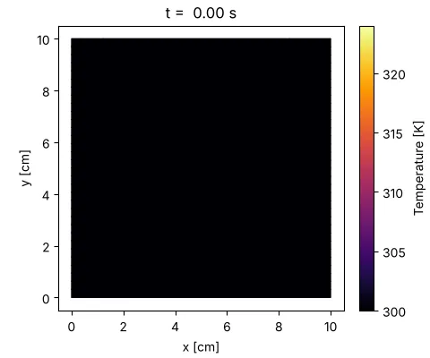
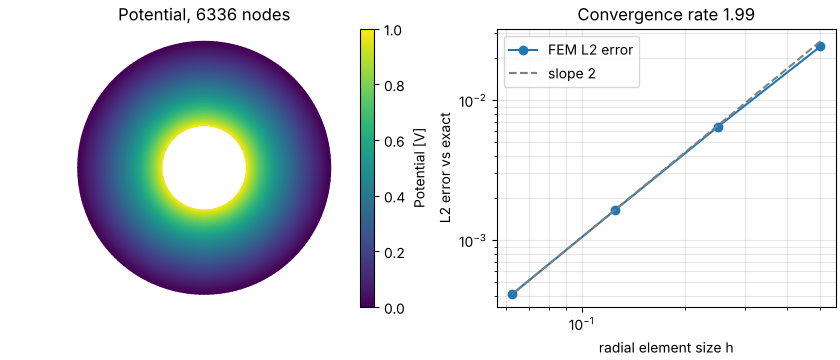
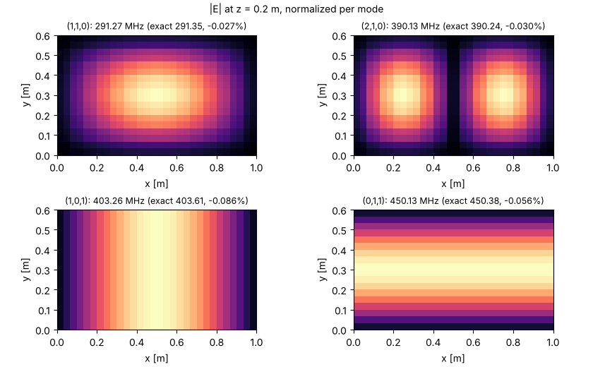

# 예제 갤러리

[English](../../../gallery.md) | **한국어**

작은 예제 세 개입니다. 각 그림은 이 레포의 입력을 쓰는 스크립트 하나가 그립니다.
기능이 무엇을 만드는지 보여 주는 것이며 수용 근거가 아닙니다. 고정된 기준은
항목마다 연결한 검증 문서에 있습니다.

[설치](overview.md) 뒤 test extra(`galerkin-refsol`)와, ParaView 출력이 필요하면
export extra(`meshio`)를 갖춘 상태에서 레포 루트에서 모든 그림을 다시 만듭니다.

```bash
python examples/simcase/gallery.py gallery-out
```

출력 폴더는 새것이거나 비어 있어야 합니다. 스크립트는 아래에 인용한 숫자를
`gallery.json`에도 씁니다. `--quick`은 거친 메시를 쓰며 시험이 이 모드를 돌립니다.
여기 그림은 Linux, Python 3.12, NumPy 2.5, SciPy 1.18, Matplotlib 3.11,
Pillow 12.3에서 만들었습니다.

## 판의 과도 열전도



한 변 10 cm의 정사각형 판에 2 MW/m³의 균일한 내부 발열이 있습니다. 왼쪽과 아래
변은 300 K로 고정하고 나머지 두 변은 단열이며, 처음 온도는 300 K입니다.
열전도도 237 W/(m K)와 체적 열용량 2.42 MJ/(m³ K)는 알루미늄의 대표적인 편람
값으로, 근사 예제 입력입니다. 32 × 32 메시를 60초까지 저장 시각 81개로 풀며,
먼 모서리는 323.3 K(+23.3 K)에 이르며 아직 천천히 오르는 중입니다.

- 입력: [`gallery_heated_plate.json`](../../../../examples/simcase/gallery_heated_plate.json)
  (`thermal.transient2d`). [마지막 장면 정지 그림](../../../gallery/heated_plate.png)도 둡니다.
- `meshio`가 설치돼 있으면 같은 결과를 ParaView 시간 시리즈
  `heated_plate_paraview/fields.pvd`로도 씁니다
  ([ParaView로 보기](packages/simcase/overview.md#paraview로-보기) 참고).
- 검증: [과도 열전도 검증](packages/galerkin/transient_heat_validation.md).
  이 사례 자체는 메시·시간 간격 수렴을 확인하지 않았습니다.

## 동축 정전기와 메시 수렴



안쪽 도체(반지름 1, 1 V)와 바깥 도체(반지름 3, 0 V) 사이 전위의 정확한 해는
V = ln(3/r)/ln 3입니다. 스크립트는 P1 요소로 메시 네 개에서 풀고 반지름 방향
요소 크기에 대한 L2 오차를 그립니다. 오차는 2.4 × 10⁻²에서 4.1 × 10⁻⁴로 줄고 마지막
수렴 차수는 1.99로, 기대한 2차와 맞습니다.

- 입력: Python API(`annulus_mesh`, `assemble_stiffness`, `solve_dirichlet`,
  `l2_error`), [`coax_convergence.py`](../../../../examples/galerkin/coax_convergence.py)와 같은 방식.
- 검증: [솔버 검증](packages/galerkin/milestone_validation.md)의 M1.

## 3D 직육면체 공진기 모드



완전 도체 벽의 1 × 0.6 × 0.4 m 진공 상자를 30 × 18 × 12로 나눈 메시에서 300 MHz에
가장 가까운 모드 네 개를 구합니다. 각 그림은 중간 단면 z = 0.2 m를 지나는
사면체들의 |E| 평균이며 모드마다 정규화했습니다. 세 변 길이가 달라 이 네 모드는
축퇴되지 않습니다. 주파수를 `galerkin-refsol`의 해석적 상자 모드와 비교합니다.

| 모드 (m, n, p) | 계산 [MHz] | 해석 [MHz] | 상대 차이 |
|---|---|---|---|
| (1, 1, 0) | 291.27 | 291.35 | −0.027% |
| (2, 1, 0) | 390.13 | 390.24 | −0.030% |
| (1, 0, 1) | 403.26 | 403.61 | −0.086% |
| (0, 1, 1) | 450.13 | 450.38 | −0.056% |

- 입력: [`gallery_box_cavity.json`](../../../../examples/simcase/gallery_box_cavity.json)
  (`em.cavity3d`, `near_target` 탐색;
  [탐색 의미](packages/simcase/cavity3d.md) 참고).
- 검증: [공진기 API, 단위, 수렴](packages/galerkin/cavity_solver.md).

## 한계

- 스크립트의 확인은 그림이 망가지지 않았는지를 막는 것입니다. 판이 데워져야 하고,
  동축 수렴 차수는 1.8보다 커야 하며, 공진 주파수는 1% 안에서 맞아야 합니다.
  검증 기준이 아닙니다.
- 이 갤러리에는 재료 영역 그림이 없습니다. 저장한 정상·과도 영역 결과는
  [VTU/PVD 내보내기](packages/simcase/thermal_regions2d.md)를 지원합니다.
- 그림 파일은 [자산 목록](assets.md)에 있습니다.
