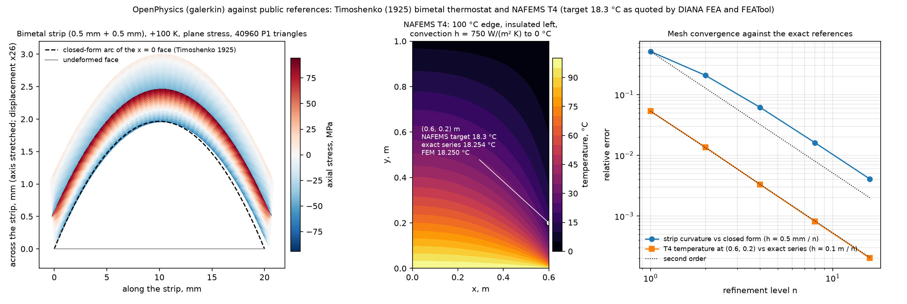

# 공개 기준값 벤치마크: 바이메탈 띠와 NAFEMS T4

[English](../../../../../packages/galerkin/public_benchmarks.md) | **한국어**

답이 공개되어 있어 누구나 확인할 수 있는 문제 두 개를 기존 `galerkin` 정상 열전도·
처방 온도 기계 단계로 풀고, 정확한 정답과 메시 세분화로 대조합니다. 엔진 코드는 바뀌지
않았고, 정답은 엔진을 import하지 않는 새 모듈 `refsol.bimetal`과
`refsol.thermal_convection`입니다. 기준은 `tests/galerkin/test_public_benchmarks.py`에,
그림은 `examples/galerkin/public_benchmarks.py`에 있습니다.



## 바이메탈 띠 (Timoshenko 1925)

**정답.** S. Timoshenko, "Analysis of Bi-Metal Thermostats", J. Opt. Soc. Am.
11(3), 233-255 (1925), [doi:10.1364/JOSA.11.000233](https://doi.org/10.1364/JOSA.11.000233).
두께 t1, t2(탄성계수 E1, E2, 열팽창계수 alpha1, alpha2)의 접합된 두 층을 dT만큼 균일하게
가열하면 곡률은

    kappa = 6 (alpha2 - alpha1) dT (1+m)^2 / (h [3 (1+m)^2 + (1+m n)(m^2 + 1/(m n))]),
    m = t1/t2, n = E1/E2, h = t1 + t2.

`refsol.bimetal.curvature`는 보 단면의 축력 0·굽힘모멘트 0 조건에서 kappa를 유도하고(층 수
제한 없음), `timoshenko_curvature`는 위 폐형식, `villarceau_curvature`는 Wikipedia
[Bimetallic strip](https://en.wikipedia.org/wiki/Bimetallic_strip) 문서(2026-10-22 열람, 거기서는
Villarceau 1863으로 귀속)에 실린 동치 형태, `stoney_uniaxial_curvature`는 Stoney 관계의
보 형태 kappa = 6 sigma_f t_f/(E_s t_s^2)입니다(G. G. Stoney, Proc. R. Soc. Lond. A 82,
172-175 (1909), [doi:10.1098/rspa.1909.0021](https://doi.org/10.1098/rspa.1909.0021)).
`tests/refsol/test_bimetal_reference.py`는 무작위 층 데이터에서 세 형태가 1e-10까지 일치함,
박막 극한이 Stoney 형태로 수렴함, `strip_fields`가 단면 힘·모멘트가 없고 계면에서 연속이며
평면응력 변형률(유한차분)과 x = 0 면의 폐형식 곡률을 가짐을 확인합니다. (1 - nu_s)가 붙는
등2축 판 형태의 Stoney 식은 판 결과이므로 여기서 다루지 않습니다.

**보 공식이 정확한 2D 정답인 이유.** 보 장 eps_yy = a + b x,
sigma_yy = E_i (a + b x - alpha_i dT), sigma_xx = sigma_xy = 0은 평면응력에서 평형·적합·계면
연속·자유 표면을 정확히 만족합니다. 끝면에는 자체 평형인 축응력이 남습니다. 그 응력을 끝면
표면하중으로 주면 보 장이 정확한 평면응력 해이므로 P1 해는 보통의 차수로 수렴해야 합니다.
끝면을 자유로 두면 Saint-Venant 해이며, 차이는 양 끝에서 두께 몇 배 안에 국한됩니다.

**사례.** 층 1: 0.5 mm, E 200 GPa, nu 0.3, alpha 12e-6 1/K(강철류); 층 2: 0.5 mm, E 70 GPa,
nu 0.33, alpha 23e-6 1/K(알루미늄류); 길이 20 mm(두께의 20배); Tref = 293.15 K에서
dT = +100 K; 평면응력; 핸드북형 예제 상수이며 인증된 데이터가 아닙니다. kappa = 1.53425 1/m
(반지름 0.652 m). 메시 `layered_rectangle_mesh([t1, h], L, [n, n], 40 n)`: 두께 방향 정사각
셀 2n개, 길이 방향 40n개. 지지는 (0, 0)의 u와 (0, L)의 u_x를 고정하며 정답도 같은 강체
선택을 씁니다. 해의 곡률은 x = 0 면 절점의 u_x에 맞춘 포물선 2차 계수의 -2배입니다(정확한
끝면 표면하중이면 면 전체, 자유단이면 가운데 절반).

정확한 끝면 표면하중(`test_bimetal_strip_converges_to_the_timoshenko_field`, `slow`),
2026-10-22 로컬 실행(macOS, Python 3.12, numpy 2.5.4, scipy 1.18.1):

| n | 삼각형 | 변위 L2 상대 | 차수 | 응력 L2 상대 | 차수 | 곡률 오차 |
|---|---|---|---|---|---|---|
| 1 | 160 | 4.96e-1 | | 1.03 | | -51.2 % |
| 2 | 640 | 2.01e-1 | 1.30 | 6.85e-1 | 0.58 | -20.8 % |
| 4 | 2 560 | 5.97e-2 | 1.75 | 3.81e-1 | 0.85 | -6.15 % |
| 8 | 10 240 | 1.57e-2 | 1.93 | 1.97e-1 | 0.96 | -1.61 % |
| 16 | 40 960 | 3.98e-3 | 1.98 | 9.91e-2 | 0.99 | -0.41 % |

기준(n = 1, 2, 4, 8): 마지막 두 구간에서 변위·곡률 차수 >= 1.6, 응력 차수 >= 0.8; n = 8에서
곡률 오차와 변위 오차 <= 2.5e-2; 지지 반력 <= 1e-9 E alpha dT h. 빠른 시험
(`test_bimetal_closed_form_and_quick_mesh`, n = 4, 두 끝면 조건)은 가운데 절반 곡률을 8e-2로
가립니다. 거친 메시가 크게 벗어나는 것은 P1 삼각형이 굽힘에 뻣뻣하기 때문이며(n = 1은 두께
방향 요소 2개), 그림처럼 오차는 2차로 줄어듭니다.

자유단(`test_free_ended_strip_has_the_timoshenko_curvature_away_from_the_ends`, `slow`):
자유단 띠의 가운데 절반 곡률은 n = 4, 8에서 정확한 표면하중 띠의 값과 상대 2e-10까지
같으므로(기준 1e-4) 두께 20배 길이의 띠에서 끝 효과는 가운데 절반에 닿지 않고, 폐형식 대비
오차도 같은 -6.15 %, -1.61 %입니다. 자유단 띠의 면 전체 맞춤과 전역 L2 오차는 끝 영역을
보며(n = 16에서 변위 L2 4.0e-3 대신 5.8e-3) 보고만 하고 가리지 않습니다.

## NAFEMS T4: 대류가 있는 2차원 열전달

**정답.** 0.6 m × 1.0 m 직사각형, 열전도율 52 W/(m K), 열원 없음; y = 0 변은 100 °C, x = 0
변은 단열, x = 0.6 m와 y = 1.0 m 변은 h = 750 W/(m² K)로 0 °C에 대류; (0.6, 0.2) m에서 목표
온도 18.3 °C. 문제 설정과 목표값은 NAFEMS를 인용한 공개 벤치마크 문서 두 개에서 옮겼습니다:
DIANA FEA, [Two-Dimensional Heat Transfer with Convection](https://tutorials.dianafea.com/2DHeatTransferConvection.pdf)
(NAFEMS, *The Standard NAFEMS Benchmarks*, 1990 인용)와 FEATool Multiphysics
[ex_heattransfer4.m](https://www.featool.com/doc/ex__heattransfer4_8m)(A. D. Cameron,
J. A. Casey, G. B. Simpson, *Benchmark Tests for Thermal Analysis*, NAFEMS, 1986 인용);
둘 다 2026-10-22 열람. 출판된 숫자만 옮겼습니다([NOTICE](../../../../../../packages/galerkin-refsol/NOTICE)).
목표값은 0.1 °C 자리까지 인용되어 있습니다.

`refsol.thermal_convection.series`는 같은 경계값 문제의 변수분리 해입니다:
lam_n tan(lam_n W) = h/k인 cos(lam_n x), 위쪽 Robin 조건을 만족하는 y 의존성, 뜨거운 변에서
정한 계수. T(0.6, 0.2) = 18.2538 °C로 NAFEMS 값의 인용 정밀도 안에 있습니다.
`tests/refsol/test_thermal_convection_reference.py`는 고유값 방정식, 유한차분으로 Laplace
방정식과 Fourier 법칙, Robin·단열·뜨거운 변 조건, 내부 값의 기하급수 수렴, 온도 오프셋에
대한 선형성을 확인합니다.

**사례.** `rectangle_mesh(0.6, 1.0, 6n, 10n)`, 0.1 m / n 정사각 셀; 뜨거운 변은 Dirichlet
373.15 K; `convection={'right': (750, 273.15), 'top': (750, 273.15)}`; 태그 없는 왼쪽 변은
기본으로 단열. 목표점은 모든 n에서 메시 절점입니다.

| n | 삼각형 | T(0.6, 0.2), °C | 급수 대비 오차, °C | 차수 | L2 상대 오차(전체) | 차수 | L2 상대 오차(y >= 0.1 m) | 차수 |
|---|---|---|---|---|---|---|---|---|
| 1 | 120 | 17.2813 | -0.972 | | 1.85e-2 | | 7.53e-3 | |
| 2 | 480 | 18.0048 | -0.249 | 1.97 | 6.12e-3 | 1.59 | 1.97e-3 | 1.93 |
| 4 | 1 920 | 18.1936 | -0.0602 | 2.05 | 1.95e-3 | 1.65 | 5.02e-4 | 1.97 |
| 8 | 7 680 | 18.2389 | -0.0149 | 2.02 | 6.00e-4 | 1.70 | 1.26e-4 | 1.99 |
| 16 | 30 720 | 18.2500 | -0.00371 | 2.00 | 1.79e-4 | 1.74 | 3.15e-5 | 2.00 |
| 32 | 122 880 | 18.2528 | -0.00093 | 2.00 | 5.30e-5 | 1.76 | 7.89e-6 | 2.00 |

기준(`test_nafems_t4_converges_at_second_order_away_from_the_hot_corner`, `slow`,
n = 2, 4, 8, 16): 마지막 두 구간에서 점·원거리 L2 차수 >= 1.8, 전체 L2 차수 >= 1.5; n = 16에서
점 오차 <= 1e-2 °C, 원거리 L2 오차 <= 1e-4. 빠른 시험(n = 8)은 점 값을 급수 대비 2.5e-2 °C,
NAFEMS 값 대비 인용 정밀도 0.1 °C로 가립니다. 전체 영역 L2 차수가 2에 못 미치는 것은 100 °C
변과 대류 변이 만나는 모서리 (0.6, 0) 때문이며, 뜨거운 변에서 떨어진 곳의 차수는 2입니다.

## 범위와 한계

- 평면응력, 미소 변형, 균일 온도, P1 삼각형; 띠 정답은 보 장이며 평면응력에서만 성립합니다.
- NAFEMS 목표값은 0.1 °C 자리까지 인용된 출판 숫자입니다. 수용 기준은 문제 그대로의 정확한
  급수를 쓰고, 출판값은 인용 정밀도로 확인합니다.
- 이 정답들과의 일치는 이 문제들에서 열·기계 단계의 근거입니다. 온도 의존 재료, 접촉, 소성,
  크리프, 수명 관련 양에 대해서는 아무것도 말하지 않습니다.

## 재현

```bash
python -m pytest -q tests/refsol/test_bimetal_reference.py tests/refsol/test_thermal_convection_reference.py tests/galerkin/test_public_benchmarks.py
python examples/galerkin/public_benchmarks.py out-dir        # 그림과 숫자; --quick은 거친 메시
```
