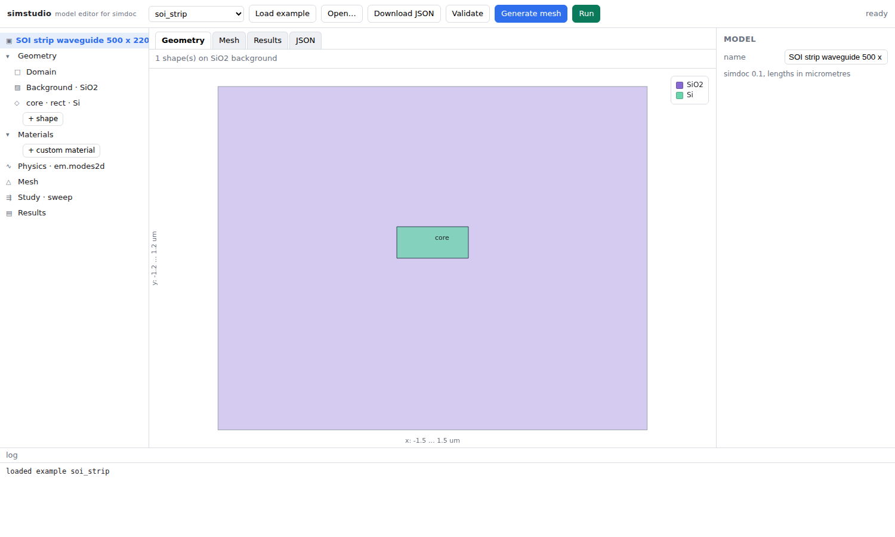
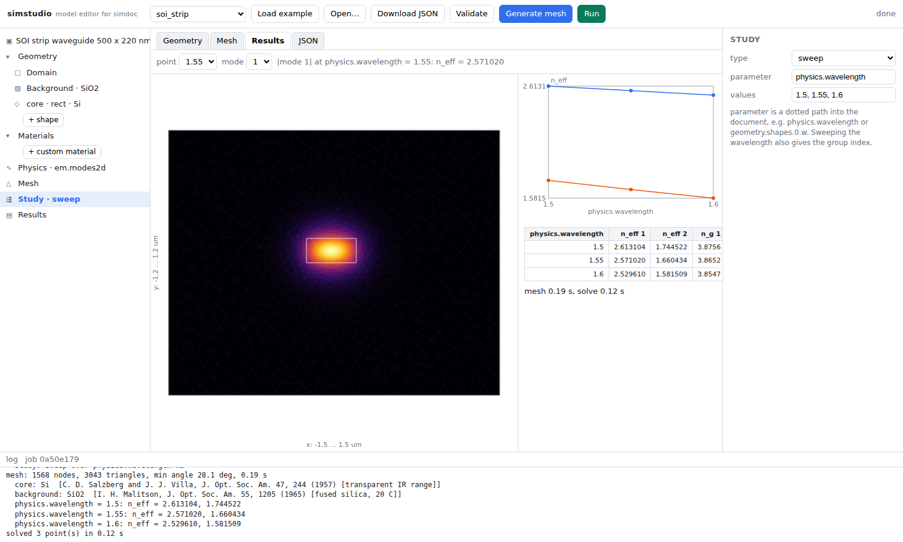

# simcase — 모델 문서와 헤드리스 실행기

[English](../../../../../packages/simcase/overview.md) | **한국어**

[전체 문서 색인](https://github.com/fieldalgo/openphysics/blob/main/docs/locales/ko/pages/index.md)

`simcase`는 JSON 모델 문서와 이를 실행하는 엔진을 정의합니다. 문서는 형상·재료·물리·메시 설정·study를 담고, 한 명령이 meshine(메시), physmat(재료), galerkin(FEM)을 거쳐 결과를 기록합니다. 문서를 편집하는 브라우저 UI는 같은 설치의 [선택적 하위 패키지](#브라우저-ui)이며 엔진은 이에 의존하지 않습니다.

```bash
# From the repository root; installs the local runtime packages together.
python -m pip install -e packages/meshine -e packages/physmat -e packages/galerkin -e packages/simcase
python -m simcase example soi_strip > model.json
python -m simcase validate model.json
python -m simcase run model.json                          # -> model_results/
python -m simcase geometry model.json                     # 버전 1 형상 블록의 영역 복합체
```

패키지와 CLI의 이름은 `simcase`입니다. JSON 버전 필드는 `"openphysics": "0.2"` 또는 `"0.3"`이며 import나 배포판 이름이 아닙니다. 형식 `"0.3"`(단위를 함께 쓴 값, 등록부 물리량 이름, 형상 구성 요소마다의 `length_unit`, 코드가 붙은 진단)은 열(`thermal.steady2d`, `thermal.transient2d`: 직사각형, 재료 영역, 버전 1 블록, 축대칭 형식)과 전기 전도·Joule 가열(`electric.steady2d`, `joule.steady2d`, `joule.temperature2d`: 직사각형, 앞의 둘은 재료 영역도), 역학(`mechanics.elasticity2d`, `mechanics.thermoelastic2d`: 직사각형과 재료 영역), 도파 모드(`em.modes2d`: 평면 형상과 버전 1 블록, 스칼라, 벡터, PML, 굽힘, 추적·부분공간 sweep)에서 읽으며, 이들은 더 이상 형식 0.2를 읽지 않습니다. `em.cavity3d`는 단위 일괄 변경의 해당 커밋까지 형식 0.2를 읽습니다: [문서 형식 0.3](document_format.md). 별도의 `openphysics` 배포판은 0.0.2부터 완제품으로, OpenPhysics 패키지들을 Studio와 함께 설치하고 `openphysics` 명령을 제공합니다. PyPI의 0.0.1은 빈 이름 예약입니다. 전체 개발 설치는 [저장소 설치 안내](https://github.com/fieldalgo/openphysics/blob/main/docs/locales/ko/pages/overview.md)를 참조하세요. 위 편집 가능 경로에는 모노레포 checkout이 필요합니다. 개별 sdist에는 형제 패키지나 저장소 루트가 없습니다. 내려받은 배포물을 설치할 때는 형제 의존 패키지의 로컬 배포물 경로도 함께 pip에 전달하세요.

`model_results/`에는 `summary.json`(단위를 붙인 SI 값: study 지점별 진공 파장과 유효 굴절률, 군굴절률, 메시 통계, 시간, 진단), `fields.npz`(미터 단위 절점 좌표와 모드 장), `results.png`(메시·모드·sweep), `log.txt`, 작성한 그대로의 문서(`model.json`)가 생성됩니다.

## 지원하는 문서

실행기는 문서마다 물리 항목 하나를 받습니다. `python -m simcase example <이름>`은 제공 예제를 출력합니다.

| 물리 유형 | 해석 내용 | 예제 | 계약 |
|---|---|---|---|
| `em.modes2d` | 수동 흡수를 포함한 2D 도파 모드, 스칼라 또는 전체 벡터. 단일 지점과 모드 추적 파장 sweep | `soi_strip`, `slab_te_check`, `fiber`, `hadley_rib`, `hadley_rib_vector`, `vector_slab`, `vector_fiber`, `vector_slab_sweep`, `vector_fiber_subspace_sweep` | 이 페이지, [부분공간 추적](vector_subspace_tracking.md) |
| `em.cavity3d` | 직육면체 고유모드: 진공 PEC, 또는 손실 직육면체 재료와 도체 벽의 복소 주파수와 Q; SI JSON/NPZ 출력 | `cavity_box`, `cavity_lossy_slab` | [공진기 문서](cavity3d.md) |
| `electric.steady2d` | 정상 전기전도: 균질 직사각형, 또는 형상 블록의 재료 영역 | `electric_rectangle` | [JSON/CLI](electric_joule.md) |
| `joule.steady2d` | 상수 물성 정상 Joule heating: 균질 직사각형, 또는 재료 영역 | `joule_rectangle` | [JSON/CLI](electric_joule.md) |
| `joule.temperature2d` | 온도 의존 정상 Joule heating | `joule_temperature` | [JSON/CLI](electric_joule.md) |
| `mechanics.elasticity2d` | 균질 직사각형의 정적 선형탄성: 평면응력·평면변형률, 변별 변위 성분, 직교좌표계 변 traction, 상수 체적력 | `elastic_plate` | [JSON/CLI](mechanics2d.md) |
| `mechanics.thermoelastic2d` | 변별 상수 경계 데이터의 정상 열전도 후 같은 메시의 열응력, 전체 변 traction | `thermoelastic_bar` | [JSON/CLI](mechanics2d.md) |
| 영역이 있는 `mechanics.elasticity2d` | 이름 있는 재료 영역의 정적 선형탄성(E·ν는 재료 표에서), 영역 열전도와 같은 경계 이름의 변위·직교좌표계 traction·계기압 | `elastic_regions` | [영역 문서](mechanics2d.md#재료-영역과-이름-있는-경계) |
| 영역이 있는 `mechanics.thermoelastic2d` | 영역 열전도 후 같은 메시에서 재료별 E·ν·α의 열응력 | `thermoelastic_regions` | [영역 문서](mechanics2d.md#재료-영역과-이름-있는-경계) |
| `thermal.steady2d` | 균질 직사각형 정상 열전도: 변 Dirichlet, 단열, 상수 외향 열유속·대류 | `thermal_slab`, `thermal_mixed`, `thermal_boundary` | [정상 열전도](thermal_steady2d.md), [경계조건](thermal_steady_boundary2d.md) |
| 영역이 있는 `thermal.steady2d` | 이름 있는 재료 영역의 정상 열전도: 배경 위 도형, 재료 표, 영역 경계를 따르는 메시 | `thermal_regions` | [영역 문서](thermal_regions2d.md) |
| `thermal.transient2d` | 균질 직사각형 과도 열전도: 후진 Euler, 명시 시간, 상수 또는 표본 변 Dirichlet, 단열, 상수 외향 열유속·대류 | `transient_thermal_uniform`, `transient_thermal_boundary` | [과도 열전도](thermal_transient2d.md) |
| 영역이 있는 `thermal.transient2d` | 이름 있는 재료 영역의 과도 열전도, 재료별 열전도율·열용량 | `transient_thermal_regions` | [영역 문서](thermal_regions2d.md) |

Studio는 2D 광학 모델을 편집·실행하고, 직사각형이거나 재료 영역이 있는(Studio 영역 한도 안의) 정상·과도 열전도 문서의 전용 화면을 제공하며, 공진기 문서는 거절합니다. 연성·다중 물리 실행, 형상·메시·재료 sweep, 기계해석 문서는 지원하지 않습니다. `em.cavity3d`는 손실 직육면체 재료를 받습니다.

## 문서

```json
{
  "openphysics": "0.3",
  "name": "SOI strip waveguide 500 x 220 nm",
  "geometry": {
    "length_unit": "um", "depth": null,
    "domain": {"xmin": -1.5, "xmax": 1.5, "ymin": -1.2, "ymax": 1.2},
    "background": {"material": "physmat:SiO2"},
    "shapes": [
      {"name": "core", "type": "rect", "x": -0.25, "y": 0.0, "w": 0.5, "h": 0.22, "material": "physmat:Si",
       "element_size": "0.02 um"}
    ]
  },
  "materials": {"myglass": {"refractive_index": 1.5}},
  "physics": {
    "em1": {"type": "em.modes2d", "formulation": "vector", "vacuum_wavelength": "1.55 um", "mode_count": 2,
            "effective_index_threshold": 1.45,
            "boundary": {"left": "pec", "right": "pec", "top": "pec", "bottom": "pec"}}
  },
  "mesh": {"element_size": "0.25 um",
           "grading": {"position": ["0 um", "0.11 um"], "near": "0.02 um", "far": "0.16 um",
                       "refinement_distance": "1 um"}},
  "study": {"type": "sweep", "parameter": "physics.em1.vacuum_wavelength",
            "values": {"unit": "um", "values": [1.4, 1.45, 1.5, 1.55, 1.6, 1.65, 1.7]}}
}
```

`geometry.length_unit`은 형상과 영역 숫자의 뜻을 정합니다. 그 밖의 모든 길이는 자기 단위를 함께 씁니다(`"1.55 um"`, `"1550 nm"`, `"1.55e-6 m"`. 진공 파장은 nm, um, m를 받습니다). 단위 없는 차원 값은 거절합니다(`E-UNIT-MISSING`). `depth`는 `null`(단면)입니다. 라이브러리 재료는 physmat의 정확한 이름으로 씁니다(`"physmat:Si"`). 접두어 없는 이름은 `materials`의 로컬 기록이며, 그 `refractive_index`는 숫자, `{"n": .., "k": ..}`(exp(−iωt)에서 n + i k: k ≥ 0은 흡수, 음수 k는 `E-GAIN`으로 거절), 또는 분산 모델입니다. `physics`는 이름 있는 물리의 맵이고 sweep 매개변수는 그중 하나를 지정합니다. 결과는 exp(−iωt)의 SI입니다: 절점 좌표와 진공 파장은 미터, 전파 손실은 dB/m입니다.

CLI 요약, 저장 그림, Studio 형상/메시/결과 라벨은 구성 요소의 길이 단위(또는 `display_units.length`)를 사용합니다. 바뀌는 것은 라벨이지 저장 숫자가 아닙니다. 내장 재료 미리보기는 미터 단위 진공 파장을 받고 돌려줍니다. `em.modes2d`의 형상·메시·모드 풀이는 문서가 선언한 단위와 관계없이 마이크로미터(커널 기준틀, exp(+iωt))에서 합니다. 모든 길이는 정확한 값에서 한 번 마이크로미터로 바꾸고(`float(exact × 10⁶)`), 결과는 마이크로미터 값에 1e-6을 곱해 SI로 돌려주며 모든 복소 값은 한 번 켤레를 취합니다. 그래서 같은 소자를 `nm`, `um`, `m`로 써도 숫자가 같은 십진수이면(예: 1550 nm, 1.55 um, 1.55e-6 m) 비트 단위로 같은 메시와 결과를 냅니다(P2-5). 되돌린 값은 커널의 마이크로미터 double에 1e-6을 곱한 값입니다(`"0.22 um"`으로 쓴 2.2e-07은 `resolved_inputs`에서는 2.2e-07이지만, 커널 값으로 계산한 결과에서는 2.1999999999999998e-07입니다). schema는 여러 항목을 표현할 수 있지만 현재 runner는 정확히 하나만 요구하고 연성·다중물리 실행을 거절합니다.

형상은 `rect`, `circle`, `polygon`입니다. 뒤의 형상이 앞의 형상을 잘라내며 남는 부분은 background가 채웁니다(Boolean 처리는 shapely). 다른 형상과 겹치지 않는 원은 정확한 원으로 메시를 만듭니다. 재료는 `materials`의 로컬 기록이거나 정확한 이름으로 쓴 physmat 내장 재료(`"physmat:Si"`, `"physmat:SiO2"`, `"physmat:Au"`, ...)이며, 내장 재료의 분산은 sweep의 각 파장에 자동 적용됩니다. `study.parameter`는 `physics.` 아래의 기존 점 경로여야 합니다. 파장은 `physics.<name>.vacuum_wavelength`이고 값은 태그 배열(`{"unit": "um", "values": [...]}`)입니다. 메시를 한 번만 만들기 때문에 형상·메시·재료 sweep은 거절합니다. 파장을 sweep하면 군굴절률도 얻습니다.

광학 모드 물리는 `em.modes2d`의 `scalar`(TE 슬랩 모드에는 정확하고 2D 고대비 코어에는 근사) 또는 단일 지점·추적 파장 sweep의 전체 `vector`입니다. 제공 예제 `soi_strip`은 `vector`를 씁니다. 이런 코어에서 스칼라 근사는 크게 어긋납니다. 같은 문서를 `scalar`로 풀면 1.55 um에서 n_eff가 2.444가 아니라 2.611입니다. 저대비 Hadley 리브에서 `hadley_rib`(스칼라)은 자기 메시에서 출판값과 4e-5 차이지만 메시를 세분화하면 멀어지고(0.65배에서 1.4e-4), `hadley_rib_vector`는 출판값보다 2.0e-4 낮고 세분화하면 다가갑니다(0.65배에서 1.1e-4). 두 경로 모두 수동 흡수를 받습니다. 부호·복소 출력·단위·선택은 [흡수 모드](lossy_modes.md)를 참고하세요. 스칼라 경계는 `pec`(장 = 0) 또는 `pmc`(자연)입니다. 벡터 PEC는 접선 전기장과 Ez를 고정하고 PMC는 자연 경계입니다. 이들은 서로 다른 장 조건이므로 스칼라 슬랩의 정식화만 바꿔도 다른 편광을 선택할 수 있습니다.

### 벡터 장과 단일 지점 study

```bash
python -m simcase example vector_slab > vector.json
python -m simcase run vector.json -o vector_results
```

`vector_slab`은 전기 측벽으로 TE 군을 선택하는 220 nm 유전체 슬랩입니다. TM 군에는 좌우 경계를 `pmc`로 바꾸세요. `vector_fiber`는 축퇴 상대를 포함해 여섯 장을 요청합니다.

물리 항목에는 `"formulation": "vector"`와 유한 양수 `effective_index_threshold`가 필요합니다. 이 무차원 수는 선택 파장에서 유도모드 탐색 구간의 사용자가 지정한 하한입니다. 단순 비대칭 슬랩에는 기판/덮개 굴절률 중 큰 값을, 광섬유에는 외부 클래딩 굴절률을 쓰세요. 일반 구조에는 더 높은 유효 굴절률의 슬랩/복사 채널이 있어 그에 맞는 하한이 필요할 수 있습니다. 상한은 메시의 최대 재료 굴절률입니다. 최소 재료 굴절률에서 자동 추론하지 않습니다.

실수·유한·양수 유전율의 등방 비자성 유전체만 지원합니다. 최대 굴절률 근처에서 모드를 탐색하고 열린 구간 `(effective_index_threshold, n_max)`으로 거른 뒤 n_eff 내림차순으로 정렬합니다. 발견 모드가 `mode_count`보다 적으면 실제 개수와 로그 경고를 반환하며, 0개면 오류입니다. 이는 제한된 탐색이지 모든 유도모드를 찾았다는 증명이 아닙니다. 유한 PEC/PMC 계산벽은 열린 경계가 아니므로 형상에 대해 메시 수렴과 영역 여백을 모두 확인하세요.

독립 지점에는 `"study": {"type": "single"}`을 사용하세요. 파장 sweep에는 아래 분리 모드 추적 계약이 필요하며 다른 벡터 sweep은 거절합니다.

`RunResult.mode_fields`는 스칼라 결과의 절점 스칼라 장을 담고 벡터 결과에서는 비어 있습니다. 벡터 데이터는 `RunResult.vector_fields`에 있으며 study 지점마다 공개 `VectorField` 객체 하나가 있습니다(SI, exp(−iωt)).

| 속성 | 형상 | 의미 |
|---|---|---|
| `edges` | `(edges, 2)` | 작은 노드 인덱스에서 큰 인덱스로 향하는 노드 쌍 |
| `transverse` | `(edges, modes)` | 미터 단위의 횡방향 전기장 선적분 |
| `longitudinal` | `(nodes, modes)` | Ex/Ey 대비 위상을 포함하는 복소 Ez |
| `electric` | `(triangles, modes, 3)` | 삼각형 중심의 복소 Ex/Ey/Ez |

각 모드는 하나의 공통 척도, 즉 중심점 최대 `|E| = 1`을 사용합니다. 진폭은 상대값이며 V/m 또는 정규화 전력이 아닙니다. 모든 성분은 이 척도를 공유하고 이 무손실 모드의 Ez는 횡방향 장과 직교 위상입니다. 중심값은 요소별로 유지되어 경계면 불연속을 보존합니다. 원시 변/절점 계수는 다른 곳에서 복원할 수 있도록 유한요소 장을 유지합니다.

벡터 `fields.npz`는 `edges`, `unnormalized_electric_field_line_integral`(m), `unnormalized_electric_field_z`, `unnormalized_electric_field`(x, y, z; 단위 1)를 담으며 세 장 배열에는 앞쪽 study 지점 축이 추가됩니다. `numpy.load(..., allow_pickle=False)`로 읽습니다. 벡터 데이터에는 스칼라 `unnormalized_mode_field`가 없습니다. archive와 summary의 `field_representation="vector-edge-nodal-v2"`가 이 구성을 식별합니다. summary metadata에는 `mode_count`, `returned_mode_count`, 정규화, `field_units`(모든 배열의 단위, `node_coordinates`는 m)가 포함됩니다. 모든 `em.modes2d` 결과(스칼라·벡터)는 저장 파일 배치 `field_layout="em-modes2d-p1-node-centroid-v2"`(P1 절점 장, 벡터 결과는 요소중심 전기장을 더함), 미터 단위 `node_coordinates`, `vacuum_wavelength`(m, study 지점마다 하나), `effective_index`(손실이 있거나 PML이면 복소, Im n_eff ≥ 0이 손실), `study_parameter`(sweep 경로, 단일 지점이면 `""`)를 기록하며, 다른 슬롯의 sweep은 `study_values`를 더합니다. subspace sweep은 대신 `field_layout="em-modes2d-subspace-raw-v2"`를 기록합니다. 단위 일괄 변경 전에 저장한 결과(배치 `-v1`)는 내보내기 도구가 이름을 밝혀 거절합니다.

### 모드 후처리

PML이 없는 모든 스칼라·벡터 `em.modes2d` 결과는 study 지점 `p`와 모드 `m`마다 세 개의 배열을 추가로 저장합니다. 값은 커널 기준틀(마이크로미터 메시, exp(+iωt))에서 [`galerkin.mode_overlap`](../galerkin/mode_overlap.md)으로 계산한 뒤 exp(−iωt)의 SI로 한 번 바꾼 것입니다. 면적은 1e-12를 곱하고 복소 값은 켤레를 취합니다(`simcase.mode_postprocessing`이 정확한 절차를 적고, `tests/simcase/test_modes_postprocessing.py`가 저장값이 그 호출을 한 번 변환한 값임을 확인합니다):

| 키 | 모양 | 의미 |
|---|---|---|
| `unnormalized_mode_power`(벡터, W) 또는 `unnormalized_mode_field_square_integral`(스칼라, m^2) | `(points, modes)` | 벡터: 저장 장을 V/m로 읽은 복소 Poynting 적분 `P = 1/2 int (E x H*) . z dA`(`vector_power`, `k0 = 2 pi / wavelength`, `mu_r = 1`); 스칼라: `int |phi|^2 dA`(`scalar_power`, 실수) |
| `confinement_factor` | `(points, modes, regions)` | `region_names` 순서의 영역별 에너지 비율 `int_R Re(eps_r) |E|^2 / int Re(eps_r) |E|^2`(`confinement_factor`); 스칼라: `int_R |phi|^2 / int |phi|^2`. 행의 합은 1 |
| `unnormalized_field_overlap` | `(points, modes, modes)` | m^2 단위의 `<E_a, E_b> = int conj(E_a) . E_b dA`(`overlap_matrix(..., "field")`, Hermitian; 스칼라: `scalar_overlap`); 대각은 `int |E|^2 dA`이며 스칼라 결과에서는 제곱 적분과 같음 |
| `coupling_efficiency` | `(points, modes)` | `results.mode_overlap.gaussian`이 있을 때만: Gaussian 입력의 `|<E_mode, E_in>|^2 / (<E_mode, E_mode> <E_in, E_in>)`(`interpolate_vector_field` 뒤 `coupling_efficiency`; 스칼라: 절점에서 `scalar_coupling_efficiency`) |

저장 진폭은 상대값이므로 이름에 "unnormalized"가 붙습니다. 벡터 진폭을 V/m로 읽으면 `unnormalized_mode_power`는 그 장의 전력(와트)이고 `Re`는 +z로 전달되는 시간 평균 전력입니다. 저장 모드를 `sqrt(Re unnormalized_mode_power)`로 나누면 1 W를 전달하는 장이 됩니다. 무손실 모드에서는 허수부가 반올림 오차이고, 손실 모드(복소 `effective_index`)에서는 무효 전력이며 모드들은 전력 직교하지 않습니다. `confinement_factor`와 `coupling_efficiency`는 무차원입니다. `summary.json`은 `mode_postprocessing` 아래에 키마다 `unit`과 `description`을 붙인 값 객체로 같은 값을 반복합니다(복소 값은 `time_convention`과 함께 `re`/`im`, `confinement_factor`는 영역 이름 포함).

선택적 문서 블록

```json
"results": {"mode_overlap": {"gaussian": {"beam_waist_radius": "0.22 um", "position": ["0 um", "0.11 um"]}}}
```

은 입력 장 `exp(-((x - x0)^2 + (y - y0)^2) / w^2)`(`w = beam_waist_radius`는 1/e 장 반지름, `position = [x0, y0]`, 각각 단위를 붙인 길이)에 대한 `coupling_efficiency`를 추가합니다. 벡터 결과에서는 x 편광 입력을 모드의 횡 장과만 비교하고, 스칼라 결과에서는 스칼라 진폭입니다. waist는 양수, 중심은 기하 창 안이어야 하며 `mode_overlap`과 `gaussian` 아래의 다른 키는 거절됩니다. PML 결과와 subspace sweep에는 이 키들이 없습니다. PML 계수는 늘린 좌표의 공변 적분이어서 창 전체의 무손실 Poynting 식이 물리 전력이 아니고, subspace 프레임은 모드가 아니기 때문입니다([PML 모드](pml_modes.md), [subspace 추적](vector_subspace_tracking.md)). VTU 내보내기는 바뀌지 않고 장만 쓰므로 후처리 값은 `fields.npz`나 `summary.json`에서 읽습니다.

Studio는 지점마다 `name="unnormalized_electric_field"`, `location="triangle_centroids"`, 성분 `x`, `y`, `z`, 단위 `1`, `time_convention`, `(modes, triangles, 3)` 형상의 별도 `real`/`imag` 배열을 가진 `vector_fields`와 미터 단위 절점 좌표를 받습니다. 스칼라 결과는 `unnormalized_mode_field`(지점마다 실수부와, 복소이면 허수부)로 오며 벡터에서는 비어 있습니다. `|E|`, `|Ex|`, `|Ey|`, `|Ez|`를 골라 공통 |E| 색 척도의 크기를 표시합니다. 저장 PNG는 |E|를 표시하고 archive는 복소 성분을 보존합니다. `VectorField.to_dict()`는 같은 JSON 안전 표시 표본을 만듭니다.

### 추적 벡터 파장 sweep

```bash
python -m simcase example vector_slab_sweep > sweep.json
python -m simcase run sweep.json -o sweep_results
```

벡터 물리의 sweep 매개변수는 정확히 `physics.<name>.vacuum_wavelength`여야 합니다. 유한 양수 값을 적어도 세 개, 엄격한 증가 또는 감소 순서의 태그 배열로 제공해야 합니다(예: `{"unit": "nm", "values": [1450, 1500, 1550]}`). 불균등 간격도 지원합니다. 메시·재료·경계조건·`mode_count`·`effective_index_threshold`는 고정됩니다. 재료 분산은 각 파장에서 계산합니다. 고정 `effective_index_threshold`는 분산 클래딩을 포함한 **전체 구간**의 외부/슬랩 복사 채널 하한을 만족해야 합니다. 보수적인 상한 포락선은 약하게 유도된 모드를 제외할 수 있으며 시작 파장의 클래딩 값만 쓰면 나중에 원하지 않는 외부 모드를 포함할 수 있습니다.

첫 지점은 n_eff 내림차순으로 `mode_count`개 분지의 시작값을 정합니다. 이후 지점에서는 추가 유도 후보를 탐색하고, 제곱 정규화 overlap 합을 최대화하는 전역 일대일 할당으로 해당 분지에 대응시킵니다.

```text
<E_a,E_b> = transverse_a^H M_edge transverse_b + Ez_a^H M_node Ez_b
score(a,b) = |<E_a,E_b>|^2 / (<E_a,E_a> <E_b,E_b>)
```

질량 행렬은 원래 고정 메시와 물리적인 원시 장 계수를 사용합니다. 이는 전기장 L2 연속성 척도이며 전력·에너지 overlap이 아닙니다. 하나의 공통 복소 위상이 대응 장을 이전 장과 맞추며 모든 원시 계수와 중심점 성분에 적용됩니다. 서로 다른 고유장을 섞지 않습니다. 결과 열은 최초 분지 식별자를 유지하므로 이후 행이 n_eff 순으로 정렬될 필요는 없습니다.

선택 설정은 `study.tracking` 아래에 있습니다.

| 설정 | 기본값 | 의미 |
|---|---|---|
| `search_mode_count` | `max(2*mode_count, mode_count+4)` | 유도 후보 수 한도, `mode_count`보다 큰 정수 |
| `mode_tracking_threshold` | `0.8` | 선택된 제곱 정규화 overlap의 최솟값, `(0,1]` |
| `mode_tracking_margin_threshold` | `0.1` | 전체 할당 점수 간격의 최솟값, `(0,1]` |
| `degeneracy_tolerance` | `1e-5` | 음수가 아닌 절대 n_eff 분리 허용치 |

적용된 기본값은 이유와 함께 `summary.json`의 `defaults_applied`에 되풀이됩니다.

선택된 각 대응의 margin은 최상 전체 할당 점수와 그 대응을 제외한 최상 완전 할당 점수를 비교합니다. 대안이 없으면 `null`입니다. 설정은 수치 진단이지 오차 경계가 아닙니다. 특히 축퇴 허용치는 메시의 굴절률 정확도를 반영해야 하며, 값을 낮춘다고 물리적 축퇴 쌍이 분리되지 않습니다.

요청 개수를 유지하지 못하거나 overlap이 약하거나 할당이 모호하거나 선택 후보에 근축퇴 상대가 있으면(미선택 후보 포함) `ModeTrackingError`를 냅니다. 후보 한도를 모두 사용한 탐색에서 선택 모드가 마지막 순위여도 실패합니다. 보이지 않은 상대를 검사하려면 `search_mode_count`를 늘리세요. 탐색은 제한돼 있으며 전체 스펙트럼의 증명이 아닙니다. 차단을 가로지르는 연속 추적은 미구현입니다. 광섬유의 두 HE11 상대는 하나만 요청해도 기본 추적기가 의도적으로 거절합니다. 독립 단일 study로 확인하거나 선택형 [부분공간 방법](vector_subspace_tracking.md)으로 그 span을 추적하세요.

추적 실패는 파장·원인·다음 조치를 알립니다. 수치 솔버 실패도 파장과 원인을 유지합니다. CLI는 새 결과를 쓰지 않고 0이 아닌 코드로 종료합니다. Studio는 결과 없는 실패 작업을 보고하고 이전 표시 장을 지웁니다. 부분 군굴절률 배열, 누락 모드를 채운 값, 축퇴를 임의로 통과하는 분지는 반환하지 않습니다.

모든 지점이 성공하면 `group_index()`가 각 추적 열에서 `n_g = n_eff - wavelength * d(n_eff)/d(wavelength)`를 끝점 포함 2차 유한차분으로 계산합니다(커널의 마이크로미터 파장에서 계산하므로 어느 길이 단위에서도 같습니다). 기존 스칼라 미분 동작은 그대로입니다. **메시/영역과 파장 간격 수렴을 모두 확인하세요.** 높은 끝점 overlap만으로 성긴 표본 사이의 회피 교차나 차단을 배제하거나 미분 정확도를 인증할 수 없습니다.

`RunResult.mode_tracking`과 `summary.json.mode_tracking`은 `method="electric-l2-assignment-v1"`, 해석된 설정, 지점별 후보 수·선택된 1부터 시작하는 후보 순위·overlap·할당 margin을 담습니다. 시작 지점의 overlap/margin은 `null`입니다. 후보 순위는 분지 식별자가 아닙니다. Studio는 summary로 이 metadata를 받아 분지 라벨과 overlap, 모든 추적 분지의 n_g를 표시합니다.

벡터 장 구성은 `vector-edge-nodal-v2`이며 sweep 지점마다 항목 하나와 일정한 추적 모드 수를 가집니다. NPZ는 `group_index`와 Unicode 스칼라 `mode_tracking_json`을 추가합니다(`json.loads(str(array))`로 해석. 설정은 위 이름을 쓰며 이름이 바뀐 증거 키는 `minimum_principal_squared` 하나입니다). 원시 복소 장·표본·`effective_index`는 모두 추적 열 순서를 공유합니다. 스칼라와 벡터 단일 결과에는 이 추적 항목이 없습니다.

### 사용자 정의 광학 재료

사용자 재료의 `refractive_index`는 상수(`1.5`), 복소 상수 `{"n": 1.5, "k": 0.01}`(exp(−iωt)에서 n + i k: 유한 양수 n, k ≥ 0은 흡수, 음수 k는 이득이며 `E-GAIN`으로 거절), 또는 Sellmeier 모델입니다.

```json
{"glass": {"source": "coefficient reference", "refractive_index": {
  "model": "sellmeier", "constant": 1.0,
  "terms": [{"strength": 0.7, "resonance_wavelength_squared": "0.01 um^2"},
            {"strength": 0.4, "resonance_wavelength_squared": "0.04 um^2"}],
  "valid": {"vacuum_wavelength": ["0.5 um", "2 um"]},
  "reference_medium": "vacuum"
}}}
```

식은 `n² = constant + sum(strength[i] * wavelength² / (wavelength² - C[i]))`이며 `C[i]`는 `resonance_wavelength_squared`(또는 `resonance_wavelength`의 제곱; 항마다 둘 중 정확히 하나)입니다. `constant`(기본 1, `defaults_applied`에 기록)와 strength는 무차원이고 모든 길이는 단위를 함께 쓰므로 같은 모델을 nm로 쓰면 `"10000 nm^2"`, `["500 nm", "2000 nm"]`입니다. resolver는 각 값을 정확한 값에서 physmat의 마이크로미터로 한 번 환산합니다. `valid.vacuum_wavelength`는 lo > 0인 `[lo, hi]` 또는 아래가 열린 `[null, hi]`이며, `valid`를 생략하면 범위를 제한하지 않습니다. `reference_medium`은 필수이고 이번 릴리스는 `"vacuum"`만 읽습니다. `rii_formula` 모델은 이름을 밝혀 거절합니다. 모델에는 항이 적어도 하나 필요합니다. 형식 0.2 키(`n`, `k`, `sellmeier`, `A`, `B`, `C`, `range`)는 새 이름을 알려 주며 거절합니다. 잘못된 모델은 메시 생성·실행 전 문서 검증에서 실패합니다.

## Python에서 사용

```python
from simcase import Document, run
doc = Document.load("model.json")
res = run(doc)
res.effective_index      # (study points, modes); Im >= 0 is loss under exp(-i omega t)
res.vacuum_wavelength    # (study points,), metres
res.group_index()        # when sweeping the wavelength
res.propagation_loss()   # dB/m: (40 pi / ln 10) Im(n_eff) / lambda0
res.save("out/")
```

`run`은 각각 공개 API인 단계들의 조합입니다. 따라서 프런트엔드는 풀이 없이 메시를 만들 수 있고 캐시 계층은 바뀐 부분만 다시 실행할 수 있습니다. 단계 API는 SI를 씁니다.

```python
from simcase import build_mesh, solve_point, study_points
model = build_mesh(doc)                  # geometry -> mesh -> materials; model.tri.nodes in metres
eps = model.relative_permittivity(1.55e-6)   # per triangle, exp(-i omega t), at a vacuum wavelength in m
parameter, values = study_points(doc)    # ("physics.em1.vacuum_wavelength", [SI values]) for a sweep
point = doc if parameter is None else doc.with_value(parameter, values[0])
result = solve_point(model, point.si["physics"]["em1"])   # effective_index, vector_field or
                                                           # unnormalized_mode_field, in SI
```

`build_domain`은 마이크로미터 메시 기준틀의 메시 생성기 영역(meshine이 받는 것)을 반환하고, `MeshedModel.solver_mesh`는 마이크로미터 커널 메시(내부)입니다. `run`과 `solve_point`는 모드 커널에 같은 double을 넘깁니다(`soi_strip`에서 테스트로 확인). 추적 sweep은 `search_mode_count`개 후보를 탐색하고 `solve_point`는 `mode_count`개를 요청합니다. `simcase.physics_em_modes2d.solve`와 `simcase.mode_postprocessing`은 커널 기준틀(마이크로미터, exp(+iωt))의 내부 구현이며 공개 API가 아닙니다.

영역이 있는 열전도 문서, 영역 전기 전도·정상 줄 가열 문서, 영역 기계 문서에서는 `run`이 선택적인 메시 상한(`max_input_vertices`, `max_nodes`, `max_triangles`)도 받고, `check_mesh_limits`는 메시하지 않고 문서가 메시 생성기에 넘기는 루프 꼭짓점 수를 셉니다. 둘 다 `MeshLimitError`를 발생시킵니다. `region_complexity`는 `Document.from_dict` 전에 원시 JSON에서 도형, 원, 다각형 점, 경계 교차를 셉니다. [호출자를 위한 메시 상한](thermal_regions2d.md#호출자를-위한-메시-상한)을 참고하세요.

## 열전도·공진기 문서

정상·과도 열 영역 문서도 마이크로미터로 정규화한 뒤 메시합니다. 같은 수치 환경에서
동등하게 환산되는 길이 입력은 SI 메시와 필드가 동일합니다. 열 결과의 좌표는 미터이며
저장 모델은 원래 단위를 유지합니다. [열 영역 계약](thermal_regions2d.md)을 참조하세요.

[공진기 문서 계약](cavity3d.md)은 `em.cavity3d` 입력, 단위 변환, 탐색 한계, SI JSON/NPZ 결과 구성을 설명합니다.

[thermal.steady2d 계약](thermal_steady2d.md)은 균질 직사각형 정상 열전도 문서(형식 0.3: 형상 `length_unit`과 모든 값의 단위)를 설명합니다. 등록부 이름의 수치 SI NPZ 배열은 전용 결과 버전/구성을 쓰며 `allow_pickle=False`로 읽습니다. 구속 반력은 구속이 주입하는 열이며 그 음수가 외향 기여입니다. [정상 경계조건 계약](thermal_steady_boundary2d.md)은 변별 상수 내향 열유속·대류와 경계 식별자·배열을 추가합니다. 두 키를 모두 쓰지 않는 문서는 기본 쌍을 유지합니다. 지정 온도가 비어 있으면 양의 Robin 고정이 필요합니다. 입력 온도는 0 K보다 크며 계산된 음의 온도는 잘라내지 않습니다.

[`thermal.transient2d` 계약](thermal_transient2d.md)은 고정 직사각형/P1, 일관 질량/후진 Euler, 상수 k/c/Q, 명시 시간, 균일/affine 초기 온도, 변 상수/표본 지정 온도와 단열을 정의합니다. `run(Document)`는 `TransientThermalRunResult`를 반환합니다. 결과는 Nt개 frame, Nt-1개 rate, SI 단위와 버전 metadata를 갖는 JSON/비객체 NPZ 이력으로 저장합니다. 초기값을 projection하지 않고 계산된 음의 온도를 잘라내지 않습니다. 상수 내향 열유속·대류 변(정상 계약과 같은 키)은 step별 열 rate 배열 두 개와 함께 `thermal.transient2d-result-v4` / `thermal2d-transient-p1-node-cell-boundary-v2` 쌍을 저장합니다. 시간 의존 열유속/Robin, restart, 자동 연성은 지원하지 않습니다.

### 저장 출력

저장하는 실행마다 dangling symlink도 없는 새 출력 디렉터리가 필요합니다. 저장과 정리가 끝날 때까지 독점적으로 관리하세요. 정리 전에 관측된 교체에 대한 보호는 시험하지만, 소유권 확인과 unlink 사이의 외부 교체는 안전을 보장하지 않습니다. 적대적 파일시스템 경쟁과 원자적 rollback은 수용 범위 밖입니다. CI는 Linux·macOS·Windows에서 열전도 저장·I/O 견고성 검사를 실행합니다. 저장·플랫폼 한계는 각 계약을 참고하세요.

### ParaView로 보기

선택 extra `pip install "simcase[export]"`(meshio, MIT)를 설치하면
`simcase.export.export_fields("out/fields.npz", "out/view.vtu")`가 저장된 직사각형 정상
열전도(지정·단열 변, 또는 열유속·대류 변이 있는 `boundary-v3` 배치와 그 절점 배열
`outward_prescribed_`, `ambient_convective_`, `outward_convective_`, `applied_heat_rate_per_depth`),
직사각형 과도 열전도(저장된 시각 하나, `time_index`, 기본값은 마지막; 열유속·대류 변이 있는
`transient-p1-node-cell-boundary-v2` 배치는 step별 `outward_prescribed_`·`outward_convective_` 열 rate를
더함), 진공 PEC 공진기 장을 VTU 사본으로 씁니다. 정상·과도 재료 영역 배치(`-regions-v2`, 축대칭은 (r, z) 점)도 지원하며 같은 배열에 정수 셀 데이터
`triangle_regions`와 저장된 정상 flux/대류 배열을 포함합니다. 단위·영역 이름 대응·예제는
[영역 내보내기](thermal_regions2d.md#vtu와-pvd-내보내기)를 참고하세요. 전기 전도·Joule 결과
(`electric-joule2d-p1-v2`, `electric.steady2d`·`joule.steady2d`·`joule.temperature2d`의 배치; 영역
배치 `electric2d-p1-node-cell-regions-v2`와 `electric-joule2d-p1-node-cell-regions-v2`는
`triangle_regions`를 더함)는 점 데이터 `electric_potential`과 절점 `joule_power_per_depth`,
`reaction_current_per_depth`, `outward_prescribed_current_per_depth`, `residual_current_per_depth`
배열, 셀 데이터 `electric_field`, `current_density`, `electrical_conductivity`,
`joule_power_density`를 모두 SI로, FieldData `units`·`conventions` 블록과 함께 내보냅니다. Joule
결과는 `temperature`, 절점 열 배열, 셀 `heat_flux`를 더하고, `joule.temperature2d`는
`evaluation_temperature`를 더합니다. 형식 0.2 전기 배치(`electric-joule2d-p1-v1`과 두
`-regions-v1`)는 이름을 밝혀 거부합니다. 탄성 결과(`mechanics2d-p1-v2`,
`mechanics.elasticity2d`의 배치)는 점 데이터 `displacement`와 절점 `applied_force_per_depth`,
`reaction_force_per_depth`, `residual_force_per_depth` 벡터, 그리고 저장된 변형률·응력 성분을 성분
이름의 스칼라 셀 데이터(`strain_xx`, `strain_yy`, `engineering_shear_strain_xy`, `stress_xx`,
`stress_yy`, `stress_xy`)로 내보냅니다. 열탄성 결과(`thermoelastic2d-p1-v2`)는 `temperature`, 절점
열률, 열 등가·체적력·traction 힘 배열, 셀 `heat_flux`, `stress_zz`, `strain_zz`와 `thermal_strain_…`,
`elastic_strain_…` 성분을 더합니다. 둘 다 FieldData `units`·`conventions` 블록을 담습니다. 형식 0.2 역학
배치(`mechanics2d-p1-v1`, `thermoelastic2d-p1-v1`)는 이름을 밝혀 거부하며, 영역 역학 결과는 아직 내보내지
않습니다. em·공진기 배열은 저장된 이름과 단위
접미사를 그대로 쓰며 Dirichlet 절점 목록과 summary는 복사하지 않습니다. 재료와 손실 벽이
있는 공진기(`cavity3d-edge-complex-v1`)는 복소 모드마다 셀 데이터
`electric_field_mode_<k>_real`과 `electric_field_mode_<k>_imag`(m^-3/2, 저장된 정규화와
`exp(+j*omega*t)` 규약; VTK에는 복소 배열이 없음)를, 재료는
`tet_relative_permittivity_real`/`_imag`과 `tet_relative_permeability_real`/`_imag`으로
내보냅니다. 주파수·Q 값·벽 전도도는 `fields.npz`와 `summary.json`에 남습니다. 단일 지점
도파관 모드 결과(`em-modes2d-p1-node-centroid-v2`, `em.modes2d`; exp(−iωt)의 SI)는 미터 단위
`node_coordinates` 위에 내보냅니다. 각 배열은 `fields.npz` 이름에 모드별 접미사 `_mode_<k>`(0부터)를,
복소이면 `_real`/`_imag`를 붙여 이름을 짓습니다. 스칼라 결과는 점 데이터
`unnormalized_mode_field_mode_<k>`(손실이 있거나 PML이면 복소)를, 벡터 결과는 셀 데이터
`unnormalized_electric_field_mode_<k>_real`/`_imag`(요소중심의 x, y, z, 저장된 상대 정규화로 가장
큰 요소중심 |E| = 1)와 점 데이터 `unnormalized_electric_field_z_mode_<k>_real`/`_imag`(절점 Ez)를
씁니다. 모든 모드 VTU에는 정수 셀 데이터 `regions`(summary의 `regions` 색인)와 FieldData
`units`·`conventions` 블록(복소부에는 `time_convention` 포함)이 들어갑니다.
PML 결과도 같은 배치를 쓰며, 메시와 배열은 흡수층까지 덮고 그 안의 장은 인공적입니다.
`effective_index`, `edges`, 변 선적분, 추적·open boundary 진단은 `fields.npz`에 남습니다.
study 지점이 여럿인 결과는 여기서 거절하고 `export_sweep`으로 내보냅니다. subspace 배치
`em-modes2d-subspace-raw-v2`(추적한 모드가 아닌 원시 고유쌍 열)는 둘 다 거절하며,
`field_layout` 배열이 없는 `fields.npz`도 거절합니다. 단위 일괄 변경 전에 저장한 결과
(`em-modes2d-p1-node-centroid-v1`, `em-modes2d-subspace-raw-v1`)는 이름을 밝혀 거절하므로 그 문서를
형식 0.3으로 다시 실행하세요. 2D 메시는 z = 0으로 두고
2D 벡터에는 z 성분 0을 붙입니다. 기준 결과는 여전히 `fields.npz`이며, 시각·주파수·단위는
그 파일과 `summary.json`에 남습니다. 이미 있는 VTU는 덮어쓰지 않습니다. meshio의 XDMF
writer는 h5py가 필요하므로 XDMF는 제공하지 않습니다.

과도 열전도 결과는
`simcase.export.export_time_series("out/fields.npz", "out/paraview")`로 저장된 모든 시각을
씁니다. `fields_00000.vtu`, `fields_00001.vtu`, …와 ParaView 컬렉션 `fields.pvd`가 생기며,
컬렉션은 저장된 각 시각(초)을 timestep으로 기록합니다. ParaView에서 `fields.pvd`를 열면
시간 컨트롤로 시각을 넘기거나 애니메이션을 재생할 수 있습니다. 각 VTU에는 그 시각에 저장된
배열만 들어가므로 step별 rate(`reaction_heat_rate_per_depth`, `residual_heat_rate_per_depth`,
`heat_storage_rate_per_depth`, 직사각형·영역 결과 모두)는 두 번째 시각부터 나타납니다. 열
VTU에는 각 배열의 SI 단위와 부호 문장을 담은 FieldData `units`, `conventions`(UInt8 배열의
UTF-8 JSON)도 있습니다. 출력 폴더는 새것이거나 비어 있어야 하며 아무것도 덮어쓰지 않습니다.
컬렉션은 VTU 파일을 상대 경로로 가리키므로 폴더째 옮겨도 됩니다. `name="heat"`로 파일 이름
앞부분을 바꿀 수 있습니다. `.pvd`는 일반 XML이라 meshio 외 의존성은 필요 없습니다.

도파관 모드 sweep은 `simcase.export.export_sweep("out/fields.npz", "out/paraview")`가
study 지점마다 VTU 하나(`fields_00000.vtu`, …, 단일 지점에서 `export_fields`가 쓰는 배열과
같음)와 컬렉션 `fields.pvd`를 씁니다. timestep은 저장된 `study_parameter`가 파장이고 값이
엄격히 단조이면(모든 벡터·PML sweep) 미터 단위의 진공 파장이고, 다른
매개변수의 스칼라 sweep이나 값이 반복·역행하는 sweep이면 지점 색인입니다. 값 자체는
`fields.npz`에 남습니다. 디렉터리·이름·rollback 규칙은 같습니다.

## 브라우저 UI

`simcase.studio`는 이 스택의 선택적 프로그램 부분입니다. 왼쪽 모델 트리, 가운데 형상/메시/결과 보기, 오른쪽 속성 패널, 아래 로그로 구성됩니다. 스크립트와 같은 문서를 편집하고 로컬 서버에 같은 엔진으로 메시 생성과 실행을 요청합니다.

```bash
python -m pip install -e "packages/simcase[studio]"  # from the repository root, after the runtime install
simcase-studio                # http://127.0.0.1:8765, opens the browser
simcase-studio --workspace    # experimental model workspace at /workspace
python -m simcase.studio --port 9000 --no-browser
```

Studio는 `http://127.0.0.1:<port>`나 `http://localhost:<port>`로 여세요. 서버는 다른
호스트 이름과 다른 웹 페이지가 보낸 상태 변경 요청을 거부하고, `--host`가 loopback
주소가 아니면 경고합니다. 자세한 내용은 [보안 안내](../../security.md#브라우저-studio)에 있습니다.

기본 설치는 헤드리스를 유지합니다. `fastapi`, `uvicorn`은 `studio` extra에만 포함되므로 배치·HPC 사용자가 문서를 실행하기 위해 웹 스택을 받을 필요가 없습니다.




- 예제를 읽고, 디스크의 `.json`을 열고, 편집 문서를 다운로드합니다.
- 모델 트리: Domain(형상 `length_unit` 포함), Background, 형상(rect / circle / polygon 추가·순서변경·삭제), 사용자 재료, Physics, Mesh, Study, Results. 노드를 선택하면 편집 폼이 나타나고, 길이는 단위를 붙인 양 문자열(`"1.55 um"`)로 편집합니다. 모든 편집이 형상 보기와 JSON 탭에 즉시 반영되며 검증기의 코드 진단(`W-GEOMETRY-SCALE` 등)이 로그에 표시됩니다.
- 재료: 정확한 이름(`physmat:Si`)으로 쓰고 출처·유효 범위를 갖는 physmat 내장 재료와 문서 상수 재료(exp(−iωt)에서 n과 k ≥ 0). 사용자 Sellmeier 모델은 JSON 탭에 입력합니다. 트리/속성 항목이 모델을 식별하고 계수 편집을 JSON으로 안내합니다.
- 메시 생성: 서버를 통해 meshine으로 생성하고 영역별로 그리며 노드·삼각형 수, 최소각, 평균 품질을 표시합니다.
- 실행(광학 모델): 백그라운드 작업 후 study 지점·모드를 선택하는 모드 장, n_eff 대 매개변수 차트, 파장 sweep 군굴절률 표를 제공합니다. 벡터 결과는 성분 선택과 상대 진폭을 추가하고 추적 sweep은 분지를 식별해 overlap과 군굴절률을 표시합니다. 손실 결과는 Im n_eff(exp(−iωt)에서 양수가 감쇠)와 dB/m 전파 손실을 표시합니다.
- JSON 탭: 문서를 직접 편집하고 적용합니다.
- 열전도: `thermal.steady2d`·`thermal.transient2d` 문서용 전용 화면. 정상 열전도는 결과 메시, 절점 Kelvin, 요소 열유속을 보여 주고, 과도 열전도는 요청 시간 선택과 페이지 단위 열량(H)·이차 범함수(V) 이력을 더합니다. 재료 영역이 있는 문서는 영역 색과 경계, 범례, 영역 표, 커서 아래 영역도 보여 줍니다. [정상](thermal_studio.md)·[과도](thermal_transient_studio.md) Studio 가이드를 참고하세요.

기존 편집기는 빌드 단계와 외부 라이브러리가 없는 단일 HTML 파일(canvas 그리기만 사용)입니다. UI가 커지면 프레임워크를 도입할 수 있습니다. 데스크톱 대신 웹을 사용하므로 어떤 프런트엔드든 같은 문서 형식의 UI를 공유하고 노트북·서버에서 같은 방식으로 실행하며 HTTP로 다른 서비스에 접근할 수 있습니다.

지원하지 않는 기능: 마우스 스케치·Boolean CAD, 3D 뷰어, 기계해석 폼, 메시를 재생성하는 형상 sweep, 사용자 계정, 서버 저장 프로젝트. Studio는 로컬 도구이며 인증된 다중 사용자 서비스가 아닙니다. 신뢰할 수 없는 네트워크에 노출하지 마세요.

### HTTP API

페이지가 사용하며 다른 클라이언트도 사용할 수 있습니다.

| 메서드 | 경로 | 목적 |
|---|---|---|
| GET | `/api/examples`, `/api/examples/{name}` | 예제 문서 |
| GET | `/api/units` | 선언 가능한 기본 차원과 단위 기호 |
| GET | `/api/materials` | 정확한 `physmat:` 이름의 physmat 내장 재료: 유효 진공 파장(m), 출처 |
| POST | `/api/materials/preview` | 미터 단위 진공 파장 구간에서 `physmat:` 재료의 n, k |
| POST | `/api/validate` | `{doc}` -> `{ok, summary, doc, notes, diagnostics}` 또는 `{ok: false, error}` |
| POST | `/api/mesh` | `{doc}` -> `field_units`와 함께 `node_coordinates`(m), `display`, 삼각형·영역·경계 변·통계, `diagnostics` |
| POST | `/api/run` | `{doc}` -> `{job}`; 백그라운드 스레드에서 실행 |
| GET | `/api/jobs/{id}` | 상태와 로그 줄 |
| GET | `/api/jobs/{id}/result` | `effective_index`, `group_index`, `propagation_loss`(summary의 계열), `vacuum_wavelength`, 장, `node_coordinates`(m), 시간, summary |

정상·과도 열전도 화면은 별도 capability·검증·실행·결과 route를 씁니다. [정상](thermal_studio.md)·[과도](thermal_transient_studio.md) Studio 가이드를 참고하세요.

`simcase.studio`는 `simcase.__all__`의 이름, 즉 simcase 공개 API만 사용할 수 있으며 그 아래 모듈은 사용할 수 없습니다. 시험이 이를 강제합니다. UI를 엔진 일부가 아닌 소비자로 유지하므로 별도 배포판으로 분리할 때 재작성 대신 이동할 수 있습니다. UI에 엔진이 내보내지 않는 기능이 필요하면 엔진이 의도적으로 공개합니다.

## 자체 검증

```bash
# From the repository root after the development install in the repository README.md
python -m pytest -q tests/simcase
node --test tests/simcase/*.cjs   # Studio JavaScript checks
```

문서는 JSON 왕복 변환을 유지하고, 잘못된 문서는 구체적인 메시지로 거절합니다. Boolean 형상은 영역을 정확히 채웁니다(면적 검사). 손대지 않은 원은 실제 원 위에 노드를 유지합니다. 세 문서를 전체 실행해 참조해와 대조합니다. 220 nm Si 슬랩은 refsol TE0을 1.5e-3까지 재현하고(P1 이산화), 계단형 광섬유는 LP01/LP11 스칼라 모드를 2e-4까지 재현하며, 스칼라 Hadley 리브는 출판 준-TE 값에 5e-4 이내로 접근합니다(남은 차이는 스칼라 근사이며, 벡터 리브는 상대 2e-4 이내와 세분화 시 개선을 확인합니다). sweep에서는 n_eff가 감소하고 n_g > n_eff입니다. 열전도 문서는 아래에 연결한 별도 독립 검증 보고를 갖습니다.

Studio endpoint는 FastAPI test client로 검사하며, n_eff가 슬랩 참조해와 일치하는 전체 실행 작업도 포함합니다. `studio` extra가 없으면 해당 시험은 skip됩니다. CI는 설치된 패키지로 실제 브라우저에서 작은 모델도 실행합니다.

같은 서버의 `/workspace`에서 [실험적 모델 작업공간](workspace.md)을 사용할 수 있습니다. 네이티브 JavaScript 모듈과 별도 지원 범위 계약을 사용하며, 기존 광학·열 편집기도 유지됩니다.

`/geometry-lab`의 실험적 [형상 실험실](geometry_lab.md)은 버전 1 형상 문서의 파라미터를 편집하고 정확 엔진의 영역 복합체를 그립니다. 별도 페이지이며 물리 계산은 하지 않습니다.

## 전체 구성에서의 위치

```
simcase.studio ->  edits the document     (optional simcase[studio] extra)
script / CLI  ->  runs the document      simcase.run
                     |-- meshine   geometry -> mesh
                     |-- physmat   material names -> eps(lambda)
                     |-- galerkin  assembly + eigenproblem
                     '-- refsol    references (tests)
```

## 문서 목록

| 주제 | English | 한국어 |
|---|---|---|
| 패키지 개요 | [Overview](../../../../../packages/simcase/overview.md) | [한국어](overview.md) |
| 도파관 튜토리얼 | [Analyse your own waveguide](../../../../../packages/simcase/waveguide_tutorial.md) | [한국어](waveguide_tutorial.md) |
| 벡터 부분공간 추적 | [Guide](../../../../../packages/simcase/vector_subspace_tracking.md) | [한국어](vector_subspace_tracking.md) |
| 공진기 문서 | [Contract](../../../../../packages/simcase/cavity3d.md) | [한국어](cavity3d.md) |
| 정상 열전도 문서 | [Contract](../../../../../packages/simcase/thermal_steady2d.md) | [한국어](thermal_steady2d.md) |
| 정상 열전도 검증 | [Report](../../../../../packages/simcase/thermal_simcase_independent_validation.md) | [한국어](thermal_simcase_independent_validation.md) |
| 정상 경계조건 | [Contract](../../../../../packages/simcase/thermal_steady_boundary2d.md) | [한국어](thermal_steady_boundary2d.md) |
| 열전도 영역 문서 | [Contract](../../../../../packages/simcase/thermal_regions2d.md) | [한국어](thermal_regions2d.md) |
| 정상 경계조건 검증 | [Report](../../../../../packages/simcase/steady_boundary_independent_validation.md) | [한국어](steady_boundary_independent_validation.md) |
| 과도 열전도 문서 | [Contract](../../../../../packages/simcase/thermal_transient2d.md) | [한국어](thermal_transient2d.md) |
| 정상 열전도 Studio | [Guide](../../../../../packages/simcase/thermal_studio.md) | [한국어](thermal_studio.md) |
| 정상 Studio 검증 | [Report](../../../../../packages/simcase/studio_thermal_independent_validation.md) | [한국어](studio_thermal_independent_validation.md) |
| 과도 열전도 Studio | [Guide](../../../../../packages/simcase/thermal_transient_studio.md) | [한국어](thermal_transient_studio.md) |
| 과도 Studio 검증 | [Report](../../../../../packages/simcase/studio_transient_thermal_independent_validation.md) | [한국어](studio_transient_thermal_independent_validation.md) |

## 라이선스

Apache License 2.0 — [LICENSE](../../../../../../packages/simcase/LICENSE), [NOTICE](../../../../../../packages/simcase/NOTICE)를 참조하세요.

Copyright 2026 Yongha Kim (FieldAlgo)
