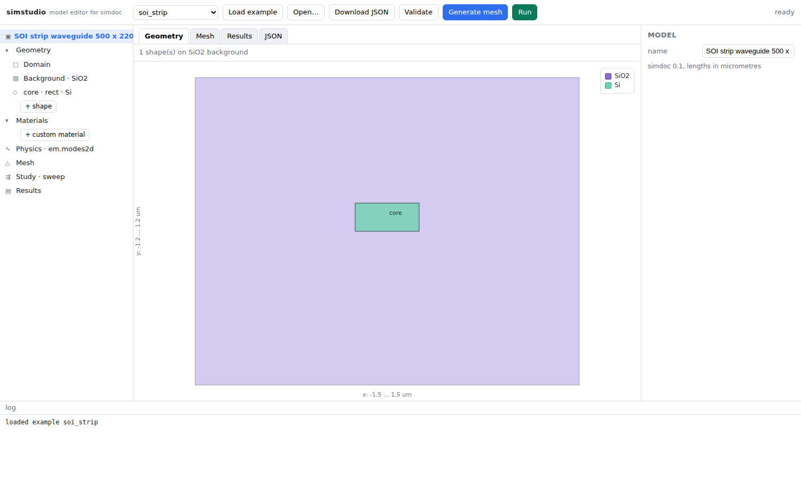
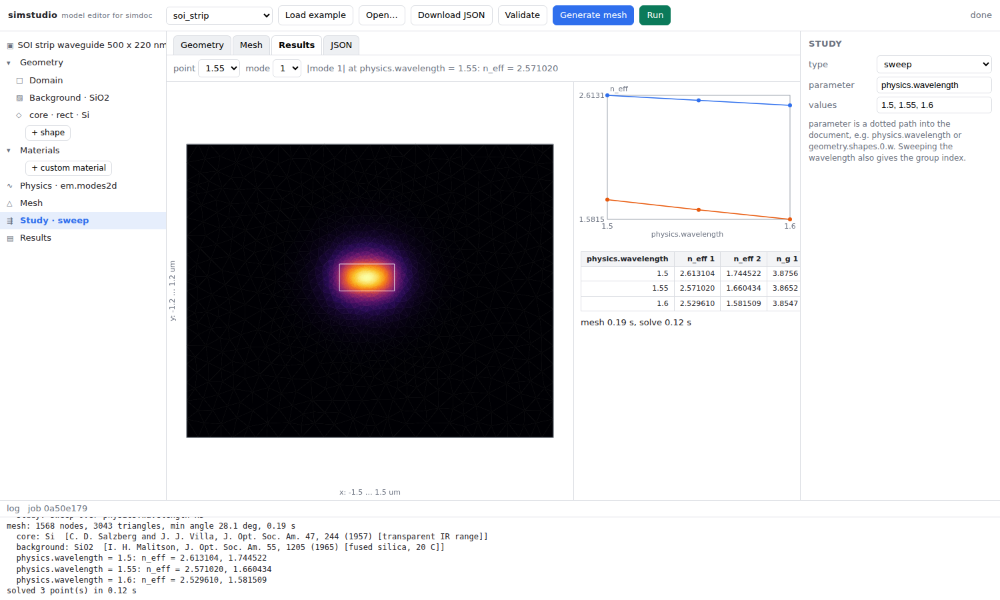

# simcase — the model document and its headless runner

**English** | [한국어](../../locales/ko/pages/packages/simcase/overview.md)

[Suite documentation](https://github.com/fieldalgo/openphysics/blob/main/docs/README.md)

`simcase` defines a JSON model document and the engine that runs it. A document
holds geometry, materials, physics, mesh settings and the study; one command runs
it through meshine (mesh), physmat (materials) and galerkin (FEM) and writes
results. The browser UI that edits the document is
[an optional subpackage](#the-browser-ui) of the same install; the engine never
depends on it.

```bash
# From the repository root; installs the local runtime packages together.
python -m pip install -e packages/meshine -e packages/physmat -e packages/galerkin -e packages/simcase
python -m simcase example soi_strip > model.json
python -m simcase validate model.json
python -m simcase run model.json                          # -> model_results/
python -m simcase geometry model.json                     # the region complex of a version 1 geometry block
```

The package and CLI are named `simcase`. The JSON version field is `"openphysics": "0.3"`; it is
not an import or distribution name. Format `"0.3"` (values with units, registry
quantity names, a `length_unit` per geometry component, coded diagnostics) is read for heat
(`thermal.steady2d` and `thermal.transient2d`: rectangles, material regions, version 1 blocks and
the axisymmetric forms) and for electric conduction and Joule heating (`electric.steady2d`,
`joule.steady2d` and `joule.temperature2d`: rectangles, and material regions for the first two)
and for mechanics (`mechanics.elasticity2d` and `mechanics.thermoelastic2d`: rectangles and
material regions) and for waveguide modes (`em.modes2d`: flat shapes and version 1 blocks, scalar,
vector, PML, bends, tracked and subspace sweeps) and for rectangular cavities (`em.cavity3d`: the
vacuum PEC box, box materials and conducting walls). No kind reads format 0.2 any more: a 0.2
document is refused by name (`E-FORMAT`) with what to write instead: [document format 0.3](document_format.md). The separate
`openphysics` distribution is the complete product from 0.0.2: it installs the
OpenPhysics packages with Studio and provides the `openphysics` command; the 0.0.1
on PyPI is an empty name reservation. See the
[repository setup](https://github.com/fieldalgo/openphysics/blob/main/README.md)
for the full development install. The editable paths above require a monorepo
checkout; an individual sdist does not contain sibling packages or the repository
root. When installing downloaded artifacts, pass their paths to pip together with
local artifacts for the sibling dependencies.

`model_results/` contains `summary.json` (SI values with their units: the vacuum wavelength and
effective index per study point, group index, mesh statistics, timings, diagnostics),
`fields.npz` (node coordinates in metres and the mode fields), `results.png` (mesh, mode, sweep),
`log.txt`, and the document as written (`model.json`).

## Supported documents

The runner accepts one physics entry per document. `python -m simcase example <name>`
prints a supplied example.

| Physics type | What it solves | Examples | Contract |
|---|---|---|---|
| `em.modes2d` | 2D waveguide modes with passive absorption, scalar or full vector; single points and wavelength sweeps with mode tracking | `soi_strip`, `slab_te_check`, `fiber`, `hadley_rib`, `hadley_rib_vector`, `vector_slab`, `vector_fiber`, `vector_slab_sweep`, `vector_fiber_subspace_sweep` | This page; [subspace tracking](vector_subspace_tracking.md) |
| `em.cavity3d` | Rectangular-box eigenmodes: vacuum PEC, or lossy box materials and conducting walls with complex frequencies and Q; SI JSON/NPZ output | `cavity_box`, `cavity_lossy_slab` | [Cavity document](cavity3d.md) |
| `electric.steady2d` | Steady conduction: a homogeneous rectangle, or material regions of a geometry block | `electric_rectangle` | [JSON/CLI](electric_joule.md) |
| `joule.steady2d` | Constant-property steady Joule heating: a homogeneous rectangle, or material regions | `joule_rectangle` | [JSON/CLI](electric_joule.md) |
| `joule.temperature2d` | Temperature-dependent steady Joule heating | `joule_temperature` | [JSON/CLI](electric_joule.md) |
| `mechanics.elasticity2d` | Static linear elasticity of a homogeneous rectangle: plane stress or strain, side displacement components, Cartesian side tractions, constant body force | `elastic_plate` | [JSON/CLI](mechanics2d.md) |
| `mechanics.thermoelastic2d` | Steady heat with side-constant boundary data, then thermal stress on the same mesh with total side tractions | `thermoelastic_bar` | [JSON/CLI](mechanics2d.md) |
| `mechanics.elasticity2d` with regions | Static linear elasticity with named material regions (E and ν from the materials table) and the boundary names of region heat: displacements, Cartesian tractions and gauge pressures | `elastic_regions` | [Region documents](mechanics2d.md#material-regions-and-named-boundaries) |
| `mechanics.thermoelastic2d` with regions | Region heat, then thermal stress with per-material E, ν and α on the same mesh | `thermoelastic_regions` | [Region documents](mechanics2d.md#material-regions-and-named-boundaries) |
| `thermal.steady2d` | Steady homogeneous rectangular heat: side Dirichlet, insulation, constant outward flux and convection | `thermal_slab`, `thermal_mixed`, `thermal_boundary` | [Steady heat](thermal_steady2d.md), [boundaries](thermal_steady_boundary2d.md) |
| `thermal.steady2d` with regions | Steady heat with named material regions: shapes over a background, a materials table, a mesh that follows region boundaries | `thermal_regions` | [Region documents](thermal_regions2d.md) |
| `thermal.transient2d` | Transient homogeneous rectangular heat: backward Euler, explicit times, constant or sampled side Dirichlet, insulation, constant outward flux and convection | `transient_thermal_uniform`, `transient_thermal_boundary` | [Transient heat](thermal_transient2d.md) |
| `thermal.transient2d` with regions | Transient heat with named material regions, per-material conductivity and heat capacity | `transient_thermal_regions` | [Region documents](thermal_regions2d.md) |

Studio edits and runs 2D optical models and has dedicated views for steady and
transient heat documents, rectangular or with material regions (the latter
within Studio's region limits); it rejects cavity documents. Coupled or
multiple-physics runs, geometry, mesh and material sweeps and mechanics
documents are not
supported; `em.cavity3d` accepts lossy box materials.

For complex indices, attenuation units and selection, see [absorbing modes](lossy_modes.md).

## The document

```json
{
  "openphysics": "0.3",
  "name": "SOI strip waveguide 500 x 220 nm",
  "geometry": {
    "length_unit": "um", "depth": null,
    "domain": {"xmin": -1.5, "xmax": 1.5, "ymin": -1.2, "ymax": 1.2},
    "background": {"material": "physmat:SiO2"},
    "shapes": [
      {"name": "core", "type": "rect", "x": -0.25, "y": 0.0, "w": 0.5, "h": 0.22, "material": "physmat:Si",
       "element_size": "0.02 um"}
    ]
  },
  "materials": {"myglass": {"refractive_index": 1.5}},
  "physics": {
    "em1": {"type": "em.modes2d", "formulation": "vector", "vacuum_wavelength": "1.55 um", "mode_count": 2,
            "effective_index_threshold": 1.45,
            "boundary": {"left": "pec", "right": "pec", "top": "pec", "bottom": "pec"}}
  },
  "mesh": {"element_size": "0.25 um",
           "grading": {"position": ["0 um", "0.11 um"], "near": "0.02 um", "far": "0.16 um",
                       "refinement_distance": "1 um"}},
  "study": {"type": "sweep", "parameter": "physics.em1.vacuum_wavelength",
            "values": {"unit": "um", "values": [1.4, 1.45, 1.5, 1.55, 1.6, 1.65, 1.7]}}
}
```

`geometry.length_unit` says what the shape and domain numbers mean; every other length carries
its own unit (`"1.55 um"`, `"1550 nm"`, `"1.55e-6 m"`; the vacuum wavelength takes nm, um or m),
and a dimensional value without its unit is refused (`E-UNIT-MISSING`). `depth` is `null` (a
cross-section). Library materials are written with their exact physmat name
(`"physmat:Si"`); a bare name is a local record in `materials`, whose `refractive_index` is a
number, `{"n": .., "k": ..}` (n + i k under exp(−iωt): k ≥ 0 is absorption, a negative k is
refused with `E-GAIN`) or a dispersion model. `physics` is a map of named physics, and a sweep
parameter names one of them. Results are SI under exp(−iωt): node coordinates and vacuum
wavelengths in metres, the propagation loss in dB/m.
CLI summaries, saved plots and Studio geometry/mesh/result labels use the component's
length unit (or `display_units.length`); this changes labels, not the stored numbers.
Built-in material previews take and return vacuum wavelengths in metres.
For `em.modes2d`, geometry, meshing and the mode solve run in micrometres whatever the
document declares (the kernel frame, under exp(+iωt)): every length goes to micrometres once
from its exact value (`float(exact × 10⁶)`), and results come back in SI as the micrometre
values times 1e-6, with every complex value conjugated once. The same device written in `nm`,
`um` or `m` therefore gives bit-identical meshes and results (P2-5) whenever its numbers are
the same decimals (such as 1550 nm, 1.55 um and 1.55e-6 m); a hand-back value is the kernel's
micrometre double times 1e-6 (2.2e-07 written as `"0.22 um"` comes back as 2.2e-07 in
`resolved_inputs` but as 2.1999999999999998e-07 in a result computed from the kernel value).
The schema can represent multiple entries, but the current runner requires
exactly one and rejects coupled or multiple-physics runs.

Shapes are `rect`, `circle` or `polygon`; later
shapes cut earlier ones and the background fills what is left (the boolean
work is done with shapely). A circle that nothing overlaps is meshed as an
exact circle. A material is a local record in `materials`, or a physmat built-in written with
its exact name (`"physmat:Si"`, `"physmat:SiO2"`, `"physmat:Au"`, ...), whose dispersion is
applied automatically at every wavelength of a sweep. `study.parameter` must be an
existing dotted path under `physics.`; the wavelength is `physics.<name>.vacuum_wavelength`,
whose values are a tagged array (`{"unit": "um", "values": [...]}`). Geometry, mesh and material sweeps are
rejected because the mesh is built once. Sweeping a wavelength also yields the
group index.

For optical modes the physics is `em.modes2d`, either `scalar` (exact for TE slab modes,
an approximation for 2D high-contrast cores) or full `vector` for single points
and tracked wavelength sweeps. The supplied `soi_strip` uses `vector`. The scalar
approximation is far off for such a core: the same document solved as `scalar`
gives n_eff 2.611 at 1.55 um instead of 2.444. On the low-contrast Hadley rib,
`hadley_rib` (scalar) lands 4e-5 from the published value on its mesh, but
refining the mesh moves it away (1.4e-4 at 0.65x); `hadley_rib_vector` is 2.0e-4
below it and approaches it on refinement (1.1e-4 at 0.65x). Both paths accept passive absorption; see the lossy-mode contract for signs and complex output. Scalar boundaries are
`pec` (field = 0) or `pmc` (natural). Vector PEC fixes tangential electric field
and Ez; PMC is natural. These are different field conditions: changing only the
formulation of a scalar slab can select a different polarization.

### Vector fields and single-point studies

```bash
python -m simcase example vector_slab > vector.json
python -m simcase run vector.json -o vector_results
```

`vector_slab` is a 220 nm dielectric slab with electric side walls, selecting
the TE family. Change its left/right boundaries to `pmc` for the TM family.
`vector_fiber` requests six fields, including degenerate partners.

The physics entry requires `"formulation": "vector"` and a finite positive
`effective_index_threshold`. This dimensionless number is the user-specified lower bound of
the guided-mode search interval at the selected wavelength. For a simple
asymmetric slab use the larger substrate/cover index; for a fiber use the
exterior cladding index. More general structures can have slab/radiation
channels with a higher effective index and need a correspondingly chosen bound.
The upper bound is the largest material index in the mesh. There is no automatic
inference from the smallest material index.

Only isotropic, nonmagnetic dielectrics with real, finite, positive permittivity
are supported. Modes are searched near the maximum index, filtered to the open
interval `(effective_index_threshold, n_max)` and sorted by descending n_eff. If fewer than
`mode_count` are found, the result contains that actual count and a log warning;
zero modes is an error. This is a bounded search, not proof that all guided
modes were found. A finite PEC/PMC computational wall is not an open boundary:
check domain padding as well as mesh convergence for your geometry.

Use `"study": {"type": "single"}` for an independent point. Wavelength sweeps
require the resolved-mode tracking contract below; other vector sweeps are rejected.

`RunResult.mode_fields` holds the nodal scalar fields of scalar results
and is empty for vector results. Vector data is in `RunResult.vector_fields`,
one public `VectorField` object per study point (SI, exp(−iωt)):

| Attribute | Shape | Meaning |
|---|---|---|
| `edges` | `(edges, 2)` | Node pairs, oriented from lower to higher node index |
| `transverse` | `(edges, modes)` | Transverse electric-field line integrals in metres |
| `longitudinal` | `(nodes, modes)` | Complex Ez, including its phase relative to Ex/Ey |
| `electric` | `(triangles, modes, 3)` | Complex Ex/Ey/Ez at triangle centroids |

Each mode has one common scale: maximum centroid `|E| = 1`. Amplitudes are
relative, not V/m or normalized power. All components share this scale; Ez is
in quadrature with the transverse field for these lossless modes. Centroid
values stay per element, preserving interface discontinuities. Raw edge/nodal
coefficients retain the finite-element field for reconstruction elsewhere.

Vector `fields.npz` contains `edges`, `unnormalized_electric_field_line_integral` (m),
`unnormalized_electric_field_z` and `unnormalized_electric_field` (x, y, z; unit 1); the
three field arrays have an extra leading study-point axis. They load with
`numpy.load(..., allow_pickle=False)`. The scalar `unnormalized_mode_field` is absent for
vector data. `field_representation="vector-edge-nodal-v2"` in the archive and summary
identifies this layout. Summary metadata includes `mode_count`, `returned_mode_count`,
the normalization and `field_units` (every array's unit; `node_coordinates` in m). Every
`em.modes2d` result, scalar or vector, records the saved file layout
`field_layout="em-modes2d-p1-node-centroid-v2"` (P1 nodal fields; vector results add the
centroid electric field), `node_coordinates` in metres, `vacuum_wavelength` (m, one per study
point), `effective_index` (complex when lossy or with PML, Im n_eff ≥ 0 being loss) and
`study_parameter` (the swept path, `""` for a single point); a sweep of another slot adds
`study_values`. A subspace sweep records `field_layout="em-modes2d-subspace-raw-v2"` instead.
Results saved before the units batch (layout `-v1`) are refused by name by the exporters.

### Mode post-processing

Every scalar or vector `em.modes2d` result without PML also saves, per study
point `p` and mode `m`, three additional arrays computed with
[`galerkin.mode_overlap`](../galerkin/mode_overlap.md) in the kernel frame (the micrometre
mesh, exp(+iωt)) and then converted once to SI under exp(−iωt): areas times 1e-12, complex
values conjugated (`simcase.mode_postprocessing` states the exact recipe, and
`tests/simcase/test_modes_postprocessing.py` checks that the saved values are those calls,
converted once):

| Key | Shape | Meaning |
|---|---|---|
| `unnormalized_mode_power` (vector, W) or `unnormalized_mode_field_square_integral` (scalar, m^2) | `(points, modes)` | vector: the complex Poynting integral `P = 1/2 int (E x H*) . z dA` of the saved field read as V/m (`vector_power`, `k0 = 2 pi / wavelength`, `mu_r = 1`); scalar: `int |phi|^2 dA` (`scalar_power`, real) |
| `confinement_factor` | `(points, modes, regions)` | energy fraction per region in `region_names` order: `int_R Re(eps_r) |E|^2 / int Re(eps_r) |E|^2` (`confinement_factor`); scalar: `int_R |phi|^2 / int |phi|^2`. Rows sum to 1 |
| `unnormalized_field_overlap` | `(points, modes, modes)` | `<E_a, E_b> = int conj(E_a) . E_b dA` in m^2 (`overlap_matrix(..., "field")`, Hermitian; scalar: `scalar_overlap`); the diagonal is `int |E|^2 dA`, which for scalar results equals the square integral |
| `coupling_efficiency` | `(points, modes)` | only with `results.mode_overlap.gaussian`: `|<E_mode, E_in>|^2 / (<E_mode, E_mode> <E_in, E_in>)` of a Gaussian input (`coupling_efficiency` after `interpolate_vector_field`; scalar: `scalar_coupling_efficiency` at the nodes) |

The saved amplitudes are relative, hence "unnormalized": read the vector amplitudes as V/m;
`unnormalized_mode_power` is then the power of that field in watts, `Re` the time-averaged
power carried in +z. Dividing a saved mode by `sqrt(Re unnormalized_mode_power)` gives a field
that carries 1 W. For a lossless mode the imaginary part is roundoff; for a lossy mode
(complex `effective_index`) it is the reactive part and the modes are not power-orthogonal.
`confinement_factor` and `coupling_efficiency` are dimensionless. `summary.json` repeats the
values under `mode_postprocessing` as value objects with a `unit` and `description` per key
(complex values as `re`/`im` with `time_convention`, `confinement_factor` with its region names).

The optional document block

```json
"results": {"mode_overlap": {"gaussian": {"beam_waist_radius": "0.22 um", "position": ["0 um", "0.11 um"]}}}
```

adds `coupling_efficiency` for the input field
`exp(-((x - x0)^2 + (y - y0)^2) / w^2)`, with `w = beam_waist_radius` the 1/e field radius
and `position = [x0, y0]`, each a length with its unit. For vector results the input is
x-polarised and compared with the transverse mode field alone; for scalar
results it is a scalar amplitude. The waist must be positive, the centre must
lie inside the geometry window and no other key is accepted under
`mode_overlap` or `gaussian`. PML results and subspace sweeps gain none of
these keys: PML coefficients are covariant integrals in stretched coordinates,
so the lossless Poynting formula over the window is not the physical power, and
subspace frames are not modes ([PML modes](pml_modes.md),
[subspace tracking](vector_subspace_tracking.md)). The VTU export is unchanged
and writes the fields only; read the post-processing from `fields.npz` or
`summary.json`.

Studio receives `vector_fields` (`name="unnormalized_electric_field"`,
`location="triangle_centroids"`, components `x`, `y`, `z`, unit `1`, `time_convention`) with
separate `real`/`imag` arrays shaped `(modes, triangles, 3)` per point, and node coordinates
in metres. Scalar results arrive as `unnormalized_mode_field` (real and, when complex,
imaginary parts per point); for vectors it is empty.
Select `|E|`, `|Ex|`, `|Ey|` or `|Ez|` to display magnitudes on a common |E|
color scale. The saved PNG displays |E|; the archive preserves complex components.
`VectorField.to_dict()` produces the same JSON-safe display samples.

### Tracked vector wavelength sweeps

```bash
python -m simcase example vector_slab_sweep > sweep.json
python -m simcase run sweep.json -o sweep_results
```

For vector physics, the sweep parameter must be exactly
`physics.<name>.vacuum_wavelength`. Supply at least three finite positive values in
strictly increasing or decreasing order (a tagged array, such as
`{"unit": "nm", "values": [1450, 1500, 1550]}`); unequal spacing is supported. The
mesh, materials, boundary conditions, `mode_count` and `effective_index_threshold`
remain fixed. Material dispersion is evaluated at each wavelength. The fixed
`effective_index_threshold` must bound the exterior/slab radiation channels over the **whole
interval**, including dispersive claddings. A conservative upper envelope may
exclude weakly guided modes; the starting wavelength's cladding value alone
may admit unwanted exterior modes later.

The first point seeds `mode_count` branches in descending n_eff order. Subsequent
points search extra guided candidates and match those branches by a global
one-to-one assignment that maximizes the sum of squared normalized overlaps:

```text
<E_a,E_b> = transverse_a^H M_edge transverse_b + Ez_a^H M_node Ez_b
score(a,b) = |<E_a,E_b>|^2 / (<E_a,E_a> <E_b,E_b>)
```

The mass matrices use the original fixed mesh and the physical raw field
coefficients. This is an electric L2 continuity metric, not a power or energy
overlap. One common complex phase aligns each matched field with its predecessor;
all raw coefficients and centroid components receive that phase. Distinct
eigenfields are not mixed. Result columns retain the initial branch identities,
so later rows need not be sorted by n_eff.

Optional settings live under `study.tracking`:

| Setting | Default | Meaning |
|---|---|---|
| `search_mode_count` | `max(2*mode_count, mode_count+4)` | Guided candidate budget; integer greater than `mode_count` |
| `mode_tracking_threshold` | `0.8` | Minimum selected squared normalized overlap, in `(0,1]` |
| `mode_tracking_margin_threshold` | `0.1` | Minimum full-assignment score gap, in `(0,1]` |
| `degeneracy_tolerance` | `1e-5` | Non-negative absolute n_eff separation tolerance |

Defaults applied are echoed in `summary.json` `defaults_applied` with their reasons.

For each selected match, the margin compares the best total assignment score
with the best complete assignment that excludes that match. If no alternative
exists, the margin is `null`. Settings are numerical diagnostics, not error
bounds. In particular, the degeneracy tolerance should reflect the mesh's index
accuracy; reducing it does not resolve a physically degenerate pair.

A sweep raises `ModeTrackingError` when it cannot retain the requested count,
overlap is weak, assignment is ambiguous, or a selected candidate has a
near-degenerate partner (including an unselected candidate). A selected mode at
the last rank of a saturated candidate search also fails: increase `search_mode_count`
to check for an unseen partner. The search is bounded, not an exhaustive spectral
proof. Continuation through cutoff is not implemented. The fiber's two HE11
partners are intentionally rejected by the default tracker even when only one
is requested; inspect them with independent single studies, or track their
span with the opt-in [subspace method](vector_subspace_tracking.md).

Tracking failures identify the wavelength, reason and a next action. Numerical
solver failures retain the wavelength and underlying reason. The CLI exits
nonzero without writing a new result; Studio reports a failed job with no result
and clears previous displayed fields. No partial group-index array, padded
missing mode or arbitrary branch through a degeneracy is returned.

After every point succeeds, `group_index()` computes
`n_g = n_eff - wavelength * d(n_eff)/d(wavelength)` on each tracked column,
using second-order finite differences including the endpoints (computed on the kernel's
micrometre wavelengths, so the same in any length unit). The existing
scalar derivative behavior is unchanged. **Check both mesh/domain and wavelength
spacing convergence.** High endpoint overlap cannot rule out an avoided crossing
or cutoff between sparse samples and does not certify a derivative's accuracy.

`RunResult.mode_tracking` and `summary.json.mode_tracking` contain
`method="electric-l2-assignment-v1"`, resolved settings and a record per point:
candidate count, selected one-based candidate ranks, overlaps and assignment
margins. At the seed point overlaps/margins are `null`. Candidate ranks are not
branch identities. Studio receives this metadata in `summary`, shows branch
labels and overlap, and displays n_g for every tracked branch.

The vector field layout is `vector-edge-nodal-v2`, with one entry per
sweep point and a constant tracked mode count. NPZ adds `group_index` and a
Unicode scalar `mode_tracking_json` (parse with `json.loads(str(array))`; its settings
use the names above, and `minimum_principal_squared` is the one renamed evidence key). Raw
complex fields, samples and `effective_index` all share the tracked column order. These
tracking additions are absent from scalar and vector-single results.

### Custom optical materials

A custom material's `refractive_index` is a constant (`1.5`), a complex constant
`{"n": 1.5, "k": 0.01}` (n + i k under exp(−iωt): finite positive n, k ≥ 0 is absorption, a
negative k is gain and refused with `E-GAIN`), or a Sellmeier model:

```json
{"glass": {"source": "coefficient reference", "refractive_index": {
  "model": "sellmeier", "constant": 1.0,
  "terms": [{"strength": 0.7, "resonance_wavelength_squared": "0.01 um^2"},
            {"strength": 0.4, "resonance_wavelength_squared": "0.04 um^2"}],
  "valid": {"vacuum_wavelength": ["0.5 um", "2 um"]},
  "reference_medium": "vacuum"
}}}
```

The formula is `n² = constant + sum(strength[i] * wavelength² / (wavelength² - C[i]))` with
`C[i]` the `resonance_wavelength_squared` (or the square of `resonance_wavelength`; a term
takes exactly one of the two). `constant` (default 1, echoed in `defaults_applied`) and the
strengths are dimensionless; every length carries its unit, so the same model in nm writes
`"10000 nm^2"` and `["500 nm", "2000 nm"]`. The resolver converts each to physmat's
micrometres once, from its exact value. `valid.vacuum_wavelength` is `[lo, hi]` with lo > 0, or
`[null, hi]` for an open lower bound; omitting `valid` leaves the range unbounded.
`reference_medium` is required and only `"vacuum"` is read in this release; the `rii_formula`
model is refused by name. A model needs at least one term. The format 0.2 keys (`n`, `k`,
`sellmeier`, `A`, `B`, `C`, `range`) are refused with the new name. Malformed models fail
during document validation, before meshing or running.

## From Python

```python
from simcase import Document, run
doc = Document.load("model.json")
res = run(doc)
res.effective_index      # (study points, modes); Im >= 0 is loss under exp(-i omega t)
res.vacuum_wavelength    # (study points,), metres
res.group_index()        # when sweeping the wavelength
res.propagation_loss()   # dB/m: (40 pi / ln 10) Im(n_eff) / lambda0
res.save("out/")
```

`run` is a composition of stages that are public in their own right, so a front
end can mesh without solving and a caching layer can redo only what changed. The
stage API speaks SI:

```python
from simcase import build_mesh, solve_point, study_points
model = build_mesh(doc)                  # geometry -> mesh -> materials; model.tri.nodes in metres
eps = model.relative_permittivity(1.55e-6)   # per triangle, exp(-i omega t), at a vacuum wavelength in m
parameter, values = study_points(doc)    # ("physics.em1.vacuum_wavelength", [SI values]) for a sweep
point = doc if parameter is None else doc.with_value(parameter, values[0])
result = solve_point(model, point.si["physics"]["em1"])   # effective_index, vector_field or
                                                           # unnormalized_mode_field, in SI
```

`build_domain` returns the mesher's domain in the micrometre meshing frame (what meshine
receives); `MeshedModel.solver_mesh` is the micrometre kernel mesh (internal). `run` and
`solve_point` hand the mode kernel the same doubles (a test asserts it on `soi_strip`); a
tracked sweep searches `search_mode_count` candidates where `solve_point` asks for
`mode_count`. `simcase.physics_em_modes2d.solve` and `simcase.mode_postprocessing` are
kernel-frame internals (micrometres, exp(+iωt)), not public API.

For heat region documents, region electric conduction and steady Joule heating documents and mechanics region documents, `run` also takes optional mesh limits
(`max_input_vertices`, `max_nodes`, `max_triangles`), and `check_mesh_limits`
counts the loop vertices a document passes to the mesher without meshing it.
Both raise `MeshLimitError`. `region_complexity` counts shapes, circles,
polygon points and boundary crossings on the raw JSON, before
`Document.from_dict`. See [mesh limits for callers](thermal_regions2d.md#mesh-limits-for-callers).

## Heat and cavity documents

Named-region steady and transient heat documents also mesh in canonical
micrometres. Equivalent length inputs give identical SI meshes and fields in
the same numerical environment; heat results retain metre coordinates and
the saved model retains its original units. See the
[region heat contract](thermal_regions2d.md#mesh-and-solve).

The [cavity document contract](cavity3d.md) covers the `em.cavity3d` input (format 0.3:
`"250 MHz"`, `"58 MS/m"`, complex materials under exp(−iωt)), search limitations and the SI
JSON/NPZ result layouts `cavity3d-edge-v2` and `cavity3d-edge-complex-v2`.

The [thermal.steady2d contract](thermal_steady2d.md) describes homogeneous
rectangular steady heat documents (format 0.3: a geometry `length_unit` and a unit on every
value). Numeric SI NPZ arrays under registry names use a dedicated result version/layout and
load with `allow_pickle=False`; the constraint reaction is the heat it injects, and its
negative is the outward contribution. The
[steady boundary contract](thermal_steady_boundary2d.md) adds side-constant
inward heat flux and convection and the boundary identifiers and arrays; documents that use
neither key keep the plain pair. Empty prescribed temperatures require positive Robin
anchoring. Input temperatures are above 0 K; a negative computed temperature is not clamped.

The [`thermal.transient2d` contract](thermal_transient2d.md) defines a fixed
rectangle/P1, consistent mass/backward Euler, constant k/c/Q, explicit times,
uniform/affine initial temperatures, side-constant/sampled prescribed temperatures and
insulation. `run(Document)` returns `TransientThermalRunResult`. Results save
JSON/non-object NPZ histories with Nt frames, Nt-1 rates, SI units and version
metadata. Initial values are not projected and a negative computed temperature is not clamped.
Constant inward heat flux and convection sides (the steady contract's keys) save the
`thermal.transient2d-result-v4` / `thermal2d-transient-p1-node-cell-boundary-v2`
pair with two per-step heat rate arrays; time-dependent flux/Robin, restart and
automatic coupling are not supported.

### Saved output

Each saved run needs a fresh output directory, including no dangling symlink.
Keep exclusive control of it until save and cleanup finish: protection against
replacements observed before cleanup is tested, but a foreign replacement
between an ownership check and unlink is not guaranteed safe. Hostile
filesystem races and atomic rollback are outside acceptance. CI runs the heat
save and I/O robustness checks on Linux, macOS and Windows; see each contract
for its save and platform limits.

### Viewing in ParaView

With the optional extra `pip install "simcase[export]"` (meshio, MIT),
`simcase.export.export_fields("out/fields.npz", "out/view.vtu")` writes a VTU
copy of saved rectangular steady heat (prescribed and insulated sides, or the
`boundary-v3` layout with flux/convection sides and its nodal
`outward_prescribed_`, `ambient_convective_`, `outward_convective_` and
`applied_heat_rate_per_depth` arrays), rectangular transient heat (one stored time,
`time_index`, default the last; the `transient-p1-node-cell-boundary-v2` layout with
flux/convection sides adds its per-step `outward_prescribed_` and `outward_convective_` heat
rates) and
vacuum PEC cavity fields. Steady/transient material-region layouts (`-regions-v2`,
axisymmetric ones with (r, z) points) are also supported, with the same arrays,
integer cell data `triangle_regions` and the saved steady flux/convection arrays. See [region export](thermal_regions2d.md#vtu-and-pvd-export)
for units, the region-name mapping and an example. Electric conduction and Joule
results (`electric-joule2d-p1-v2`, the layout of `electric.steady2d`,
`joule.steady2d` and `joule.temperature2d`; the region layouts
`electric2d-p1-node-cell-regions-v2` and `electric-joule2d-p1-node-cell-regions-v2` add
`triangle_regions`) export point data `electric_potential` with the nodal
`joule_power_per_depth`, `reaction_current_per_depth`,
`outward_prescribed_current_per_depth` and `residual_current_per_depth` arrays, and cell
data `electric_field`, `current_density`, `electrical_conductivity` and
`joule_power_density`, all SI, with the FieldData `units` and `conventions` blocks; a Joule
result adds `temperature`, its nodal heat arrays and cell `heat_flux`, and
`joule.temperature2d` adds `evaluation_temperature`. The format 0.2 electric layouts
(`electric-joule2d-p1-v1` and the two `-regions-v1`) are refused by name. Elasticity results (`mechanics2d-p1-v2`, the layout of
`mechanics.elasticity2d`) export point data `displacement` and the nodal
`applied_force_per_depth`, `reaction_force_per_depth` and `residual_force_per_depth` vectors,
and the saved strain and stress components as scalar cell data under their component names
(`strain_xx`, `strain_yy`, `engineering_shear_strain_xy`, `stress_xx`, `stress_yy`,
`stress_xy`); thermoelastic results (`thermoelastic2d-p1-v2`) add `temperature`, the nodal
heat rates, the thermal-equivalent, body and traction force arrays, cell `heat_flux`,
`stress_zz`, `strain_zz` and the `thermal_strain_…` and `elastic_strain_…` components; both
carry the FieldData `units` and `conventions` blocks. The format 0.2 mechanics layouts
(`mechanics2d-p1-v1`, `thermoelastic2d-p1-v1`) are refused by name; region mechanics results
are not exported yet. A vacuum PEC cavity (`cavity3d-edge-v2`) exports its
`node_coordinates` in metres and each mode as the cell data
`mass_normalized_electric_field_mode_<k>` (1/m^(3/2), at tetrahedron centroids); Dirichlet
node lists and the summary are not copied. The cavity with materials
and lossy walls (`cavity3d-edge-complex-v2`) exports each complex mode as the
cell data `mass_normalized_electric_field_mode_<k>_real` and `..._imag`
(the saved normalization under exp(−iωt); VTK has no
complex arrays) and the materials as `relative_permittivity_real`/`_imag`
and `relative_permeability_real`/`_imag`; frequencies, quality factors and
wall conductivities stay in `fields.npz` and `summary.json`. Both carry the FieldData `units`
and `conventions` blocks. The format 0.2 cavity layouts (`cavity3d-edge-v1`,
`cavity3d-edge-complex-v1`) are refused by name. A single-point
waveguide mode result (`em-modes2d-p1-node-centroid-v2`, from `em.modes2d`; SI under
exp(−iωt)) is exported on its `node_coordinates` in metres. Each array is named by its
`fields.npz` name with the per-mode suffix `_mode_<k>` (zero-based) and, when complex, the
parts `_real`/`_imag`: a scalar result gives point data `unnormalized_mode_field_mode_<k>`
(complex when lossy or with PML); a vector result gives cell data
`unnormalized_electric_field_mode_<k>_real`/`_imag` (x, y, z at centroids, the saved
relative normalization with the largest centroid |E| = 1) and point data
`unnormalized_electric_field_z_mode_<k>_real`/`_imag` (nodal Ez). Every mode VTU adds the
integer cell data `regions` (indices into the summary's `regions`) and the FieldData `units`
and `conventions` blocks (with `time_convention` for complex parts). PML results use
the same layout; the mesh and so the arrays cover the absorbing layer, where the
fields are artificial. `effective_index`, `edges`, the edge line integrals,
tracking and open-boundary diagnostics stay in `fields.npz`. A result with
several study points is refused here and goes through `export_sweep`; the
subspace layout `em-modes2d-subspace-raw-v2` (raw eigenpair columns, not
tracked modes) is refused by both, and so is a `fields.npz` without a
`field_layout` array. Results saved before the units batch (`em-modes2d-p1-node-centroid-v1`,
`em-modes2d-subspace-raw-v1`) are refused by name: run their document again in format 0.3. 2D meshes get
z = 0, and 2D vectors a zero z component. `fields.npz` stays
the reference result; times, frequencies and units remain in it and in
`summary.json`. An existing VTU is never overwritten. XDMF is not offered
because meshio's XDMF writer needs h5py.

For a transient heat result,
`simcase.export.export_time_series("out/fields.npz", "out/paraview")` writes
every stored time: `fields_00000.vtu`, `fields_00001.vtu`, … and the ParaView
collection `fields.pvd`, which records each stored time (seconds) as its
timestep. Open `fields.pvd` in ParaView to step through time with the time
controls or play an animation. Each VTU holds the arrays stored at its time, so
the per-step rates (`reaction_heat_rate_per_depth`, `residual_heat_rate_per_depth`,
`heat_storage_rate_per_depth`, for rectangle and region results alike) appear from the
second time on. The heat VTU files also carry FieldData `units` and `conventions`
(UTF-8 JSON in a UInt8 array) with each array's SI unit and the sign sentences. The output directory must be new or empty and nothing is
overwritten; the collection refers to its VTU files by relative paths, so the
directory can be moved as a whole. `name="heat"` changes the file stem. No
dependency beyond meshio is needed: the `.pvd` is plain XML.

For a waveguide mode sweep,
`simcase.export.export_sweep("out/fields.npz", "out/paraview")` writes one VTU
per study point (`fields_00000.vtu`, …, with the arrays `export_fields` writes
for a single point) and the collection `fields.pvd`. Its timestep is the vacuum
wavelength in metres when the saved `study_parameter` is the wavelength and the values
are strictly monotone, which
every vector and PML sweep is; for a scalar sweep of another parameter, or one
whose values repeat or reverse, it is the point index. The values themselves
stay in `fields.npz`. The same directory, name and rollback rules apply.

## The browser UI

`simcase.studio` is the program part of the stack, and it is optional: a model
tree on the left, geometry / mesh / results views in the middle, a properties
panel on the right, a log at the bottom. It edits the same document a script
edits and asks a local server to mesh and run it with the same engine.

```bash
python -m pip install -e "packages/simcase[studio]"  # from the repository root, after the runtime install
simcase-studio                # http://127.0.0.1:8765, opens the browser
simcase-studio --workspace    # experimental model workspace at /workspace
python -m simcase.studio --port 9000 --no-browser
```

Open Studio at `http://127.0.0.1:<port>` or `http://localhost:<port>`: the
server refuses other host names and state-changing requests from other web
pages, and warns when `--host` is not a loopback address. Details are in the
[security notes](../../security.md#browser-studio).

The base install stays headless — `fastapi` and `uvicorn` arrive only with the
`studio` extra, so a batch or an HPC user never pulls a web stack to run a
document.




- Load an example, open a `.json` from disk, download the edited document.
- Model tree: Domain (with the geometry `length_unit`), Background, shapes (rect / circle /
  polygon, add, reorder, delete), custom materials, Physics, Mesh, Study, Results. Selecting a
  node shows an editable form; lengths are edited as quantity strings with their unit
  (`"1.55 um"`); every edit updates the geometry view and the JSON tab immediately, and the
  validator's coded diagnostics (such as `W-GEOMETRY-SCALE`) show up in the log.
- Materials: physmat's built-ins under their exact names (`physmat:Si`) with their source and
  validity range, plus document-level constant materials (n and k ≥ 0 under exp(−iωt)). Custom
  Sellmeier models can be entered in the JSON tab; their tree/property entries identify the
  model and direct coefficient edits to JSON.
- Generate mesh: meshine through the server, drawn by region, with node and
  triangle counts, minimum angle and mean quality.
- Run (optical models): a background job, then the mode field (selectable study point and mode),
  an n_eff-vs-parameter chart and a group-index table for wavelength sweeps.
  Vector results add a component selector and relative amplitudes; tracked
  sweeps identify branches and display their overlap and group indices. Lossy results show
  Im n_eff (positive is attenuation under exp(−iωt)) and the propagation loss in dB/m.
- JSON tab: edit the document by hand and apply.
- Heat: dedicated views for `thermal.steady2d` and `thermal.transient2d`
  documents. Steady heat shows the result mesh, nodal
  Kelvin and cell heat flux; transient heat adds requested-time selection and
  paged heat-content (H) and quadratic-functional (V) histories. Documents with
  material regions also show region colours and boundaries, a legend, a region
  table and the region under the cursor. See the [steady](thermal_studio.md) and
  [transient](thermal_transient_studio.md) Studio guides.

The original editor is a single HTML file with no build step and no external libraries
(canvas drawing only); a framework can come in when the UI grows. Web rather
than desktop so that any front end shares one UI over the same document format,
runs the same on a laptop or a server, and can reach other services over HTTP.

Not supported: mouse sketching and boolean CAD, a 3D viewer, mechanics forms,
geometry sweeps that regenerate the mesh, user accounts and projects saved on
the server. Studio is a local tool, not an authenticated multi-user service;
keep it off untrusted networks.

### The HTTP API

Used by the page, usable by anything else.

| method | path | purpose |
|---|---|---|
| GET | `/api/examples`, `/api/examples/{name}` | example documents |
| GET | `/api/quantities` | every registry quantity a document writes, with its canonical unit and its unit menu (from `simcase.quantities`), and the length units |
| GET | `/api/materials` | physmat built-ins under their exact `physmat:` names: valid vacuum wavelengths (m), source |
| POST | `/api/materials/preview` | n, k of a `physmat:` material over a vacuum wavelength interval in m |
| POST | `/api/validate` | `{doc}` -> `{ok: true, summary, doc, diagnostics}` or `{ok: false, error, diagnostics}`; `doc` is the document as sent, every number with its written digits |
| POST | `/api/mesh` | `{doc}` -> `node_coordinates` (m) with `field_units`, `display`, triangles, regions, boundary edges, stats, `diagnostics` |
| POST | `/api/run` | `{doc}` -> `{job}`; runs in a background thread |
| GET | `/api/jobs/{id}` | status and log lines |
| GET | `/api/jobs/{id}/result` | `effective_index`, `group_index`, `propagation_loss` (the summary's series), `vacuum_wavelength`, fields, `node_coordinates` (m), timings, summary |

Every route that takes a document reads the request's raw bytes with `simcase.reader`:
a duplicate key, `NaN`, `Infinity`, malformed JSON, text that is not UTF-8 and a string with an
escaped unpaired surrogate (`"\ud800"`) are refused with their code (`E-KEY-DUPLICATE`, `E-JSON`;
status 400, and a duplicate key inside the document is a diagnostic of `/api/validate`), a leading
UTF-8 byte order mark is accepted, and a number keeps its written digits, so an unchanged document
comes back byte for byte apart from whitespace and the spelling of string escapes (`"\u00b5"`
comes back as `"µ"`).

The steady and transient heat views use their own capability, validation, run and
result routes; see the [steady](thermal_studio.md) and
[transient](thermal_transient_studio.md) Studio guides.

`simcase.studio` may use only simcase's public API — the names in
`simcase.__all__`, never a module underneath it. A test enforces that. It keeps
the UI a consumer of the engine rather than a part of it, so it can be lifted
back out into its own distribution as a move rather than a rewrite; when the UI
needs something the engine does not export, the engine exports it on purpose.

The [experimental model workspace](workspace.md) is available at `/workspace` on the same server. It uses native JavaScript modules and a separate capability contract; the original optical and heat editors remain available.

The experimental [geometry lab](geometry_lab.md) at `/geometry-lab` edits the parameters of a version 1 geometry document and draws the exact engine's region complex; it is a separate page and runs no physics.

## Self-checks

```bash
# From the repository root after the development install in the repository README.md
python -m pytest -q tests/simcase
node --test tests/simcase/*.cjs   # Studio JavaScript checks
```

Documents round-trip through JSON; malformed documents are rejected with
specific messages; boolean geometry tiles the domain exactly (areas checked);
untouched circles keep their nodes on the true circle; and three documents
run end to end against references: a 220 nm Si slab reproduces refsol's TE0
to 1.5e-3 (P1 discretisation), a step-index fiber reproduces the LP01/LP11
scalar modes to 2e-4, and the scalar Hadley rib comes within 5e-4 of the published
quasi-TE value (the remaining gap is the scalar approximation; the vector rib is
checked to 2e-4 relative and to improve on refinement). Sweeps give
falling n_eff and n_g > n_eff. The heat documents have their own independent
validation reports, linked below.

The studio's endpoints are tested with FastAPI's test client, including a full
run job whose n_eff matches the slab reference; those tests skip when the
`studio` extra is not installed. CI also runs a small model in a real browser
against the installed packages.

## Where this sits

```
simcase.studio ->  edits the document     (optional simcase[studio] extra)
script / CLI  ->  runs the document      simcase.run
                     |-- meshine   geometry -> mesh
                     |-- physmat   material names -> eps(lambda)
                     |-- galerkin  assembly + eigenproblem
                     '-- refsol    references (tests)
```

## Documentation

| Topic | English | 한국어 |
|---|---|---|
| Package overview | [Overview](overview.md) | [한국어](../../locales/ko/pages/packages/simcase/overview.md) |
| Waveguide tutorial | [Analyse your own waveguide](waveguide_tutorial.md) | [한국어](../../locales/ko/pages/packages/simcase/waveguide_tutorial.md) |
| Vector subspace tracking | [Guide](vector_subspace_tracking.md) | [한국어](../../locales/ko/pages/packages/simcase/vector_subspace_tracking.md) |
| Cavity documents | [Contract](cavity3d.md) | [한국어](../../locales/ko/pages/packages/simcase/cavity3d.md) |
| Steady heat documents | [Contract](thermal_steady2d.md) | [한국어](../../locales/ko/pages/packages/simcase/thermal_steady2d.md) |
| Steady heat validation | [Report](thermal_simcase_independent_validation.md) | [한국어](../../locales/ko/pages/packages/simcase/thermal_simcase_independent_validation.md) |
| Steady boundaries | [Contract](thermal_steady_boundary2d.md) | [한국어](../../locales/ko/pages/packages/simcase/thermal_steady_boundary2d.md) |
| Steady boundary validation | [Report](steady_boundary_independent_validation.md) | [한국어](../../locales/ko/pages/packages/simcase/steady_boundary_independent_validation.md) |
| Heat region documents | [Contract](thermal_regions2d.md) | [한국어](../../locales/ko/pages/packages/simcase/thermal_regions2d.md) |
| Transient heat documents | [Contract](thermal_transient2d.md) | [한국어](../../locales/ko/pages/packages/simcase/thermal_transient2d.md) |
| Steady heat Studio | [Guide](thermal_studio.md) | [한국어](../../locales/ko/pages/packages/simcase/thermal_studio.md) |
| Steady Studio validation | [Report](studio_thermal_independent_validation.md) | [한국어](../../locales/ko/pages/packages/simcase/studio_thermal_independent_validation.md) |
| Transient heat Studio | [Guide](thermal_transient_studio.md) | [한국어](../../locales/ko/pages/packages/simcase/thermal_transient_studio.md) |
| Transient Studio validation | [Report](studio_transient_thermal_independent_validation.md) | [한국어](../../locales/ko/pages/packages/simcase/studio_transient_thermal_independent_validation.md) |

## License

Apache License 2.0 - see [LICENSE](../../../packages/simcase/LICENSE) and [NOTICE](../../../packages/simcase/NOTICE).

Copyright 2026 Yongha Kim (FieldAlgo)
