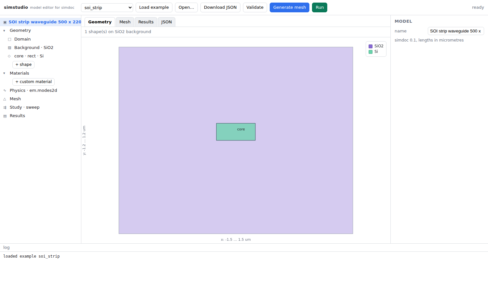

# simcase — the model document and its headless runner

**English** | [한국어](../../locales/ko/pages/packages/simcase/overview.md)

[Suite documentation](https://github.com/fieldalgo/openphysics/blob/main/docs/README.md)

`simcase` defines a JSON model document and the engine that runs it. A document
holds geometry, materials, physics, mesh settings and the study; one command runs
it through meshine (mesh), physmat (materials) and galerkin (FEM) and writes
results. The browser UI that edits the document is
[an optional subpackage](#the-browser-ui) of the same install; the engine never
depends on it.

```bash
# From the repository root; installs the local runtime packages together.
python -m pip install -e packages/meshine -e packages/physmat -e packages/galerkin -e packages/simcase
python -m simcase example soi_strip > model.json
python -m simcase validate model.json
python -m simcase run model.json                          # -> model_results/
```

The package and CLI are named `simcase`. The JSON version field remains
`"openphysics": "0.2"`; it is not an import or distribution name. The separate
`openphysics` distribution is only a name reservation. See the
[repository setup](https://github.com/fieldalgo/openphysics/blob/main/README.md)
for the full development install. The editable paths above require a monorepo
checkout; an individual sdist does not contain sibling packages or the repository
root. When installing downloaded artifacts, pass their paths to pip together with
local artifacts for the sibling dependencies.

`model_results/` contains `summary.json` (declared units, n_eff per study point, group index,
mesh statistics, timings), `fields.npz` (mesh and mode fields), `results.png`
(mesh, mode, sweep), `log.txt`, and a copy of the document.

## Supported documents

The runner accepts one physics entry per document. `python -m simcase example <name>`
prints a supplied example.

| Physics type | What it solves | Examples | Contract |
|---|---|---|---|
| `em.modes2d` | Lossless 2D waveguide modes, scalar or full vector; single points and wavelength sweeps with mode tracking | `soi_strip`, `slab_te_check`, `fiber`, `hadley_rib`, `hadley_rib_vector`, `vector_slab`, `vector_fiber`, `vector_slab_sweep`, `vector_fiber_subspace_sweep` | This page; [subspace tracking](vector_subspace_tracking.md) |
| `em.cavity3d` | Rectangular-box eigenmodes: vacuum PEC, or lossy box materials and conducting walls with complex frequencies and Q; SI JSON/NPZ output | `cavity_box`, `cavity_lossy_slab` | [Cavity document](cavity3d.md) |
| `thermal.steady2d` | Steady homogeneous rectangular heat: side Dirichlet, insulation, constant outward flux and convection | `thermal_slab`, `thermal_mixed`, `thermal_boundary` | [Steady heat](thermal_steady2d.md), [boundaries](thermal_steady_boundary2d.md) |
| `thermal.steady2d` with regions | Steady heat with named material regions: shapes over a background, a materials table, a mesh that follows region boundaries | `thermal_regions` | [Region documents](thermal_regions2d.md) |
| `thermal.transient2d` | Transient homogeneous rectangular heat: backward Euler, explicit times, constant or sampled side Dirichlet, insulation | `transient_thermal_uniform` | [Transient heat](thermal_transient2d.md) |
| `thermal.transient2d` with regions | Transient heat with named material regions, per-material conductivity and heat capacity | `transient_thermal_regions` | [Region documents](thermal_regions2d.md) |

Studio edits and runs 2D optical models and has dedicated views for rectangular
steady and transient heat; it rejects cavity documents and heat documents with
material regions. Coupled or multiple-physics runs, geometry, mesh and material
sweeps, lossy optical materials in `em.modes2d` and mechanics documents are not
supported; `em.cavity3d` accepts lossy box materials.

## The document

```json
{
  "openphysics": "0.2",
  "name": "SOI strip waveguide 500 x 220 nm",
  "units": {"length": "um"},
  "geometry": {
    "domain": {"xmin": -1.5, "xmax": 1.5, "ymin": -1.2, "ymax": 1.2},
    "background": {"material": "SiO2"},
    "shapes": [
      {"name": "core", "type": "rect", "x": -0.25, "y": 0.0, "w": 0.5, "h": 0.22, "material": "Si", "mesh_size": 0.02}
    ]
  },
  "materials": {"myglass": {"n": 1.5}},
  "physics": {
    "em1": {"type": "em.modes2d", "formulation": "vector", "wavelength": 1.55, "num_modes": 2,
            "n_cladding": 1.45,
            "boundary": {"left": "pec", "right": "pec", "top": "pec", "bottom": "pec"}}
  },
  "mesh": {"size": 0.25, "grading": {"center": [0.0, 0.11], "near": 0.02, "far": 0.16, "distance": 1.0}},
  "study": {"type": "sweep", "parameter": "physics.em1.wavelength", "values": [1.4, 1.45, 1.5, 1.55, 1.6, 1.65, 1.7]}
}
```

`units` declares one symbol per SI base dimension the physics needs; every
number in the document is then a bare number in that system, and a dimension
the physics requires but the document does not name is an error rather than a
silent metre. `physics` is a map of named physics, and a sweep parameter names
one of them.
CLI summaries, saved plots and Studio geometry/mesh/result labels use the declared
length unit, including numeric declarations such as `{"length": {"in_m": 1e-10}}`.
This changes labels, not the stored numbers: changing a declaration alone
reinterprets the model, so rescale its dimensional inputs when changing units.
Built-in material previews use physmat's native micrometres and label them as such.
For `em.modes2d`, geometry and meshing run in micrometres whatever the document
declares: every length is converted once, with a single correctly rounded step,
and mesh coordinates come back in the document unit for results, CLI output and
Studio. The same device written in `nm`, `um` or `m` therefore gives the same mesh
and bit-identical results whenever its numbers convert exactly (such as 1550 nm,
1.55 um and 1.55e-6 m). A number that does not convert exactly can still differ
in its last bit, and one ulp of input can change a mesh; the answer then agrees
within the discretization, not bit for bit.
The schema can represent multiple entries, but the current runner requires
exactly one and rejects coupled or multiple-physics runs.

Shapes are `rect`, `circle` or `polygon`; later
shapes cut earlier ones and the background fills what is left (the boolean
work is done with shapely). A circle that nothing overlaps is meshed as an
exact circle. Material names are looked up in `materials` first, then in
physmat's built-ins (`"Si"`, `"SiO2"`, `"Au"`, ...), so dispersion is applied
automatically at every wavelength of a sweep. `study.parameter` must be an
existing dotted path under `physics.`. Geometry, mesh and material sweeps are
rejected because the mesh is built once. Sweeping a wavelength also yields the
group index.

For optical modes the physics is lossless `em.modes2d`, either `scalar` (exact for TE slab modes,
an approximation for 2D high-contrast cores) or full `vector` for single points
and tracked wavelength sweeps. The supplied `soi_strip` uses `vector`. The scalar
approximation is far off for such a core: the same document solved as `scalar`
gives n_eff 2.611 at 1.55 um instead of 2.444. On the low-contrast Hadley rib,
`hadley_rib` (scalar) lands 4e-5 from the published value on its mesh, but
refining the mesh moves it away (1.4e-4 at 0.65x); `hadley_rib_vector` is 2.0e-4
below it and approaches it on refinement (1.1e-4 at 0.65x). Lossy materials are rejected in both paths. Scalar boundaries are
`pec` (field = 0) or `pmc` (natural). Vector PEC fixes tangential electric field
and Ez; PMC is natural. These are different field conditions: changing only the
formulation of a scalar slab can select a different polarization.

### Vector fields and single-point studies

```bash
python -m simcase example vector_slab > vector.json
python -m simcase run vector.json -o vector_results
```

`vector_slab` is a 220 nm dielectric slab with electric side walls, selecting
the TE family. Change its left/right boundaries to `pmc` for the TM family.
`vector_fiber` requests six fields, including degenerate partners.

The physics entry requires `"formulation": "vector"` and a finite positive
`n_cladding`. This dimensionless number is the user-specified lower bound of
the guided-mode search interval at the selected wavelength. For a simple
asymmetric slab use the larger substrate/cover index; for a fiber use the
exterior cladding index. More general structures can have slab/radiation
channels with a higher effective index and need a correspondingly chosen bound.
The upper bound is the largest material index in the mesh. There is no automatic
inference from the smallest material index.

Only isotropic, nonmagnetic dielectrics with real, finite, positive permittivity
are supported. Modes are searched near the maximum index, filtered to the open
interval `(n_cladding, n_max)` and sorted by descending n_eff. If fewer than
`num_modes` are found, the result contains that actual count and a log warning;
zero modes is an error. This is a bounded search, not proof that all guided
modes were found. A finite PEC/PMC computational wall is not an open boundary:
check domain padding as well as mesh convergence for your geometry.

Use `"study": {"type": "single"}` for an independent point. Wavelength sweeps
require the resolved-mode tracking contract below; other vector sweeps are rejected.

`RunResult.fields` retains its original nodal scalar layout for scalar results
and is empty for vector results. Vector data is in `RunResult.vector_fields`,
one public `VectorField` object per study point:

| Attribute | Shape | Meaning |
|---|---|---|
| `edges` | `(edges, 2)` | Node pairs, oriented from lower to higher node index |
| `transverse` | `(edges, modes)` | Transverse electric-field line integrals in document length units |
| `longitudinal` | `(nodes, modes)` | Complex Ez, including its phase relative to Ex/Ey |
| `electric` | `(triangles, modes, 3)` | Complex Ex/Ey/Ez at triangle centroids |

Each mode has one common scale: maximum centroid `|E| = 1`. Amplitudes are
relative, not V/m or normalized power. All components share this scale; Ez is
in quadrature with the transverse field for these lossless modes. Centroid
values stay per element, preserving interface discontinuities. Raw edge/nodal
coefficients retain the finite-element field for reconstruction elsewhere.

Vector `fields.npz` contains `edges`, `vector_transverse`, `vector_longitudinal`
and `vector_electric`; the three field arrays have an extra leading study-point
axis. They load with `numpy.load(..., allow_pickle=False)`. The scalar `fields`
key is absent for vector data. `field_representation="vector-edge-nodal-v1"`
in the archive and summary identifies this layout. Summary metadata includes
the requested/returned mode counts, normalization and declared coordinate units.
The model JSON format remains `"openphysics": "0.2"`.

Studio receives `vector_fields` with `location="triangle_centroids"`, component
names and separate `real`/`imag` arrays shaped `(modes, triangles, 3)` per point.
The existing scalar HTTP `fields` layout is unchanged; for vectors it is empty.
Select `|E|`, `|Ex|`, `|Ey|` or `|Ez|` to display magnitudes on a common |E|
color scale. The saved PNG displays |E|; the archive preserves complex components.
`VectorField.to_dict()` produces the same JSON-safe display samples.

### Tracked vector wavelength sweeps

```bash
python -m simcase example vector_slab_sweep > sweep.json
python -m simcase run sweep.json -o sweep_results
```

For vector physics, the sweep parameter must be exactly
`physics.<name>.wavelength`. Supply at least three finite positive values in
strictly increasing or decreasing order; unequal spacing is supported. The
mesh, materials, boundary conditions, requested mode count and `n_cladding`
remain fixed. Material dispersion is evaluated at each wavelength. The fixed
`n_cladding` must bound the exterior/slab radiation channels over the **whole
interval**, including dispersive claddings. A conservative upper envelope may
exclude weakly guided modes; the starting wavelength's cladding value alone
may admit unwanted exterior modes later.

The first point seeds `num_modes` branches in descending n_eff order. Subsequent
points search extra guided candidates and match those branches by a global
one-to-one assignment that maximizes the sum of squared normalized overlaps:

```text
<E_a,E_b> = transverse_a^H M_edge transverse_b + Ez_a^H M_node Ez_b
score(a,b) = |<E_a,E_b>|^2 / (<E_a,E_a> <E_b,E_b>)
```

The mass matrices use the original fixed mesh and the physical raw field
coefficients. This is an electric L2 continuity metric, not a power or energy
overlap. One common complex phase aligns each matched field with its predecessor;
all raw coefficients and centroid components receive that phase. Distinct
eigenfields are not mixed. Result columns retain the initial branch identities,
so later rows need not be sorted by n_eff.

Optional settings live under `study.tracking`:

| Setting | Default | Meaning |
|---|---|---|
| `search_modes` | `max(2*num_modes, num_modes+4)` | Guided candidate budget; integer greater than `num_modes` |
| `min_overlap` | `0.8` | Minimum selected squared normalized overlap, in `(0,1]` |
| `min_margin` | `0.1` | Minimum full-assignment score gap, in `(0,1]` |
| `degeneracy_tolerance` | `1e-5` | Non-negative absolute n_eff separation tolerance |

For each selected match, the margin compares the best total assignment score
with the best complete assignment that excludes that match. If no alternative
exists, the margin is `null`. Settings are numerical diagnostics, not error
bounds. In particular, the degeneracy tolerance should reflect the mesh's index
accuracy; reducing it does not resolve a physically degenerate pair.

A sweep raises `ModeTrackingError` when it cannot retain the requested count,
overlap is weak, assignment is ambiguous, or a selected candidate has a
near-degenerate partner (including an unselected candidate). A selected mode at
the last rank of a saturated candidate search also fails: increase `search_modes`
to check for an unseen partner. The search is bounded, not an exhaustive spectral
proof. Continuation through cutoff is not implemented. The fiber's two HE11
partners are intentionally rejected by the default tracker even when only one
is requested; inspect them with independent single studies, or track their
span with the opt-in [subspace method](vector_subspace_tracking.md).

Tracking failures identify the wavelength, reason and a next action. Numerical
solver failures retain the wavelength and underlying reason. The CLI exits
nonzero without writing a new result; Studio reports a failed job with no result
and clears previous displayed fields. No partial group-index array, padded
missing mode or arbitrary branch through a degeneracy is returned.

After every point succeeds, `group_index()` computes
`n_g = n_eff - wavelength * d(n_eff)/d(wavelength)` on each tracked column,
using second-order finite differences including the endpoints. The existing
scalar derivative behavior is unchanged. **Check both mesh/domain and wavelength
spacing convergence.** High endpoint overlap cannot rule out an avoided crossing
or cutoff between sparse samples and does not certify a derivative's accuracy.

`RunResult.mode_tracking` and `summary.json.mode_tracking` contain
`method="electric-l2-assignment-v1"`, resolved settings and a record per point:
candidate count, selected one-based candidate ranks, overlaps and assignment
margins. At the seed point overlaps/margins are `null`. Candidate ranks are not
branch identities. Studio receives this metadata in `summary`, shows branch
labels and overlap, and displays n_g for every tracked branch.

The vector field layout remains `vector-edge-nodal-v1`, now with one entry per
sweep point and a constant tracked mode count. NPZ adds `group_index` and a
Unicode scalar `mode_tracking_json` (parse with `json.loads(str(array))`). Raw
complex fields, samples and neff all share the tracked column order. These
tracking additions are absent from scalar and vector-single results.

### Custom optical materials

A custom material is either a constant `{"n": 1.5, "k": 0}` (finite,
non-negative `n` and `k`; `k` defaults to zero), or a Sellmeier model:

```json
{"glass": {"source": "coefficient reference", "sellmeier": {
  "A": 1.0, "B": [0.7, 0.4], "C": [0.01, 0.04], "range": [0.5, 2.0]
}}}
```

This example is a `materials` entry for a document in `um`. The formula is
`n² = A + sum(B[i] * wavelength² / (wavelength² - C[i]))`. `A` (default 1) and
`B` are dimensionless; `C` is in the document's length unit squared, and the
optional validity `range` is in its length unit. In `nm`, the same `C` is
`[10000, 40000]` and the range is `[500, 2000]`. The resolver converts these
quantities to physmat's micrometre convention once at the material boundary.

`B` and `C` must be non-empty finite numeric arrays of equal length; `A` must be
finite. A supplied range needs two finite bounds with `0 <= minimum < maximum`;
omitting it leaves the range unbounded. `source` is an optional string.
Sellmeier requires no `n` or `k`: mixing either with `sellmeier` is an error,
because it would silently discard the constant value. Remove a placeholder
`n` from older workaround documents. The old `range_um` spelling is rejected;
use `range` expressed in the declared length unit. Malformed models fail during
document validation, before meshing or running.

## From Python

```python
from simcase import Document, run
doc = Document.load("model.json")
res = run(doc)
res.neff                 # (study points, modes)
res.group_index()        # when sweeping wavelength
res.save("out/")
```

`run` is a composition of stages that are public in their own right, so a front
end can mesh without solving and a caching layer can redo only what changed:

```python
from simcase import build_mesh, solve_point, study_points
model = build_mesh(doc)                  # geometry -> mesh -> materials
parameter, values = study_points(doc)
result = solve_point(model, doc.sole_physics()[1])
```

## Heat and cavity documents

The [cavity document contract](cavity3d.md) covers the `em.cavity3d` input,
unit conversion, search limitations and the SI JSON/NPZ result layout.

The [thermal.steady2d contract](thermal_steady2d.md) describes homogeneous
rectangular steady heat documents with explicit geometry length units and
absolute Kelvin. Numeric SI NPZ arrays use a dedicated result version/layout and
load with `allow_pickle=False`; support heat reaction is inward, and its negative
is the thermostat outward contribution. The
[steady boundary contract](thermal_steady_boundary2d.md) adds side-constant
outward flux and convection, v2 metadata and raw arrays; documents that use
neither key keep v1. Empty Dirichlet requires positive Robin anchoring. Input
Kelvin is nonnegative; finite negative computed temperature is not clamped.

The [`thermal.transient2d` contract](thermal_transient2d.md) defines a fixed
rectangle/P1, consistent mass/backward Euler, constant k/c/Q, explicit times,
uniform/affine initial Kelvin, side-constant/sampled Dirichlet values and
insulation. `run(Document)` returns `TransientThermalRunResult`. Results save
JSON/non-object NPZ histories with Nt frames, Nt-1 rates, SI units and version
metadata. Initial values are not projected and negative K is not clamped.
Transient flux/Robin, restart and automatic coupling are not supported.

### Saved output

Each saved run needs a fresh output directory, including no dangling symlink.
Keep exclusive control of it until save and cleanup finish: protection against
replacements observed before cleanup is tested, but a foreign replacement
between an ownership check and unlink is not guaranteed safe. Hostile
filesystem races and atomic rollback are outside acceptance. CI runs the heat
save and I/O robustness checks on Linux, macOS and Windows; see each contract
for its save and platform limits.

### Viewing in ParaView

With the optional extra `pip install "simcase[export]"` (meshio, MIT),
`simcase.export.export_fields("out/fields.npz", "out/view.vtu")` writes a VTU
copy of saved rectangular steady heat with Dirichlet and insulated sides,
rectangular transient heat (one stored time, `time_index`, default the last)
and vacuum PEC cavity fields. Region documents, steady documents with flux or
convection sides, lossy cavities and `em.modes2d` results are refused as an
unsupported field layout. 2D meshes get z = 0. `fields.npz` stays
the reference result; times, frequencies and units remain in it and in
`summary.json`. An existing VTU is never overwritten. XDMF is not offered
because meshio's XDMF writer needs h5py.

For a transient heat result,
`simcase.export.export_time_series("out/fields.npz", "out/paraview")` writes
every stored time: `fields_00000.vtu`, `fields_00001.vtu`, … and the ParaView
collection `fields.pvd`, which records each stored `time_s` (seconds) as its
timestep. Open `fields.pvd` in ParaView to step through time with the time
controls or play an animation. Each VTU holds the arrays stored at its time, so
`reaction_w_per_m`, `residual_w_per_m` and `storage_rate_w_per_m` appear from
the second time on. The output directory must be new or empty and nothing is
overwritten; the collection refers to its VTU files by relative paths, so the
directory can be moved as a whole. `name="heat"` changes the file stem. No
dependency beyond meshio is needed: the `.pvd` is plain XML.

## The browser UI

`simcase.studio` is the program part of the stack, and it is optional: a model
tree on the left, geometry / mesh / results views in the middle, a properties
panel on the right, a log at the bottom. It edits the same document a script
edits and asks a local server to mesh and run it with the same engine.

```bash
python -m pip install -e "packages/simcase[studio]"  # from the repository root, after the runtime install
simcase-studio                # http://127.0.0.1:8765, opens the browser
python -m simcase.studio --port 9000 --no-browser
```

The base install stays headless — `fastapi` and `uvicorn` arrive only with the
`studio` extra, so a batch or an HPC user never pulls a web stack to run a
document.




- Load an example, open a `.json` from disk, download the edited document.
- Model tree: Units, Domain, Background, shapes (rect / circle / polygon, add,
  reorder, delete), custom materials, Physics, Mesh, Study, Results. Selecting a
  node shows an editable form; every edit updates the geometry view and the JSON
  tab immediately, and the validator's magnitude warnings show up next to it.
- Materials: physmat's built-ins with their source and validity range, plus
  document-level constant materials. Custom Sellmeier models can be entered in
  the JSON tab; their tree/property entries identify the model and direct coefficient
  edits to JSON, without adding a constant `n` or `k`.
- Generate mesh: meshine through the server, drawn by region, with node and
  triangle counts, minimum angle and mean quality.
- Run (optical models): a background job, then the mode field (selectable study point and mode),
  an n_eff-vs-parameter chart and a group-index table for wavelength sweeps.
  Vector results add a component selector and relative amplitudes; tracked
  sweeps identify branches and display their overlap and group indices.
- JSON tab: edit the document by hand and apply.
- Heat: dedicated views for rectangular `thermal.steady2d` and
  `thermal.transient2d` documents. Steady heat shows the result mesh, nodal
  Kelvin and cell heat flux; transient heat adds requested-time selection and
  paged heat-content (H) and quadratic-functional (V) histories. See the [steady](thermal_studio.md) and
  [transient](thermal_transient_studio.md) Studio guides.

The page is a single HTML file with no build step and no external libraries
(canvas drawing only); a framework can come in when the UI grows. Web rather
than desktop so that any front end shares one UI over the same document format,
runs the same on a laptop or a server, and can reach other services over HTTP.

Not supported: mouse sketching and boolean CAD, a 3D viewer, mechanics forms,
geometry sweeps that regenerate the mesh, user accounts and projects saved on
the server. Studio is a local tool, not an authenticated multi-user service;
keep it off untrusted networks.

### The HTTP API

Used by the page, usable by anything else.

| method | path | purpose |
|---|---|---|
| GET | `/api/examples`, `/api/examples/{name}` | example documents |
| GET | `/api/units` | the declarable base dimensions and their unit symbols |
| GET | `/api/materials` | physmat built-ins: names, aliases, range, source |
| POST | `/api/materials/preview` | n, k of a material over a wavelength range |
| POST | `/api/validate` | `{doc}` -> `{ok, summary, doc, notes}` or `{ok: false, error}` |
| POST | `/api/mesh` | `{doc}` -> nodes, triangles, regions, boundary edges, stats |
| POST | `/api/run` | `{doc}` -> `{job}`; runs in a background thread |
| GET | `/api/jobs/{id}` | status and log lines |
| GET | `/api/jobs/{id}/result` | n_eff, group index, fields, mesh, timings |

The steady and transient heat views use their own capability, validation, run and
result routes; see the [steady](thermal_studio.md) and
[transient](thermal_transient_studio.md) Studio guides.

`simcase.studio` may use only simcase's public API — the names in
`simcase.__all__`, never a module underneath it. A test enforces that. It keeps
the UI a consumer of the engine rather than a part of it, so it can be lifted
back out into its own distribution as a move rather than a rewrite; when the UI
needs something the engine does not export, the engine exports it on purpose.

## Self-checks

```bash
# From the repository root after the development install in the repository README.md
python -m pytest -q tests/simcase
node --test tests/simcase/*.cjs   # Studio JavaScript checks
```

Documents round-trip through JSON; malformed documents are rejected with
specific messages; boolean geometry tiles the domain exactly (areas checked);
untouched circles keep their nodes on the true circle; and three documents
run end to end against references: a 220 nm Si slab reproduces refsol's TE0
to 1.5e-3 (P1 discretisation), a step-index fiber reproduces the LP01/LP11
scalar modes to 2e-4, and the scalar Hadley rib comes within 5e-4 of the published
quasi-TE value (the remaining gap is the scalar approximation; the vector rib is
checked to 2e-4 relative and to improve on refinement). Sweeps give
falling n_eff and n_g > n_eff. The heat documents have their own independent
validation reports, linked below.

The studio's endpoints are tested with FastAPI's test client, including a full
run job whose n_eff matches the slab reference; those tests skip when the
`studio` extra is not installed. CI also runs a small model in a real browser
against the installed packages.

## Where this sits

```
simcase.studio ->  edits the document     (optional simcase[studio] extra)
script / CLI  ->  runs the document      simcase.run
                     |-- meshine   geometry -> mesh
                     |-- physmat   material names -> eps(lambda)
                     |-- galerkin  assembly + eigenproblem
                     '-- refsol    references (tests)
```

## Documentation

| Topic | English | 한국어 |
|---|---|---|
| Package overview | [Overview](overview.md) | [한국어](../../locales/ko/pages/packages/simcase/overview.md) |
| Vector subspace tracking | [Guide](vector_subspace_tracking.md) | [한국어](../../locales/ko/pages/packages/simcase/vector_subspace_tracking.md) |
| Cavity documents | [Contract](cavity3d.md) | [한국어](../../locales/ko/pages/packages/simcase/cavity3d.md) |
| Steady heat documents | [Contract](thermal_steady2d.md) | [한국어](../../locales/ko/pages/packages/simcase/thermal_steady2d.md) |
| Steady heat validation | [Report](thermal_simcase_independent_validation.md) | [한국어](../../locales/ko/pages/packages/simcase/thermal_simcase_independent_validation.md) |
| Steady boundaries | [Contract](thermal_steady_boundary2d.md) | [한국어](../../locales/ko/pages/packages/simcase/thermal_steady_boundary2d.md) |
| Steady boundary validation | [Report](steady_boundary_independent_validation.md) | [한국어](../../locales/ko/pages/packages/simcase/steady_boundary_independent_validation.md) |
| Heat region documents | [Contract](thermal_regions2d.md) | [한국어](../../locales/ko/pages/packages/simcase/thermal_regions2d.md) |
| Transient heat documents | [Contract](thermal_transient2d.md) | [한국어](../../locales/ko/pages/packages/simcase/thermal_transient2d.md) |
| Steady heat Studio | [Guide](thermal_studio.md) | [한국어](../../locales/ko/pages/packages/simcase/thermal_studio.md) |
| Steady Studio validation | [Report](studio_thermal_independent_validation.md) | [한국어](../../locales/ko/pages/packages/simcase/studio_thermal_independent_validation.md) |
| Transient heat Studio | [Guide](thermal_transient_studio.md) | [한국어](../../locales/ko/pages/packages/simcase/thermal_transient_studio.md) |
| Transient Studio validation | [Report](studio_transient_thermal_independent_validation.md) | [한국어](../../locales/ko/pages/packages/simcase/studio_transient_thermal_independent_validation.md) |

## License

Apache License 2.0 - see [LICENSE](../../../packages/simcase/LICENSE) and [NOTICE](../../../packages/simcase/NOTICE).

Copyright 2026 Yongha Kim (FieldAlgo)
