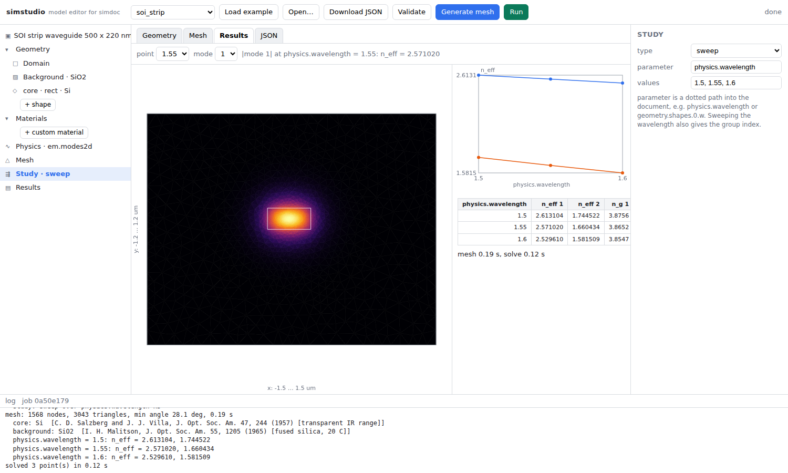

# simcase — the model document and its headless runner

A COMSOL-style program is, underneath, a file that describes the model and an
engine that runs the file. `simcase` implements that file format and engine for the
FieldAlgo stack: a JSON document holds geometry, materials, physics, mesh
settings and the study; one command runs it through meshine (mesh), physmat
(materials) and galerkin (FEM) and writes results. The browser UI that edits
the document is [an optional subpackage](#the-browser-ui) of the same install;
the engine never depends on it.

```bash
# From the repository root; installs the local runtime packages together.
python -m pip install -e packages/meshine -e packages/physmat -e packages/galerkin -e packages/simcase
python -m simcase example soi_strip > model.json
python -m simcase validate model.json
python -m simcase run model.json                          # -> model_results/
```

The package and CLI are named `simcase`. The JSON version field remains
`"openphysics": "0.2"`; it is not an import or distribution name. The separate
`openphysics` distribution is only a name reservation. See the
[repository setup](../../README.md) for the full development install.

`model_results/` contains `summary.json` (n_eff per study point, group index,
mesh statistics, timings), `fields.npz` (mesh and mode fields), `results.png`
(mesh, mode, sweep), `log.txt`, and a copy of the document.

Summaries, plot axes and Studio labels use the document's declared length unit,
including numeric custom units. `summary.json` also carries the `units` declaration;
coordinates and study values keep their document-unit numbers. Material database
validity ranges remain in micrometres, the database's native unit.

## The document

```json
{
  "openphysics": "0.2",
  "name": "SOI strip waveguide 500 x 220 nm",
  "units": {"length": "um"},
  "geometry": {
    "domain": {"xmin": -1.5, "xmax": 1.5, "ymin": -1.2, "ymax": 1.2},
    "background": {"material": "SiO2"},
    "shapes": [
      {"name": "core", "type": "rect", "x": -0.25, "y": 0.0, "w": 0.5, "h": 0.22, "material": "Si", "mesh_size": 0.02}
    ]
  },
  "materials": {"myglass": {"n": 1.5}},
  "physics": {
    "em1": {"type": "em.modes2d", "formulation": "scalar", "wavelength": 1.55, "num_modes": 2,
            "boundary": {"left": "pec", "right": "pec", "top": "pec", "bottom": "pec"}}
  },
  "mesh": {"size": 0.25, "grading": {"center": [0.0, 0.11], "near": 0.02, "far": 0.16, "distance": 1.0}},
  "study": {"type": "sweep", "parameter": "physics.em1.wavelength", "values": [1.4, 1.45, 1.5, 1.55, 1.6, 1.65, 1.7]}
}
```

`units` declares one symbol per SI base dimension the physics needs; every
number in the document is then a bare number in that system, and a dimension
the physics requires but the document does not name is an error rather than a
silent metre. `physics` is a map of named physics, and a sweep parameter names
one of them.
The schema can represent multiple entries, but the current runner requires
exactly one and rejects coupled or multiple-physics runs.

Shapes are `rect`, `circle` or `polygon`; later
shapes cut earlier ones and the background fills what is left (the boolean
work is done with shapely). A circle that nothing overlaps is meshed as an
exact circle. Material names are looked up in `materials` first, then in
physmat's built-ins (`"Si"`, `"SiO2"`, `"Au"`, ...), so dispersion is applied
automatically at every wavelength of a sweep. `study.parameter` must be an
existing dotted path under `physics.`. Geometry, mesh and material sweeps are
rejected because the mesh is built once. Sweeping a wavelength also yields the
group index.

Physics today: `em.modes2d` with the `scalar` formulation (exact for TE slab
modes, an approximation for 2D high-contrast cores). The `vector` formulation
is accepted in a document but raises a clear error when run: galerkin already
has the M3a vector solver, and connecting it to this runner remains to be done.
Lossy materials are also rejected by the scalar path. Boundaries: `pec`
(field = 0) or `pmc` (natural).

## From Python

```python
from simcase import Document, run
doc = Document.load("model.json")
res = run(doc)
res.neff                 # (study points, modes)
res.group_index()        # when sweeping wavelength
res.save("out/")
```

`run` is a composition of stages that are public in their own right, so a front
end can mesh without solving and a caching layer can redo only what changed:

```python
from simcase import build_mesh, solve_point, study_points
model = build_mesh(doc)                  # geometry -> mesh -> materials
parameter, values = study_points(doc)
result = solve_point(model, doc.sole_physics()[1])
```

## The browser UI

`simcase.studio` is the program part of the stack, and it is optional: a model
tree on the left, geometry / mesh / results views in the middle, a properties
panel on the right, a log at the bottom. It edits the same document a script
edits and asks a local server to mesh and run it with the same engine.

```bash
python -m pip install -e "packages/simcase[studio]"  # from the repository root, after the runtime install
simcase-studio                # http://127.0.0.1:8765, opens the browser
python -m simcase.studio --port 9000 --no-browser
```

The base install stays headless — `fastapi` and `uvicorn` arrive only with the
`studio` extra, so a batch or an HPC user never pulls a web stack to run a
document.




- Load an example, open a `.json` from disk, download the edited document.
- Model tree: Units, Domain, Background, shapes (rect / circle / polygon, add,
  reorder, delete), custom materials, Physics, Mesh, Study, Results. Selecting a
  node shows an editable form; every edit updates the geometry view and the JSON
  tab immediately, and the validator's magnitude warnings show up next to it.
- Materials: physmat's built-ins with their source and validity range, plus
  document-level constant materials.
- Generate mesh: meshine through the server, drawn by region, with node and
  triangle counts, minimum angle and mean quality.
- Run: a background job whose log streams back, then the mode field (selectable
  study point and mode), an n_eff-vs-parameter chart and a table with the group
  index.
- JSON tab: edit the document by hand and apply.

The page is a single HTML file with no build step and no external libraries
(canvas drawing only); a framework can come in when the UI grows. Web rather
than desktop so that any front end shares one UI over the same document format,
runs the same on a laptop or a server, and can reach other services over HTTP.

Not yet: mouse sketching and boolean CAD, a 3D viewer, geometry sweeps that
regenerate the mesh, user accounts, projects saved on the server.

### The HTTP API

Used by the page, usable by anything else.

| method | path | purpose |
|---|---|---|
| GET | `/api/examples`, `/api/examples/{name}` | example documents |
| GET | `/api/units` | the declarable base dimensions and their unit symbols |
| GET | `/api/materials` | physmat built-ins: names, aliases, range, source |
| POST | `/api/materials/preview` | n, k of a material over a wavelength range |
| POST | `/api/validate` | `{doc}` -> `{ok, summary, doc, notes}` or `{ok: false, error}` |
| POST | `/api/mesh` | `{doc}` -> nodes, triangles, regions, boundary edges, stats |
| POST | `/api/run` | `{doc}` -> `{job}`; runs in a background thread |
| GET | `/api/jobs/{id}` | status and log lines |
| GET | `/api/jobs/{id}/result` | n_eff, group index, fields, mesh, timings |

`simcase.studio` may use only simcase's public API — the names in
`simcase.__all__`, never a module underneath it. A test enforces that. It keeps
the UI a consumer of the engine rather than a part of it, so it can be lifted
back out into its own distribution as a move rather than a rewrite; when the UI
needs something the engine does not export, the engine exports it on purpose.

## Self-checks

```bash
# From the repository root after the development install in ../../README.md
python -m pytest -q packages/simcase/tests
```

Studio canvas and DOM unit-label checks can also run with Node.js, without npm
dependencies (they exercise the page script, not browser layout):

```bash
node --test packages/simcase/tests/studio_units.cjs
```

Documents round-trip through JSON; malformed documents are rejected with
specific messages; boolean geometry tiles the domain exactly (areas checked);
untouched circles keep their nodes on the true circle; and three documents
run end to end against references: a 220 nm Si slab reproduces refsol's TE0
to 1.5e-3 (P1 discretisation), a step-index fiber reproduces the LP01/LP11
scalar modes to 2e-4, and the Hadley rib comes within 5e-4 of the published
quasi-TE value (the remaining gap is the scalar approximation). Sweeps give
falling n_eff and n_g > n_eff.

The studio's endpoints are tested with FastAPI's test client, including a full
run job whose n_eff matches the slab reference; those tests skip when the
`studio` extra is not installed. An earlier manual browser check covered
load -> edit -> mesh -> run -> results.
The automated tests cover the HTTP API and packaged HTML, not browser interaction;
that manual check is not repeated by running pytest.

## Where this sits

```
simcase.studio ->  edits the document     (optional simcase[studio] extra)
script / CLI  ->  runs the document      simcase.run
                     |-- meshine   geometry -> mesh
                     |-- physmat   material names -> eps(lambda)
                     |-- galerkin  assembly + eigenproblem
                     '-- refsol    references (tests)
```

## License

Apache License 2.0 - see [LICENSE](LICENSE) and [NOTICE](NOTICE).

Copyright 2026 Yongha Kim (FieldAlgo)
